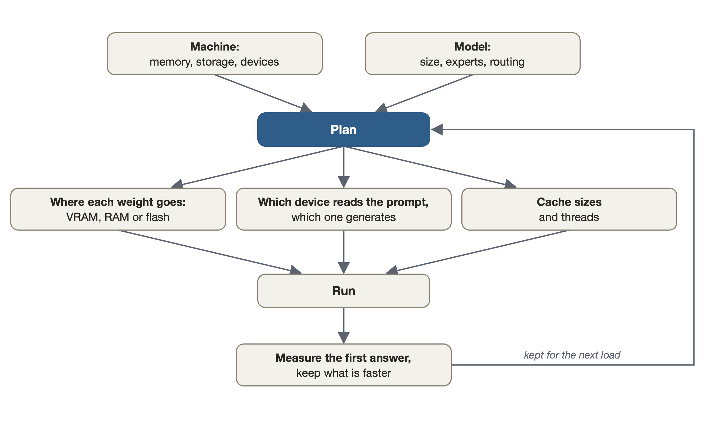

<p align="center">
  <picture>
    <source media="(prefers-color-scheme: dark)" srcset="docs/assets/logo/horizontal-ink.svg">
    
  </picture>
</p>

<p align="center">
  <a href="https://github.com/Helldez/BigMoeOnEdge/releases/latest"></a>
  <a href="https://github.com/Helldez/BigMoeOnEdge/actions/workflows/ci.yml"></a>
  <a href="LICENSE"></a>
</p>

<p align="center"><a href="README.md">English</a> · <a href="README_zh.md">中文</a> · <a href="README_ja.md">日本語</a> · <a href="README_es.md">Español</a> · <a href="README_fr.md">Français</a> · <a href="README_it.md">Italiano</a></p>

Run Mixture-of-Experts models larger than your device's memory. The experts are read from flash as
the model needs them. Android, iOS, macOS, Windows and Linux, built on llama.cpp.

<table align="center">
<tr>
<td align="center" width="50%"></td>
<td align="center" width="50%"></td>
</tr>
<tr>
<td align="center">12 GB Android phone</td>
<td align="center">12 GB iPhone</td>
</tr>
<tr>
<td align="center" colspan="2"></td>
</tr>
<tr>
<td align="center" colspan="2">16 GB Apple-silicon laptop</td>
</tr>
</table>

Qwen3.6-35B-A3B (21-22 GB) on each device, larger than each device's memory. On the Android phone and
the laptop it writes an answer in real time; on the iPhone, the app with the model loaded.

**The tour** (2:38): models, the planner, chat, the agent on a folder, tasks and connected apps on a 16 GB Mac.

https://github.com/user-attachments/assets/16371803-b96b-42a4-b147-cb1b7d515c73

**The agent on a 2021 laptop, no GPU** (1:33): the viral voxel-pagoda prompt to the built-in agent on a ThinkPad with 15 GB of RAM, CPU only, and Qwen3.6-35B-A3B Q4_K_M (20.8 GB). 988 lines at 2.3 tok/s, then the page in the app's preview; the speed-ups are marked on screen.

<p align="center"></p>

https://github.com/user-attachments/assets/a93fc61c-99ff-4ca6-894a-1c29cd27ef53

## What it does

- **Runs models that do not fit.** A MoE model uses a few experts per token. The engine keeps the
  weights every token needs and the experts used most in memory, and reads the rest from flash. The
  output is the same as with the whole model in memory; the tests check it.
- **Sets itself up.** `--auto` measures the machine and the model and picks the cache size, the
  threads and which device does what. The Plan screen shows each choice and why.
- **Any MoE GGUF.** Whatever llama.cpp loads, in any quantization. No per-model code.
- **Every backend.** CPU, Metal, CUDA, HIP, Vulkan, OpenCL and the Hexagon NPU. On a graphics card,
  the experts used most stay in its VRAM.
- **Apps and a server.** A desktop app, phone apps, and an OpenAI- and Anthropic-compatible server
  for coding agents.
- **Sees images.** Put a model's projector file (`mmproj`) beside it and the server reads images on
  every API; the CLI with `--mmproj` and `--image`. Any vision model llama.cpp's projector library
  knows, any quantization, every backend.

## Performance

| Hardware | Memory | Model | On disk | Experts from | Decode tok/s |
|---|---|---|---:|---|---:|
| **Android phone** | 12 GB | DeepSeek V4 Flash 284B | 91 GB | flash | 1 |
|  |  | Qwen3.8-Flash-Next 125B | 80 GB | flash | 2-4 |
|  |  | Qwen3.6-35B-A3B | 21 GB | flash | 5-6 |
| **iPhone** | 12 GB | Qwen3.6-35B-A3B | 21 GB | flash | 6 |
| **Apple-silicon laptop** | 16 GB | Qwen3.8-Flash-Next 125B | 76 GB | flash | 7-9 |
|  |  | Qwen3.6-35B-A3B | 21 GB | flash | 18-24 |
| **Windows laptop** | 16 GB | Qwen3.6-35B-A3B | 21 GB | flash | 5 |
| **Desktop GPU** (NVIDIA) | 12 GB + 128 GB RAM | Qwen3.8-Flash-Next 125B | 84 GB | RAM, GPU cache | 16-17 |
| **Desktop GPU** (NVIDIA) | 16 GB + 32 GB RAM | Qwen3.8-Flash-Next 125B | 66 GB | flash, GPU cache | 19-21 |
| **Desktop GPU** (NVIDIA) | 24 GB + 96 GB RAM | Qwen3.8-Flash-Next 125B | 66 GB | RAM, GPU cache | 70 |
|  |  | Qwen3.6-35B-A3B | 21 GB | GPU | 217 |
| **Desktop GPU** (NVIDIA) | 24 GB + 62 GB RAM | Qwen3.6-35B-A3B | 21 GB | GPU | 154 |
|  | 12 GB of it free | Qwen3.6-35B-A3B | 21 GB | RAM, GPU cache | 59-67 |
|  |  | Gemma 4 26B-A4B | 17 GB | GPU | 114 |
|  |  | Laguna XS 2.1 33B | 20 GB | GPU | 93-94 |
| **Desktop GPU** (NVIDIA) | 8 GB + 125 GB RAM | Qwen3.6-35B-A3B | 21 GB | RAM, GPU | 32-33 |
| **Datacenter GPU** (AMD, ROCm) | 192 GB | Qwen3.8-Flash-Next 125B | 66 GB | GPU | 53 |

A range is the spread across runs. Method and every run:
[docs/benchmarks.md](docs/benchmarks.md). To add your machine, run
`scripts/bench-report.sh model.gguf` and open a
[benchmark report](https://github.com/Helldez/BigMoeOnEdge/issues/new?template=benchmark-report.yml).

## Install

From the [latest release](https://github.com/Helldez/BigMoeOnEdge/releases/latest):

- **macOS** (Apple silicon): open the `.dmg` and drag the app to Applications. It is not notarised
  yet; the dmg's README.txt has the one step for the first start.
- **Windows**: run the `-setup.exe`. No administrator rights.
- **Linux**: make the `.AppImage` executable and run it. The window needs WebKitGTK 4.1;
  `--server` runs the server alone.
- **Android**: install `app-dev-release.apk`. Each release installs over the previous one.
- **iOS**: build it with Xcode from [examples/ios](examples/ios/README.md). Experimental.

Open the app and pick a model under **Models**. An NVIDIA or AMD card gets its backend from
**Settings** ([docs/desktop-app.md](docs/desktop-app.md)).

Command-line tools only (`bmoe-cli`, `bmoe-server`):

```bash
curl -fsSL https://github.com/Helldez/BigMoeOnEdge/releases/latest/download/install.sh | sh
```

```powershell
irm https://github.com/Helldez/BigMoeOnEdge/releases/latest/download/install.ps1 | iex
```

## Use

```bash
bmoe-cli -m model.gguf --auto -p "Explain MoE routing."   # plan and run
bmoe-cli -m model.gguf --plan                              # print the plan
bmoe-server -m model.gguf -c 32768                         # the server and its web UI, port 8765
```

The server speaks the OpenAI API (`/v1/chat/completions`, `/v1/responses`) and the Anthropic one
(`/v1/messages`), with streaming, tool calls and reasoning. Add `--host 0.0.0.0 --api-key KEY` to
serve other machines. Reference: [docs/server-api.md](docs/server-api.md).

On a machine that stays on, register it as a service of your login instead: it starts with the
machine, comes back with its model, and reloads it when a request finds none loaded
([running as a service](docs/server-api.md#running-as-a-service)).

```bash
bmoe-server service install --host 0.0.0.0 -m model.gguf -c 65536   # systemd, launchd or Task Scheduler
bmoe-server service status
```

```python
from openai import OpenAI

client = OpenAI(base_url="http://127.0.0.1:8765/v1", api_key="local")
reply = client.chat.completions.create(model="local", messages=[{"role": "user", "content": "Hello"}])
print(reply.choices[0].message.content)
```

**Coding agents** need a large context: a few times their first request. 32768 is enough for
opencode, 65536 for Claude Code
([sizing the context](docs/server-api.md#sizing-the-context-for-a-client)).

```jsonc
// opencode, ~/.config/opencode/opencode.json
{
  "$schema": "https://opencode.ai/config.json",
  "provider": {
    "bmoe": {
      "npm": "@ai-sdk/openai-compatible",
      "options": { "baseURL": "http://127.0.0.1:8765/v1", "apiKey": "local" },
      "models": { "<model id from /v1/models>": { "limit": { "context": 32768, "output": 8192 } } }
    }
  },
  "model": "bmoe/<model id from /v1/models>"
}
```

```bash
# Claude Code
export ANTHROPIC_BASE_URL=http://127.0.0.1:8765
export ANTHROPIC_API_KEY=local
export ANTHROPIC_MODEL=<model id from /v1/models>
export ANTHROPIC_DEFAULT_HAIKU_MODEL=$ANTHROPIC_MODEL
export CLAUDE_CODE_MAX_CONTEXT_TOKENS=65536
claude
```

```toml
# Codex CLI, ~/.codex/config.toml
model = "<model id from /v1/models>"
model_provider = "bmoe"

[model_providers.bmoe]
name = "bmoe"
base_url = "http://127.0.0.1:8765/v1"
wire_api = "responses"
env_key = "BMOE_API_KEY"   # export BMOE_API_KEY=local
```

Under **Connect apps**, the app writes the settings for opencode and Codex CLI and shows the ones for
Claude Code.

**The agent.** The desktop app has its own agent: it works in a folder you choose, reads and edits
files and runs commands, and asks before it changes anything unless you allow it. A conversation can
also be run by OpenCode, Claude Code, Codex or Pi. See [docs/agent.md](docs/agent.md).

## How it works

For each token, the router of each layer picks a few experts. The engine looks for them in up to
three tiers, each a cache for the one below:

- **VRAM**, on a graphics card: the weights every token reads, and the experts used most.
- **RAM**: a cache of experts. Without a graphics card, also the weights every token reads.
- **Flash** (the drive): the whole model.

An expert missing from VRAM is copied from RAM; one missing from RAM is read from flash. On a phone or
an Apple-silicon Mac the GPU uses the same RAM as the CPU, so there are two tiers. A model that fits
the card runs on it whole. Streaming only reads, so it does not wear the drive.

The engine uses llama.cpp's public API, so its quantizations, tokenizers and chat templates work
unchanged, and an upgrade is a submodule bump. Which tensors are experts is read from the file
([docs/which-models-stream.md](docs/which-models-stream.md)). Design:
[docs/architecture.md](docs/architecture.md).

## The planner

<p align="center">
  
</p>

The planner reads the model's header and measures the machine: memory, storage speed, each CPU, GPU
and NPU. Its rules name no device or platform, so a phone and a desktop get different plans from the
same code. Values you set yourself are kept. See [docs/hardware-planning.md](docs/hardware-planning.md).

<p align="center">
  
</p>

## Platforms

| | Android | macOS | Windows | Linux | iOS |
|---|---|---|---|---|---|
| Engine and CLI | arm64 | Apple silicon | x86_64, arm64 | x86_64, aarch64 | arm64 (in the app) |
| App | native app | desktop app | desktop app | desktop app | native app, built from source |
| Accelerators | Hexagon NPU, Vulkan, OpenCL | Metal | Vulkan, CUDA, OpenCL (arm64), Hexagon NPU (arm64) | Vulkan, CUDA, HIP | Metal |
| Tested on | 12 GB phone | 16 GB laptop | 16 GB laptop | rented 12-24 GB NVIDIA and 192 GB AMD cards | 12 GB iPhone |

Details: [docs/platforms.md](docs/platforms.md).

## How it compares

| | **BigMoeOnEdge** | Strata | ds4 | colibri | KTransformers |
|---|:---:|:---:|:---:|:---:|:---:|
| Android phone (NPU too) | ✅ | ❌ | ❌ | ❌ | ❌ |
| iPhone | ✅ | ❌ | ❌ | ❌ | ❌ |
| Mac | ✅ | ✅ | ✅ | ✅ | ❌ |
| Windows / Linux, CPU only | ✅ | ❌ | Linux, for debugging | ✅ | ❌ |
| NVIDIA | ✅ | ✅ | ✅ | ✅ | ✅ |
| AMD (ROCm) | ✅ (MI300X too) | Radeon RX and Strix Halo | Strix Halo and RDNA | Vulkan | ✅ |
| Any MoE model in GGUF | ✅ | few models | few models | its own format | few models |
| Configures itself | ✅ `--auto` | picks the model by memory | expert-cache budget | `coli tune` | ❌ |

Where a model fits in a gaming GPU plus RAM, Strata is two to four times faster. Where it streams from
flash, every engine is in single digits and the drive sets the pace. On one 24 GB card against
Lucebox, with the same file and prompts, this engine decoded Qwen3.6-35B-A3B faster (154 against 123
tok/s) and reached a 28k-token prompt's first token in 5 s against 37; Lucebox's per-model drafter
decoded Gemma 4's code more than twice as fast. Speeds and sources:
[docs/comparison.md](docs/comparison.md).

## Build from source

```bash
git clone --recursive https://github.com/Helldez/BigMoeOnEdge.git
cd BigMoeOnEdge
cd ui && npm ci && npm run build && cd ..
scripts/build-host.sh
build/bin/bmoe-server --open
```

A llama.cpp backend is a CMake flag passed through: `scripts/build-host.sh -DGGML_VULKAN=ON` (or
`-DGGML_CUDA=ON`). Tests: `cd build && ctest --output-on-failure` (needs `python3` with `gguf`). Android:
`scripts/build-android.ps1`, then the APK in [examples/android](examples/android). More:
[CONTRIBUTING.md](CONTRIBUTING.md).

## Documentation

[docs/](docs/README.md). Start with [hardware-planning.md](docs/hardware-planning.md),
[settings.md](docs/settings.md), [server-api.md](docs/server-api.md) and
[limitations.md](docs/limitations.md).

## Prior art

AirLLM, Apple's *LLM in a flash*, FlexGen, PowerInfer, EdgeMoE and
[flash-moe](https://github.com/danveloper/flash-moe), a Metal engine that streams a 397B MoE from SSD
on Apple silicon.

## License

Apache-2.0 ([LICENSE](LICENSE)). The binaries and apps also carry llama.cpp, ggml and other libraries
under MIT, BSD, Apache-2.0 and SIL OFL 1.1: [THIRD_PARTY_LICENSES](THIRD_PARTY_LICENSES).
