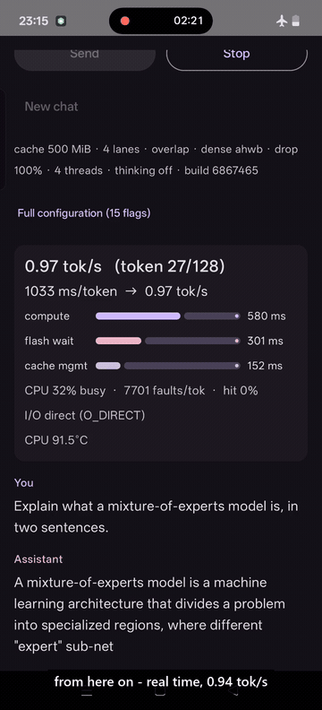
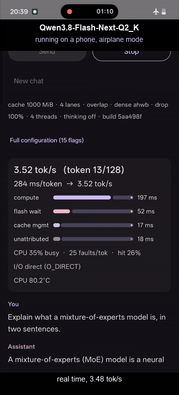

<p align="center">
  <picture>
    <source media="(prefers-color-scheme: dark)" srcset="docs/assets/logo/horizontal-ink.svg">
    
  </picture>
</p>

<p align="center">
  <a href="https://trendshift.io/repositories/85652?utm_source=trendshift-badge&amp;utm_medium=badge&amp;utm_campaign=badge-trendshift-85652" target="_blank" rel="noopener noreferrer"></a>
</p>

<p align="center"><b>Run Mixture-of-Experts models bigger than your device's RAM.</b></p>

<p align="center">
  <a href="https://github.com/Helldez/BigMoeOnEdge/releases/latest"></a>
  <a href="https://github.com/Helldez/BigMoeOnEdge/actions/workflows/ci.yml"></a>
  <a href="LICENSE"></a>
</p>

---

A Mixture-of-Experts model uses only a few of its experts for each token. BigMoeOnEdge keeps the
always-needed part of the model in RAM and reads the experts a token asks for from storage, when it
asks. The rest stays on disk, so a model several times larger than RAM runs, and the output is
byte-identical to running it fully resident.

- **On llama.cpp's public API.** Every quantization, tokenizer and chat template llama.cpp
  supports works unchanged. A new MoE architecture is one registry row; a new llama.cpp release is
  a submodule bump.
- **It configures itself.** `--auto` measures the machine (memory, storage, cores, accelerators),
  reads the model's shape and derives the streaming settings, with the fact behind each one. The
  goal is the best streaming for any MoE model on any hardware: a phone with an NPU and an
  Apple-silicon laptop, for example, each get a different plan from the same rules.
- **One engine, one application layer.** `bmoe-server` is what every UI talks to: the Android app
  runs it as a process of its own, the desktop serves a web UI from it, and both offer an
  OpenAI-compatible API that, with a key, serves other machines too. What runs on each platform:
  [docs/platforms.md](docs/platforms.md).

<p align="center"></p>
<p align="center"><em>DeepSeek V4 Flash 0731: 284B parameters, ~91 GB on disk, on a 12 GB phone.
0.94 tok/s in the demo app, real time.</em></p>

<p align="center"></p>
<p align="center"><em>Qwen3.8-Flash-Next: 125B parameters, ~80 GB on disk (Q2_K), on a 12 GB phone.
3.48 tok/s in the demo app, real time.</em></p>

Qwen3.8-Flash-Next ran on that phone the day its weights appeared, before upstream supported it.
Three more, one after another on the same phone:

https://github.com/user-attachments/assets/f899b93f-c7c4-4ce9-9fb0-5ed1bae13761

<p align="center"><em>Left to right: gpt-oss-120b (~60 GB), Qwen3-30B-A3B (18.5 GB), Gemma-4-26B-A4B (17 GB),
recorded in the demo app on a 12 GB phone, real time, not sped up.</em></p>

## Table of contents

- [Why](#why)
- [Try it](#try-it)
- [Automatic configuration (`--auto`)](#automatic-configuration---auto)
- [Settings](#settings)
- [Supported models](#supported-models)
- [Benchmarks](#benchmarks)
- [Build from source](#build-from-source)
- [How it works](#how-it-works)
- [Documentation](#documentation)
- [Prior art](#prior-art)
- [License](#license)

## Why

Mainstream runtimes hold or page the whole model file. Past RAM that means refusing to load, or
thrashing. Streaming changes three cases:

- **Far past RAM.** A ~60 GB model on a 12 GB phone cannot be resident. Streamed, it runs.
- **Just past RAM.** An 18 to 22 GB model on a 12 GB phone turns ordinary loading into a fault
  storm. Streamed, it runs stably at up to 5 tok/s with byte-identical output.
- **Barely fits.** The model runs inside a memory budget you choose and leaves the rest of the
  system alone.

Decode runs on the CPU. Prefill can run on a Snapdragon's Hexagon NPU or an Apple GPU.

## Try it

**Phone.** Install the APK from the
[latest release](https://github.com/Helldez/BigMoeOnEdge/releases/latest). On the Models screen,
pick a model from the catalog or paste any direct gguf URL under **Get a model**. Models split into
shards download and load as they are, with no merge step. The planner configures every load and
the Plan screen shows why. **Serve on the network**, in Settings, lets any OpenAI-compatible client
on your network use the phone, with a generated key.

**Desktop.** Download the `bmoe-desktop` archive from the same release and start `bmoe-server`. The
UI opens at `http://127.0.0.1:8765/` (this machine only; `--port` changes it): pick a model, let
the planner configure it, chat. Any OpenAI client can use the same address, and `--host` with
`--api-key` serves it to other machines ([docs/server-api.md](docs/server-api.md)).

Both show the same five screens: chat, models, plan, settings and metrics
([docs/screens.md](docs/screens.md)).

**Command line.** See [Build from source](#build-from-source).

## Automatic configuration (`--auto`)

```bash
bmoe-cli -m model.gguf --auto -p "Explain MoE routing."   # measure, plan, run
bmoe-cli -m model.gguf --plan                              # print the plan and exit
```

```
 model.gguf metadata --+
                       +--> regime: fits | experts-stream | dense-oversized
 machine, measured ----+
   -> memory ledger: buffers, prefill device, dense set, expert cache
   -> I/O and compute: read lanes, threads, graph width, prefill device
   -> plan: each setting, the fact behind it, the flags that reproduce it
```

A setting passed by hand is never overruled. The rules name no platform or device; each machine
answers the same questions through its own probes. Rules, and what each was measured on:
[docs/hardware-planning.md](docs/hardware-planning.md).

## Settings

The ones that matter most when setting things by hand:

| Setting | Flag | What it does |
|---|---|---|
| Expert cache | `--cache-mb N\|auto` | Keeps the most-used experts in RAM. The main lossless lever. |
| Dense weights | `--dense-weights mmap\|warm\|anon\|ahwb` | How the always-needed weights are held. Decisive far past RAM. |
| Read lanes | `--io-threads N` | Parallel expert reads. |
| Overlap I/O | `--overlap` | Issues the next reads while the current layer computes. Byte-identical. |
| Prefill device | `--prefill-device D` | Runs wide prompt graphs on an NPU or GPU; decode stays on the CPU. |

Those change how weights are fetched, never the result. These trade quality for fewer reads, for a
model so far past memory that the alternative is no answer:

| Setting | Flag | What it gives up |
|---|---|---|
| Active experts | `--n-expert-used N` | Consults fewer experts per token than the model asks for. Same prompt, same answer. |
| Drop cold experts | `--drop-cold-experts F` | Skips an expert only when it is a cache miss and the router barely wanted it. The answer depends on what the cache held. |
| Expert substitution | `--expert-substitute F` | Nudges the routing toward experts already in RAM. Cache-dependent. Experimental. |
| Route ahead | `--route-ahead N` | Commits a layer's routing early so its reads start early. Experimental. |

`--mtp` and `--ngram` draft several tokens and verify them in one decode, with no loss. `--decide`
answers a multiple-choice prompt from one prefill, with no decode ([docs/decide.md](docs/decide.md)).
Every setting, with its values and measurements: [docs/settings.md](docs/settings.md).

## Supported models

| Architecture | Reference models | Notes |
|---|---|---|
| `qwen3moe` | Qwen3-30B-A3B and siblings | Shipped default, validated below |
| `qwen35moe` | Qwen3.6-35B-A3B and siblings, Ornith-1.5-35B-A3B | Hybrid attention/SSM stack; routed experts stream unchanged |
| `qwen2moe` | Qwen2 MoE family | Same layout as qwen3moe |
| `gemma4` | Gemma 4 MoE (e.g. 26B-A4B) | Fused expert layout, handled by its registry row |
| `gpt-oss` | OpenAI gpt-oss-20b / 120b | Purely routed; MXFP4 weights stream unchanged |
| `nemotron_h_moe` | NVIDIA Nemotron 3 / 3.5 MoE (e.g. Nemotron-3.5-Lightning-30B-A3B) | Gate-less experts (up/down only); hybrid Mamba2/attention stack, optional latent projections and a shared expert stay resident |
| `lfm2moe` | Liquid AI LFM2 / LFM2.5 MoE (e.g. 8B-A1B) | Hybrid conv/attention stack with leading dense blocks; those stay resident |
| `deepseek4` | DeepSeek V4 Flash (284B-A13B), validated on the 0731 release | V3.2-style routing (256 experts + shared); compressed attention is dense-side; ships multi-shard |
| `bailingmoe3` | Ling 3.0 (e.g. Ling-3.0-flash, 127B-A5B) | 512 routed experts + shared, biased top-k; hybrid KDA/MLA attention is dense-side |
| `qwen4exp` | Qwen3.8-Flash-Next (125B-A6B), the Qwen4 architecture preview | 512 routed experts + shared; a 51B n-gram embedding table stays mmap'd (see limitations). Runs on the 12 GB test phone with pinned dense weights: ~2 tok/s at UD-IQ3_XXS, 3.5 tok/s at the Q2_K build; upstream support merged in `b10666` |


Expert counts and layouts are read from the model file at runtime.
`bmoe-cli --list-archs` prints the compiled-in set; adding one:
[docs/adding-a-model.md](docs/adding-a-model.md).

## Benchmarks

Measured, tok/s, on a 12 GB phone with UFS 4.x storage. All models Q4_K_M.

| Model | Size | Ordinary load (mmap) | Streamed, lossless | Streamed, fewer experts |
|---|---:|---:|---:|---:|
| gpt-oss-120b | ~60 GB | 0.09 | 1.3 | 2.2 (2 of 4) |
| Qwen3.6-35B-A3B | 22.3 GB | 0.1, unstable | 5.0 | 5.8 (6 of 8) |
| Qwen3-30B-A3B | 18.5 GB | 2.0, unstable | 5.2 | 5.0 (6 of 8) |
| Gemma-4-26B-A4B | 17.0 GB | 0.4 | 4.1 | 5.0 (6 of 8) |

Best observed per configuration, 256-token greedy decode (Qwen3.6: a single 96-token run);
gpt-oss with reasoning off. Phone throughput moves with heat and free memory. Every row, the
configurations behind it and the method: [docs/benchmarks.md](docs/benchmarks.md),
[docs/benchmark-method.md](docs/benchmark-method.md).

**Prefill on the NPU** (same phone, Hexagon v81; decode stays on the CPU):

| Model | Prompt | CPU | NPU | Speedup |
|---|---|---|---|---|
| Qwen3.6-35B-A3B Q4_0 | 1418 tokens | 63.8 s | 8.2 s | 7.8x |
| Qwen3.6-35B-A3B Q4_0 | 1921 tokens | 106.5 s | 11.2 s | 9.5x |
| Qwen3.6-35B-A3B Q4_K_M | 1418 tokens | 80.6 s | 10.2 s | 7.9x |
| Gemma 4 26B-A4B | 238 tokens | 16.2 s | 5.85 s | 2.8x |


Off by default; the NPU computes in fp16, so its output is not identical to the CPU's.
[docs/npu-prefill.md](docs/npu-prefill.md).

**Desktop.** Windows x86 laptop, 16 GB, Qwen3.6-35B-A3B set by hand: 4.8 tok/s lossless, 7.3 with
cold experts dropped. Apple-silicon laptop, 16 GB, same model with `--auto` alone: 22.4 tok/s, and
a 10850-token prompt prefilled in 31.8 s. One machine each.

The rows above come from one phone and two laptops. To add your machine, one command runs the fixed
protocol and prints a table to paste into a
[benchmark report](https://github.com/Helldez/BigMoeOnEdge/issues/new?template=benchmark-report.yml):

```bash
scripts/bench-report.sh /path/to/any-moe-model.gguf
```

## Build from source

```bash
git clone --recursive https://github.com/Helldez/BigMoeOnEdge.git
cd BigMoeOnEdge
scripts/build-host.sh
build/bin/bmoe-cli -m Qwen3-30B-A3B-Q4_K_M.gguf --auto --chatml -p "Explain MoE routing."
```

The same run with the settings given by hand:

```bash
build/bin/bmoe-cli -m Qwen3-30B-A3B-Q4_K_M.gguf --moe-stream \
  --cache-mb auto --cache-ceil-mb 4000 --io-threads 4 -t 4 -n 48 \
  --chatml -p "Explain MoE routing."
```

Desktop app, from source (the UI is built first so the CMake build can place it beside the server):

```bash
cd ui && npm ci && npm run build && cd ..
scripts/build-host.sh
build/bin/bmoe-server --open
```

Android: `scripts/build-android.ps1` builds the engine and the server for arm64, then the APK in
[`examples/android`](examples/android). A model pushed by hand for the CLI over `adb` must sit on a
real filesystem (`/data/local/tmp/...`, not `/sdcard`).
Tests: `cd build && ctest --output-on-failure` (needs `python3` with the `gguf` package).

Android, macOS, Linux and Windows have release builds; iOS builds as a measuring harness
([`examples/ios`](examples/ios)). On Windows, build with CMake: the script is bash. What each
platform runs, what CI checks on it and what was measured there:
[docs/platforms.md](docs/platforms.md).

## How it works

The model loads file-backed and the engine hooks llama.cpp's public evaluation callback:

```
 layer L picks its top-k experts            (llama.cpp, public callback)
   -> in the cache: use it  |  not in the cache: read its slices from flash
   -> point the layer's expert tensors at those bytes
   -> llama.cpp runs the matmul as if they had been resident
```

The dense weights are read on every token and stay in RAM; only the experts, most of the file,
are streamed. No llama.cpp source is modified, with one exception: `--overlap` needs a wait point
no public API exposes, carried as a single ~25-line hook on a fork branch and dropped when upstream
ships an equivalent. [docs/architecture.md](docs/architecture.md), [docs/seam.md](docs/seam.md).

Correctness is a gate, not a benchmark: `ctest` asserts that streaming only the routed experts
gives output identical to running with every expert resident, across the cache, evictions,
overlap, prefetch, sessions and split models.

Every run accounts for its own time: `--progress` splits each token into flash I/O, cache
management and compute, and `--csv` adds the memory picture. The apps show the same feed live.
[docs/telemetry.md](docs/telemetry.md).

## Documentation

[docs/](docs/README.md) is indexed by what you are trying to do. Entry points:

- [architecture.md](docs/architecture.md): the layer map and the llama.cpp relationship.
- [hardware-planning.md](docs/hardware-planning.md): `--auto` and the rules behind each choice.
- [settings.md](docs/settings.md): every setting.
- [platforms.md](docs/platforms.md): what runs on each operating system and backend.
- [application-framework.md](docs/application-framework.md) and
  [server-api.md](docs/server-api.md): the server every UI talks to, and its HTTP API.
- [screens.md](docs/screens.md): the five screens every UI shows, specified once.
- [design.md](docs/design.md): the visual language, pixel, from the logo: palette, type, geometry.
- [adding-a-model.md](docs/adding-a-model.md): supporting a new MoE architecture.
- [benchmarks.md](docs/benchmarks.md) and [benchmark-method.md](docs/benchmark-method.md):
  results and how they were produced.
- [community-benchmarks.md](docs/community-benchmarks.md): results on hardware we do not own.
- [limitations.md](docs/limitations.md): what this does not do.
- [roadmap.md](docs/roadmap.md): where the project is going, and what was measured and refuted.

## Prior art

An engineering package of ideas from AirLLM, Apple's *LLM in a flash*, FlexGen, PowerInfer and
EdgeMoE, not a novel technique. The closest recent work is
[flash-moe](https://github.com/danveloper/flash-moe), a purpose-built Metal engine that streams a
397B MoE from SSD on Apple Silicon. BigMoeOnEdge takes the other side: llama.cpp's public API,
across architectures and platforms. The cache-aware routing behind `--expert-substitute` is the
rerouting of Skliar et al. ([arXiv:2412.00099](https://arxiv.org/abs/2412.00099)), applied to a
RAM cache in front of flash.

## License

Apache-2.0. See [LICENSE](LICENSE).
