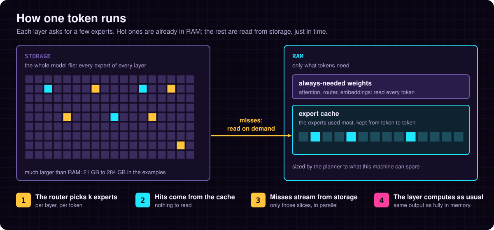
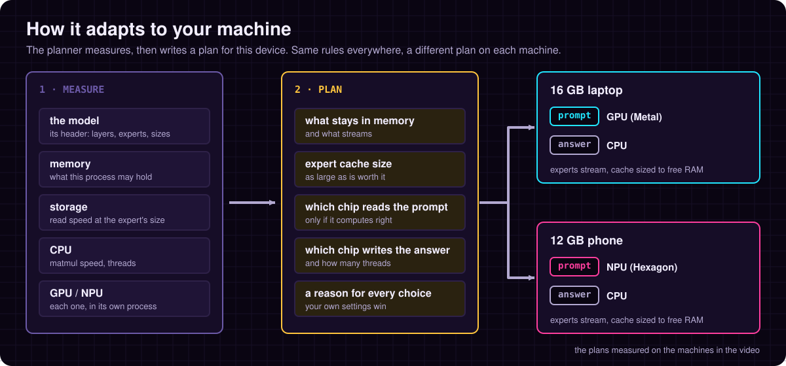
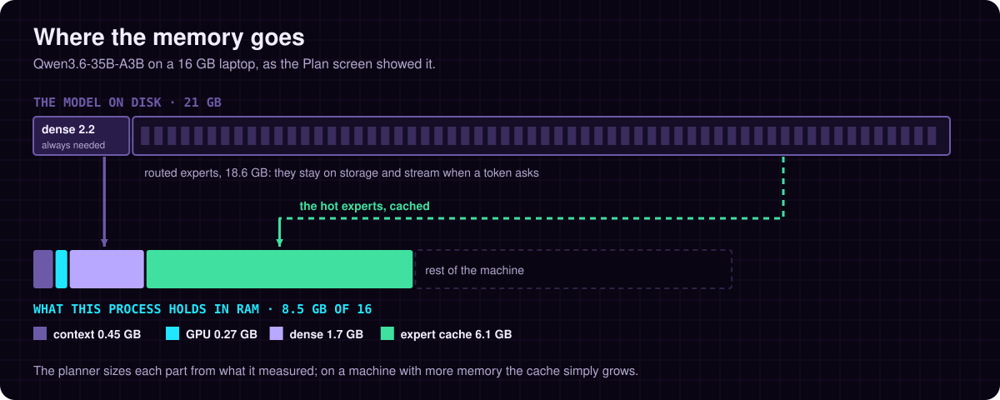

<p align="center">
  <picture>
    <source media="(prefers-color-scheme: dark)" srcset="docs/assets/logo/horizontal-ink.svg">
    
  </picture>
</p>

<p align="center"><b>Big local AI agents, on every edge device.</b></p>

<p align="center">
  An adaptive streaming optimizer for Mixture-of-Experts models.<br>
  Any hardware, any OS, any model, any quantization, behind a local OpenAI-compatible server.
</p>

<p align="center">
  <a href="https://github.com/Helldez/BigMoeOnEdge/releases/latest"></a>
  <a href="https://github.com/Helldez/BigMoeOnEdge/actions/workflows/ci.yml"></a>
  <a href="LICENSE"></a>
</p>

https://github.com/user-attachments/assets/PROMO-VIDEO-ID

<p align="center"><em>Real recordings on a 16 GB laptop and a 12 GB Android phone. Sped-up parts are marked in the video.</em></p>

---

## What it does

A Mixture-of-Experts model uses only a few of its experts for each token. BigMoeOnEdge keeps in
memory what every token needs and streams the rest from storage, exactly when it is needed. A model
several times larger than RAM runs, and its output is identical to running it fully in memory.

- **Adaptive streaming optimizer.** The planner measures the machine (memory, storage speed, every
  CPU, GPU and NPU) and builds the plan for that exact device: what stays in memory, what streams,
  which chip reads the prompt and which writes the answer. It shows the reason behind every choice.
  No flags, no tuning.
- **Any hardware, any OS.** Android, macOS, Windows and Linux ship today, with iOS on the way. CPU,
  GPU and NPU backends load as modules, and the planner uses whichever the machine has.
- **Any model, any quantization.** Any MoE gguf that llama.cpp loads. Search Hugging Face from the
  app, and the engine reads the model's header before the download and tells you how it will run.
- **A local OpenAI-compatible server.** Every device serves the models it runs, so chat clients and
  coding agents such as opencode work fully local. A phone can serve a laptop over Wi-Fi.

## Examples

Real runs, measured live. They are examples, not limits: the engine fits itself to whatever it runs
on, and stronger hardware runs faster.

| Model | On disk | Device | × its RAM | Decode |
|---|---:|---|---:|---:|
| DeepSeek V4 Flash 284B | 91 GB | 12 GB Android phone | 7.6× | 0.94 tok/s |
| Qwen3.8-Flash-Next 125B | 80 GB | 12 GB Android phone | 6.7× | 2.2-3.5 tok/s |
| gpt-oss-120b | 60 GB | 12 GB Android phone | 5× | 1.3 tok/s |
| Qwen3.6-35B-A3B | 21 GB | 12 GB Android phone | 1.9× | 4.8-5.0 tok/s |
| Qwen3-30B-A3B | 18.5 GB | 12 GB Android phone | 1.5× | 5.2 tok/s |
| Gemma-4-26B-A4B | 17 GB | 12 GB Android phone | 1.4× | 4.1 tok/s |
| Qwen3.8-Flash-Next 125B | 76 GB | 16 GB Apple-silicon laptop | 4.8× | 6.5-9 tok/s |
| Qwen3.6-35B-A3B | 21 GB | 16 GB Apple-silicon laptop | 1.3× | 18-22 tok/s |
| Qwen3-Coder-30B-A3B | 18.6 GB | 16 GB Apple-silicon laptop | 1.2× | 23 tok/s; 7-9 inside opencode |
| Qwen3.6-35B-A3B | 21 GB | 16 GB Windows laptop | 1.3× | 4.8 tok/s |

Every figure, the configuration behind it and the method: [docs/benchmarks.md](docs/benchmarks.md).
Got a machine that is not here? Run `scripts/bench-report.sh /path/to/model.gguf` and paste the
table into a [benchmark report](https://github.com/Helldez/BigMoeOnEdge/issues/new?template=benchmark-report.yml).

## Get started

**Phone (Android).** Install the APK from the
[latest release](https://github.com/Helldez/BigMoeOnEdge/releases/latest), pick a model under
**Models**, and chat. **Settings → Serve on the network** shares it with other devices, with a key.

**Desktop (macOS, Windows, Linux).** Download the `bmoe-desktop` archive from the same release and
run `bmoe-server --open`. The app opens at `http://127.0.0.1:8765/`.

**Command line.**

```bash
bmoe-cli -m model.gguf --auto -p "Explain MoE routing."   # measure, plan, run
bmoe-cli -m model.gguf --plan                              # show the plan and exit
```

The phone and the desktop show the same five screens: Chat, Models, Plan, Settings and Metrics.

## Use it from your tools

Any OpenAI client works with the local address:

```python
from openai import OpenAI

client = OpenAI(base_url="http://127.0.0.1:8765/v1", api_key="local")
reply = client.chat.completions.create(
    model="local",
    messages=[{"role": "user", "content": "Write a haiku about experts on flash."}],
)
print(reply.choices[0].message.content)
```

Streaming, tool calls and reasoning are supported. For opencode, add the server as an
OpenAI-compatible provider with `baseURL` set to `http://127.0.0.1:8765/v1`. To serve other machines,
start the server with `--host` and `--api-key`. The full API: [docs/server-api.md](docs/server-api.md).

## How it works

<p align="center"></p>

The engine is built on llama.cpp's public API, so every quantization, tokenizer and chat template
llama.cpp supports works unchanged, and a new llama.cpp release is a submodule bump. Which tensors
are the routed experts is read from the file itself, so new MoE architectures need no code here
([docs/which-models-stream.md](docs/which-models-stream.md)).

Correctness is a test, not a promise: `ctest` checks that streaming gives output identical to
running with every expert in memory, across the cache, evictions, overlap, sessions and split
models. [docs/architecture.md](docs/architecture.md).

## How it adapts

<p align="center"></p>

The planner reads the model's shape from its header and measures the machine it runs on. Its rules
name no platform and no device, so a phone and a laptop get different plans from the same rules. A
setting you pass by hand is never overruled. The Plan screen shows the result: a one-line summary,
where the memory goes, what each device does, and every decision with its reason.
[docs/hardware-planning.md](docs/hardware-planning.md).

<p align="center"></p>

## Platforms

| | Android | macOS | Windows | Linux | iOS |
|---|---|---|---|---|---|
| Engine and CLI | ✓ arm64 | ✓ Apple silicon | ✓ x86_64 | ✓ x86_64, aarch64 | ✓ builds; runs in the simulator |
| App and OpenAI server | ✓ native app | ✓ web app | ✓ web app | ✓ web app | app wanted ([#235](https://github.com/Helldez/BigMoeOnEdge/issues/235)) |
| Accelerators | NPU (Hexagon), Vulkan, OpenCL | Metal | Vulkan | Vulkan | Metal, built in; not yet run on a device |

Backends load as modules beside the engine, so a CUDA, HIP or SYCL module built with its own
toolchain loads like the shipped ones. Details, and what was measured where:
[docs/platforms.md](docs/platforms.md).

## Build from source

```bash
git clone --recursive https://github.com/Helldez/BigMoeOnEdge.git
cd BigMoeOnEdge
cd ui && npm ci && npm run build && cd ..
scripts/build-host.sh
build/bin/bmoe-server --open
```

Tests: `cd build && ctest --output-on-failure` (needs `python3` with the `gguf` package). Android:
`scripts/build-android.ps1`, then the APK in [`examples/android`](examples/android).
[CONTRIBUTING.md](CONTRIBUTING.md).

## Documentation

[docs/](docs/README.md), indexed by what you are trying to do. Start with
[hardware-planning.md](docs/hardware-planning.md), [settings.md](docs/settings.md),
[server-api.md](docs/server-api.md), [platforms.md](docs/platforms.md) and
[limitations.md](docs/limitations.md).

## Prior art

Ideas from AirLLM, Apple's *LLM in a flash*, FlexGen, PowerInfer and EdgeMoE, packaged on top of
llama.cpp. The closest recent work is [flash-moe](https://github.com/danveloper/flash-moe), a Metal
engine that streams a 397B MoE from SSD on Apple Silicon; BigMoeOnEdge takes llama.cpp's public API
across architectures and platforms instead.

## License

Apache-2.0. See [LICENSE](LICENSE).
