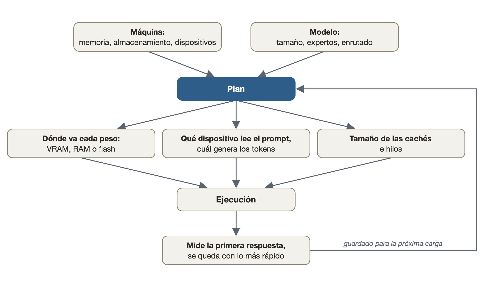

<p align="center">
  <picture>
    <source media="(prefers-color-scheme: dark)" srcset="docs/assets/logo/horizontal-ink.svg">
    
  </picture>
</p>

<p align="center">
  <a href="https://trendshift.io/repositories/85652?utm_source=trendshift-badge&amp;utm_medium=badge&amp;utm_campaign=badge-trendshift-85652" target="_blank" rel="noopener noreferrer"></a>
</p>

<p align="center">
  <a href="https://github.com/Helldez/BigMoeOnEdge/releases/latest"></a>
  <a href="https://github.com/Helldez/BigMoeOnEdge/actions/workflows/ci.yml"></a>
  <a href="LICENSE"></a>
</p>

<p align="center"><a href="README.md">English</a> · <a href="README_zh.md">中文</a> · <a href="README_ja.md">日本語</a> · <a href="README_es.md">Español</a> · <a href="README_fr.md">Français</a> · <a href="README_it.md">Italiano</a></p>

Esta es una traducción; el README en inglés es la referencia y puede ser más reciente.

Ejecuta modelos Mixture-of-Experts más grandes que la memoria de tu dispositivo. El motor mantiene en
memoria los pesos que necesita cada token y los expertos más usados, y lee el resto de la flash cuando el
modelo los pide. Un solo motor para teléfonos, portátiles y GPU de escritorio y de centro de datos, en
Android, iOS, macOS, Windows y Linux: mide la máquina y el modelo y se configura solo. Construido sobre
llama.cpp.

<table align="center">
<tr>
<td align="center" width="50%"></td>
<td align="center" width="50%"></td>
</tr>
<tr>
<td align="center">Teléfono Android de 12 GB<br>Qwen3.6-35B-A3B · 5-6 tok/s</td>
<td align="center">iPhone de 12 GB<br>Qwen3.6-35B-A3B · 6 tok/s</td>
</tr>
<tr>
<td align="center" colspan="2"></td>
</tr>
<tr>
<td align="center" colspan="2">Portátil Apple silicon de 16 GB<br>Qwen3.6-35B-A3B · 18-24 tok/s</td>
</tr>
</table>

Qwen3.6-35B-A3B, más grande que la memoria de cada dispositivo; funciona cualquier modelo MoE en
GGUF, con cualquier cuantización. Velocidades por máquina y versión: [Rendimiento](#rendimiento).

**El agente en un portátil de 2021, sin GPU**: el prompt viral de la pagoda de vóxeles al agente integrado en un ThinkPad con 16 GB de RAM, solo CPU, y Qwen3.6-35B-A3B Q4_K_M. 988 líneas a 2,3 tok/s y luego la página en la vista previa de la app; las partes aceleradas se indican en pantalla.

<p align="center"></p>

## Qué hace

- **Ejecuta modelos que no caben.** Un modelo MoE usa unos pocos expertos por token. El motor mantiene en
  memoria los pesos que necesita cada token y los expertos más usados, y lee el resto de la flash. La salida
  es la misma que con el modelo entero en memoria; los tests lo comprueban.
- **Se configura solo.** `--auto` mide la máquina y el modelo y elige el tamaño de la caché, los hilos y qué
  dispositivo hace qué. La pantalla Plan muestra cada decisión y su motivo.
- **Cualquier GGUF MoE.** Todo lo que carga llama.cpp, en cualquier cuantización. Sin código por modelo.
- **Todos los backends.** CPU, Metal, CUDA, HIP, Vulkan, OpenCL y la Hexagon NPU. En una tarjeta gráfica,
  los expertos más usados se quedan en su VRAM.
- **Apps y un servidor.** Una app de escritorio, apps para el teléfono y un servidor compatible con OpenAI y
  Anthropic para agentes de programación, y un agente propio en la app de escritorio.
- **Ve imágenes.** Pon junto al modelo su archivo de proyector (`mmproj`) y el servidor lee imágenes en
  todas las API; la CLI con `--mmproj` e `--image`. Cualquier modelo de visión que conozca la biblioteca de
  proyectores de llama.cpp, en cualquier cuantización, en todos los backends.

## Plataformas

| | Android | iOS | macOS | Windows | Linux |
|---|---|---|---|---|---|
| Motor y CLI | arm64 | arm64 (dentro de la app) | Apple silicon | x86_64, arm64 | x86_64, aarch64 |
| App | app nativa (APK) | app nativa, beta en TestFlight | app de escritorio (`.dmg`) | app de escritorio (instalador) | app de escritorio (AppImage) |
| Aceleradores | Hexagon NPU, Vulkan, OpenCL | Metal | Metal | CUDA, Vulkan; OpenCL y Hexagon NPU en arm64 | CUDA, HIP (AMD ROCm), Vulkan |
| Probado en | un teléfono de 12 GB | iPhone de 12 GB | un portátil de 16 GB | un portátil de 16 GB; portátiles y equipos de escritorio NVIDIA en informes de usuarios | tarjetas NVIDIA alquiladas de 8 a 96 GB, una tarjeta AMD de 192 GB (ROCm) |

Qué está medido, publicado o aún pendiente en cada una: [docs/platforms.md](docs/platforms.md).

## Cómo se compara

| | **BigMoeOnEdge** | llama.cpp | Strata | Lucebox | ds4 | colibri | KTransformers |
|---|:---:|:---:|:---:|:---:|:---:|:---:|:---:|
| Teléfono Android (también NPU) | ✅ | ✅ | ❌ | ❌ | ❌ | ❌ | ❌ |
| iPhone | ✅ | ✅ | ❌ | ❌ | ❌ | ❌ | ❌ |
| Mac | ✅ | ✅ | ✅ | ❌ | ✅ | ✅ | ❌ |
| Windows | ✅ | ✅ | ✅ | ❌ | ❌ | ✅ | ✅ |
| Solo CPU | ✅ | ✅ | ❌ | ❌ | ❌ | ✅ | ❌ |
| NVIDIA | ✅ | ✅ | ✅ | ✅ | ✅ | ✅ | ✅ |
| AMD | ✅ ROCm, también MI300X | ✅ | Radeon RX, Strix Halo | R9700, Ryzen AI MAX+ | Strix Halo | Vulkan | ✅ |
| Modelos | cualquier GGUF MoE | cualquier GGUF | una lista; tu propio archivo desde 0.2.23 | una lista | sus propios GGUF | formato propio; GGUF por importación | familias listadas |
| Expertos más allá de la RAM | en streaming desde la flash | caché de páginas del SO | repartidos al SSD por su planificador | en streaming desde SSD (DeepSeek V4.1) | en streaming desde SSD | en streaming desde el disco | en RAM |
| Se configura solo | ✅ `--auto`, a partir de mediciones | `--fit` | elige el modelo según la memoria | un perfil por conjunto de GPU | presupuesto de la caché de expertos | `coli setup`, `coli tune` | ❌ |

En qué funciona cada motor y las velocidades que publica cada uno, comprobado el 2026-11-28:
[docs/comparison.md](docs/comparison.md). Frente a ellos en la misma máquina:
[Rendimiento](#rendimiento).

## Instalación

Desde la [última versión](https://github.com/Helldez/BigMoeOnEdge/releases/latest):

- **macOS** (Apple silicon): abre el `.dmg` y arrastra la app a Aplicaciones. Aún no está notarizada; el
  README.txt del dmg tiene el único paso para el primer arranque.
- **Windows**: ejecuta el `-setup.exe`. Sin derechos de administrador.
- **Linux**: haz ejecutable el `.AppImage` y ejecútalo. La ventana necesita WebKitGTK 4.1;
  `--server` ejecuta solo el servidor.
- **Android**: instala `app-dev-release.apk`. Cada versión se instala sobre la anterior.
- **iOS**: únete a la [beta de TestFlight](https://testflight.apple.com/join/fKks3qjJ), compilada desde las
  etiquetas de versión por un colaborador, o compila la app con Xcode desde [examples/ios](examples/ios/README.md).
  Experimental.

Abre la app y elige un modelo en **Models**. Una tarjeta NVIDIA o AMD obtiene su backend desde
**Settings** ([docs/desktop-app.md](docs/desktop-app.md)).

Solo las herramientas de línea de comandos (`bmoe-cli`, `bmoe-server`):

```bash
curl -fsSL https://github.com/Helldez/BigMoeOnEdge/releases/latest/download/install.sh | sh
```

```powershell
irm https://github.com/Helldez/BigMoeOnEdge/releases/latest/download/install.ps1 | iex
```

## Uso

```bash
bmoe-cli -m model.gguf --auto -p "Explain MoE routing."   # plan and run
bmoe-cli -m model.gguf --plan                              # print the plan
bmoe-server -m model.gguf -c 32768                         # the server and its web UI, port 8765
```

El servidor habla la API de OpenAI (`/v1/chat/completions`, `/v1/responses`) y la de Anthropic
(`/v1/messages`), con streaming, llamadas a herramientas y razonamiento. Añade `--host 0.0.0.0 --api-key KEY`
para dar servicio a otras máquinas. Referencia: [docs/server-api.md](docs/server-api.md).

En una máquina que queda encendida, regístralo en su lugar como servicio de tu sesión: arranca con la
máquina, vuelve con su modelo y lo recarga cuando una petición no encuentra ninguno cargado
([ejecutar como servicio](docs/server-api.md#running-as-a-service)).

```bash
bmoe-server service install --host 0.0.0.0 -m model.gguf -c 65536   # systemd, launchd or Task Scheduler
bmoe-server service status
```

```python
from openai import OpenAI

client = OpenAI(base_url="http://127.0.0.1:8765/v1", api_key="local")
reply = client.chat.completions.create(model="local", messages=[{"role": "user", "content": "Hello"}])
print(reply.choices[0].message.content)
```

**Los agentes de programación** necesitan un contexto grande: varias veces el tamaño de su primera petición.
32768 basta para opencode, 65536 para Claude Code
([dimensionar el contexto](docs/server-api.md#sizing-the-context-for-a-client)).

<details>
<summary>Configuración de opencode, Claude Code y Codex CLI</summary>

```jsonc
// opencode, ~/.config/opencode/opencode.json
{
  "$schema": "https://opencode.ai/config.json",
  "provider": {
    "bmoe": {
      "npm": "@ai-sdk/openai-compatible",
      "options": { "baseURL": "http://127.0.0.1:8765/v1", "apiKey": "local" },
      "models": { "<model id from /v1/models>": { "limit": { "context": 32768, "output": 8192 } } }
    }
  },
  "model": "bmoe/<model id from /v1/models>"
}
```

```bash
# Claude Code
export ANTHROPIC_BASE_URL=http://127.0.0.1:8765
export ANTHROPIC_API_KEY=local
export ANTHROPIC_MODEL=<model id from /v1/models>
export ANTHROPIC_DEFAULT_HAIKU_MODEL=$ANTHROPIC_MODEL
export CLAUDE_CODE_MAX_CONTEXT_TOKENS=65536
claude
```

```toml
# Codex CLI, ~/.codex/config.toml
model = "<model id from /v1/models>"
model_provider = "bmoe"

[model_providers.bmoe]
name = "bmoe"
base_url = "http://127.0.0.1:8765/v1"
wire_api = "responses"
env_key = "BMOE_API_KEY"   # export BMOE_API_KEY=local
```

</details>

En **Connect apps**, la app escribe la configuración de opencode y Codex CLI y muestra la de
Claude Code.

**El agente.** La app de escritorio tiene su propio agente: trabaja en una carpeta que eliges, lee y edita
archivos y ejecuta comandos, y pregunta antes de cambiar nada salvo que se lo permitas. Una conversación
también la puede llevar OpenCode, Claude Code, Codex o Pi. Consulta [docs/agent.md](docs/agent.md).

## Cómo funciona

Para cada token, el router de cada capa elige unos pocos expertos. El motor los busca en hasta tres
niveles, cada uno una caché del de abajo:

- **VRAM**, en una tarjeta gráfica: los pesos que lee cada token y los expertos más usados.
- **RAM**: una caché de expertos. Sin tarjeta gráfica, también los pesos que lee cada token.
- **Flash** (el disco): el modelo entero.

Un experto que falta en la VRAM se copia desde la RAM; uno que falta en la RAM se lee de la flash. En un
teléfono o un Mac con Apple silicon la GPU usa la misma RAM que la CPU, así que hay dos niveles. Un modelo
que cabe en la tarjeta se ejecuta entero en ella. El streaming solo lee, así que no desgasta el disco.

El motor usa la API pública de llama.cpp, así que sus cuantizaciones, tokenizadores y plantillas de chat
funcionan sin cambios, y una actualización es un bump del submódulo. Qué tensores son expertos se lee del
archivo ([docs/which-models-stream.md](docs/which-models-stream.md)). Diseño:
[docs/architecture.md](docs/architecture.md).

## El planificador

<p align="center">
  
</p>

El planificador lee la cabecera del modelo y mide la máquina: memoria, velocidad del almacenamiento, cada
CPU, GPU y NPU. Sus reglas no nombran ningún dispositivo ni plataforma, así que un teléfono y un equipo de
escritorio reciben planes distintos del mismo código. Los valores que fijas tú se respetan. Consulta
[docs/hardware-planning.md](docs/hardware-planning.md).

<p align="center">
  
</p>

## Rendimiento

Decodificación en tokens por segundo, `--auto`, un solo flujo. Un rango es la variación entre ejecuciones.

**Medido en 0.50** ([bench-data](docs/bench-data/2026-11-25-release-0.50/README.md)):

| Hardware | Memoria | Modelo | En disco | Expertos desde | Decodificación tok/s |
|---|---|---|---:|---|---:|
| **GPU de escritorio** (NVIDIA) | 24 GB + 23 GB RAM | Qwen3.6-35B-A3B | 21 GB | GPU | 156 |
|  |  | Qwen3.8-Flash-Next 125B | 66 GB | flash, caché en GPU | 16-19 |
| **GPU de escritorio** (NVIDIA) | 12 GB + 61 GB RAM | Qwen3.6-35B-A3B | 21 GB | RAM, caché en GPU | 99-102 |
|  |  | Qwen3.8-Flash-Next 125B | 66 GB | RAM, caché en GPU | 45-51 |

**Versiones anteriores**, que se mantienen hasta que una prueba de versión las vuelva a medir:

| Hardware | Memoria | Modelo | En disco | Expertos desde | Decodificación tok/s |
|---|---|---|---:|---|---:|
| **Teléfono Android** | 12 GB | DeepSeek V4 Flash 284B | 91 GB | flash | 1 |
|  |  | Qwen3.8-Flash-Next 125B | 80 GB | flash | 2-4 |
|  |  | Qwen3.6-35B-A3B | 21 GB | flash | 5-6 |
| **iPhone** | 12 GB | Qwen3.6-35B-A3B | 21 GB | flash | 6 |
| **Portátil Apple silicon** | 16 GB | Qwen3.8-Flash-Next 125B | 76 GB | flash | 7-9 |
|  |  | Qwen3.6-35B-A3B | 21 GB | flash | 18-24 |
| **Portátil Windows** | 16 GB | Qwen3.6-35B-A3B | 21 GB | flash | 5 |
| **GPU de escritorio** (NVIDIA) | 12 GB + 128 GB RAM | Qwen3.8-Flash-Next 125B | 84 GB | RAM, caché en GPU | 16-17 |
| **GPU de escritorio** (NVIDIA) | 16 GB + 32 GB RAM | Qwen3.8-Flash-Next 125B | 66 GB | flash, caché en GPU | 19-21 |
| **GPU de escritorio** (NVIDIA) | 24 GB + 96 GB RAM | Qwen3.8-Flash-Next 125B | 66 GB | RAM, caché en GPU | 70 |
|  |  | Qwen3.6-35B-A3B | 21 GB | GPU | 217 |
| **GPU de escritorio** (NVIDIA) | 24 GB + 62 GB RAM | Qwen3.6-35B-A3B | 21 GB | GPU | 154 |
|  | 12 GB de ellos libres | Qwen3.6-35B-A3B | 21 GB | RAM, caché en GPU | 59-67 |
|  |  | Gemma 4 26B-A4B | 17 GB | GPU | 114 |
|  |  | Laguna XS 2.1 33B | 20 GB | GPU | 93-94 |
| **GPU de escritorio** (NVIDIA) | 8 GB + 31 GB RAM | Qwen3.8-Flash-Next 125B | 66 GB | flash, caché en GPU | 16 |
|  |  | Qwen3.6-35B-A3B | 21 GB | RAM, caché en GPU | 37-44 |
| **Dos GPU de escritorio** (NVIDIA) | 2 × 16 GB + 60 GB RAM | Qwen3.8-Flash-Next 125B | 66 GB | RAM, caché en GPU | 41-48 |
|  |  | DeepSeek V4 Flash 284B | 91 GB | flash, caché en GPU | 5 |
| **GPU de centro de datos** (AMD, ROCm) | 192 GB | Qwen3.8-Flash-Next 125B | 66 GB | GPU | 53 |


**Frente a otros motores, misma máquina y mismo archivo.** Con Qwen3.6-35B-A3B este motor va por delante:
55 tok/s frente a los 41 de Strata en una tarjeta de 12 GB (0.45), 154 frente a los 123 de Lucebox en una de
24 GB (0.41). Con Qwen3.8-Flash-Next Strata es de dos a tres veces más rápido: 23 frente a 45 en una tarjeta
de 12 GB, 16 frente a 49 en una de 8 GB (0.45). Todas las ejecuciones:
[docs/comparison.md](docs/comparison.md#same-machine-same-file).

Método y todas las ejecuciones: [docs/benchmarks.md](docs/benchmarks.md). Para añadir tu máquina, ejecuta
`scripts/bench-report.sh model.gguf` y abre un
[informe de benchmark](https://github.com/Helldez/BigMoeOnEdge/issues/new?template=benchmark-report.yml).

## Compilar desde el código fuente

```bash
git clone --recursive https://github.com/Helldez/BigMoeOnEdge.git
cd BigMoeOnEdge
cd ui && npm ci && npm run build && cd ..
scripts/build-host.sh
build/bin/bmoe-server --open
```

Un backend de llama.cpp es una opción de CMake que se pasa tal cual: `scripts/build-host.sh -DGGML_VULKAN=ON`
(o `-DGGML_CUDA=ON`). Tests: `cd build && ctest --output-on-failure` (requiere `python3` con `gguf`). Android:
`scripts/build-android.ps1`, y luego el APK en [examples/android](examples/android). En el propio teléfono,
en Termux: `pkg install git cmake clang make nodejs-lts`, y luego los pasos de arriba con
`scripts/build-host.sh -DBMOE_BACKEND_MODULES=OFF`, una sola biblioteca de CPU para los núcleos de ese
teléfono en lugar de un módulo por nivel de conjunto de instrucciones. Más: [CONTRIBUTING.md](CONTRIBUTING.md).

## Documentación

[docs/](docs/README.md). Empieza por [hardware-planning.md](docs/hardware-planning.md),
[settings.md](docs/settings.md), [server-api.md](docs/server-api.md) y
[limitations.md](docs/limitations.md).

## Trabajos previos

AirLLM, *LLM in a flash* de Apple, FlexGen, PowerInfer, EdgeMoE y
[flash-moe](https://github.com/danveloper/flash-moe), un motor Metal que lee en streaming un MoE de 397B
desde SSD en Apple silicon.

## Licencia

Apache-2.0 ([LICENSE](LICENSE)). Los binarios y las apps también incluyen llama.cpp, ggml y otras
bibliotecas bajo MIT, BSD, Apache-2.0 y SIL OFL 1.1: [THIRD_PARTY_LICENSES](THIRD_PARTY_LICENSES).
