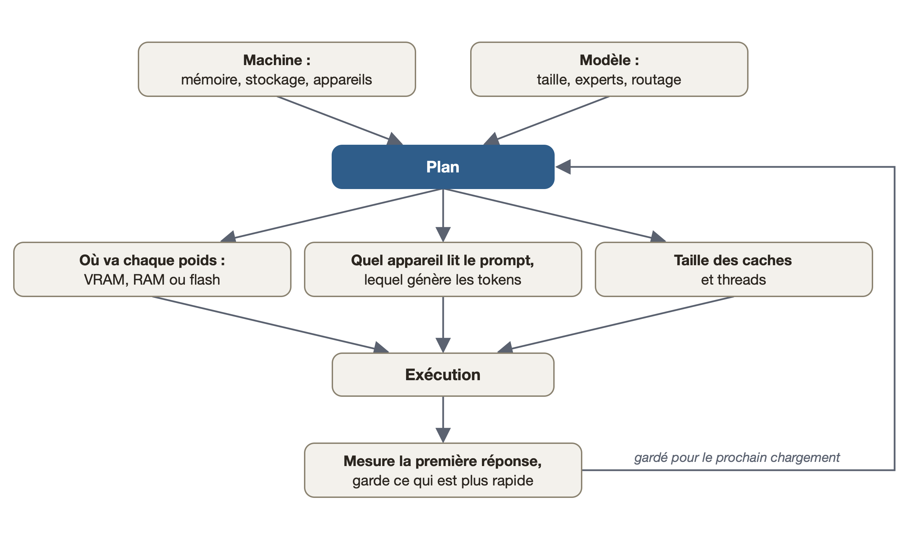

<p align="center">
  <picture>
    <source media="(prefers-color-scheme: dark)" srcset="docs/assets/logo/horizontal-ink.svg">
    
  </picture>
</p>

<p align="center">
  <a href="https://github.com/Helldez/BigMoeOnEdge/releases/latest"></a>
  <a href="https://github.com/Helldez/BigMoeOnEdge/actions/workflows/ci.yml"></a>
  <a href="LICENSE"></a>
</p>

<p align="center"><a href="README.md">English</a> · <a href="README_zh.md">中文</a> · <a href="README_ja.md">日本語</a> · <a href="README_es.md">Español</a> · <a href="README_fr.md">Français</a> · <a href="README_it.md">Italiano</a></p>

Ceci est une traduction ; le README en anglais fait référence et peut être plus récent.

Exécutez des modèles Mixture-of-Experts plus grands que la mémoire de votre appareil. Les experts sont lus
depuis la flash quand le modèle en a besoin. Android, iOS, macOS, Windows et Linux, construit sur llama.cpp.

<table align="center">
<tr>
<td align="center" width="50%"></td>
<td align="center" width="50%"></td>
</tr>
<tr>
<td align="center">Téléphone Android de 12 GB<br>Qwen3.6-35B-A3B · 5-6 tok/s</td>
<td align="center">iPhone de 12 GB<br>Qwen3.6-35B-A3B · 6 tok/s</td>
</tr>
<tr>
<td align="center" colspan="2"></td>
</tr>
<tr>
<td align="center" colspan="2">Portable Apple silicon de 16 GB<br>Qwen3.6-35B-A3B · 18-24 tok/s</td>
</tr>
</table>

Qwen3.6-35B-A3B (22 GB), plus grand que la mémoire de chaque appareil ; tout modèle MoE en GGUF
fonctionne, quelle que soit sa quantification. Les vitesses de décodage sont celles du tableau
[Performances](#performances). Sur le téléphone Android et le portable, il écrit une réponse en temps
réel ; sur l'iPhone, l'application avec le modèle chargé.

**L'agent sur un portable de 2021, sans GPU** (1:33) : le prompt viral de la pagode en voxels donné à l'agent intégré, sur un ThinkPad avec 15 GB de RAM, CPU seulement, et Qwen3.6-35B-A3B Q4_K_M (20,8 GB). 988 lignes à 2,3 tok/s, puis la page dans l'aperçu de l'app ; les passages accélérés sont indiqués à l'écran.

<p align="center"></p>

https://github.com/user-attachments/assets/a93fc61c-99ff-4ca6-894a-1c29cd27ef53

## Ce qu'il fait

- **Exécute des modèles qui ne tiennent pas en mémoire.** Un modèle MoE utilise quelques experts par token.
  Le moteur garde en mémoire les poids dont chaque token a besoin et les experts les plus utilisés, et lit le
  reste depuis la flash. La sortie est la même qu'avec le modèle entier en mémoire ; les tests le vérifient.
- **Se configure seul.** `--auto` mesure la machine et le modèle et choisit la taille du cache, les threads
  et quel appareil fait quoi. L'écran Plan montre chaque choix et sa raison.
- **Tout GGUF MoE.** Tout ce que llama.cpp charge, dans n'importe quelle quantification. Aucun code par
  modèle.
- **Tous les backends.** CPU, Metal, CUDA, HIP, Vulkan, OpenCL et le NPU Hexagon. Sur une carte graphique,
  les experts les plus utilisés restent dans sa VRAM.
- **Applications et un serveur.** Une application de bureau, des applications pour téléphone et un serveur
  compatible OpenAI et Anthropic pour les agents de code.
- **Voit les images.** Placez le fichier de projecteur du modèle (`mmproj`) à côté de lui et le serveur lit
  les images sur chaque API ; la CLI avec `--mmproj` et `--image`. Tout modèle de vision que connaît la
  bibliothèque de projecteurs de llama.cpp, dans n'importe quelle quantification, sur tous les backends.

## Performances

| Matériel | Mémoire | Modèle | Sur disque | Experts depuis | Décodage tok/s |
|---|---|---|---:|---|---:|
| **Téléphone Android** | 12 GB | DeepSeek V4 Flash 284B | 91 GB | flash | 1 |
|  |  | Qwen3.8-Flash-Next 125B | 80 GB | flash | 2-4 |
|  |  | Qwen3.6-35B-A3B | 21 GB | flash | 5-6 |
| **iPhone** | 12 GB | Qwen3.6-35B-A3B | 21 GB | flash | 6 |
| **Portable Apple silicon** | 16 GB | Qwen3.8-Flash-Next 125B | 76 GB | flash | 7-9 |
|  |  | Qwen3.6-35B-A3B | 21 GB | flash | 18-24 |
| **Portable Windows** | 16 GB | Qwen3.6-35B-A3B | 21 GB | flash | 5 |
| **GPU de bureau** (NVIDIA) | 12 GB + 128 GB RAM | Qwen3.8-Flash-Next 125B | 84 GB | RAM, cache GPU | 16-17 |
| **GPU de bureau** (NVIDIA) | 16 GB + 32 GB RAM | Qwen3.8-Flash-Next 125B | 66 GB | flash, cache GPU | 19-21 |
| **GPU de bureau** (NVIDIA) | 24 GB + 96 GB RAM | Qwen3.8-Flash-Next 125B | 66 GB | RAM, cache GPU | 70 |
|  |  | Qwen3.6-35B-A3B | 21 GB | GPU | 217 |
| **GPU de bureau** (NVIDIA) | 24 GB + 62 GB RAM | Qwen3.6-35B-A3B | 21 GB | GPU | 154 |
|  | dont 12 GB libres | Qwen3.6-35B-A3B | 21 GB | RAM, cache GPU | 59-67 |
|  |  | Gemma 4 26B-A4B | 17 GB | GPU | 114 |
|  |  | Laguna XS 2.1 33B | 20 GB | GPU | 93-94 |
| **GPU de bureau** (NVIDIA) | 8 GB + 125 GB RAM | Qwen3.6-35B-A3B | 21 GB | RAM, GPU | 32-33 |
| **GPU de centre de données** (AMD, ROCm) | 192 GB | Qwen3.8-Flash-Next 125B | 66 GB | GPU | 53 |

Une plage est l'écart entre les exécutions. Méthode et toutes les exécutions :
[docs/benchmarks.md](docs/benchmarks.md). Pour ajouter votre machine, lancez
`scripts/bench-report.sh model.gguf` et ouvrez un
[rapport de benchmark](https://github.com/Helldez/BigMoeOnEdge/issues/new?template=benchmark-report.yml).

## Installation

Depuis la [dernière version](https://github.com/Helldez/BigMoeOnEdge/releases/latest) :

- **macOS** (Apple silicon) : ouvrez le `.dmg` et glissez l'application dans Applications. Elle n'est pas
  encore notarisée ; le README.txt du dmg donne la seule étape du premier lancement.
- **Windows** : lancez le `-setup.exe`. Sans droits d'administrateur.
- **Linux** : rendez le `.AppImage` exécutable et lancez-le. La fenêtre a besoin de WebKitGTK 4.1 ;
  `--server` lance le serveur seul.
- **Android** : installez `app-dev-release.apk`. Chaque version s'installe par-dessus la précédente.
- **iOS** : compilez l'application avec Xcode depuis [examples/ios](examples/ios/README.md). Expérimental.

Ouvrez l'application et choisissez un modèle sous **Models**. Une carte NVIDIA ou AMD reçoit son backend
depuis **Settings** ([docs/desktop-app.md](docs/desktop-app.md)).

Les outils en ligne de commande seuls (`bmoe-cli`, `bmoe-server`) :

```bash
curl -fsSL https://github.com/Helldez/BigMoeOnEdge/releases/latest/download/install.sh | sh
```

```powershell
irm https://github.com/Helldez/BigMoeOnEdge/releases/latest/download/install.ps1 | iex
```

## Utilisation

```bash
bmoe-cli -m model.gguf --auto -p "Explain MoE routing."   # plan and run
bmoe-cli -m model.gguf --plan                              # print the plan
bmoe-server -m model.gguf -c 32768                         # the server and its web UI, port 8765
```

Le serveur parle l'API OpenAI (`/v1/chat/completions`, `/v1/responses`) et celle d'Anthropic
(`/v1/messages`), avec streaming, appels d'outils et raisonnement. Ajoutez `--host 0.0.0.0 --api-key KEY`
pour servir d'autres machines. Référence : [docs/server-api.md](docs/server-api.md).

```python
from openai import OpenAI

client = OpenAI(base_url="http://127.0.0.1:8765/v1", api_key="local")
reply = client.chat.completions.create(model="local", messages=[{"role": "user", "content": "Hello"}])
print(reply.choices[0].message.content)
```

**Les agents de code** ont besoin d'un grand contexte : quelques fois la taille de leur première requête.
32768 suffit pour opencode, 65536 pour Claude Code
([dimensionner le contexte](docs/server-api.md#sizing-the-context-for-a-client)).

```jsonc
// opencode, ~/.config/opencode/opencode.json
{
  "$schema": "https://opencode.ai/config.json",
  "provider": {
    "bmoe": {
      "npm": "@ai-sdk/openai-compatible",
      "options": { "baseURL": "http://127.0.0.1:8765/v1", "apiKey": "local" },
      "models": { "<model id from /v1/models>": { "limit": { "context": 32768, "output": 8192 } } }
    }
  },
  "model": "bmoe/<model id from /v1/models>"
}
```

```bash
# Claude Code
export ANTHROPIC_BASE_URL=http://127.0.0.1:8765
export ANTHROPIC_API_KEY=local
export ANTHROPIC_MODEL=<model id from /v1/models>
export ANTHROPIC_DEFAULT_HAIKU_MODEL=$ANTHROPIC_MODEL
export CLAUDE_CODE_MAX_CONTEXT_TOKENS=65536
claude
```

```toml
# Codex CLI, ~/.codex/config.toml
model = "<model id from /v1/models>"
model_provider = "bmoe"

[model_providers.bmoe]
name = "bmoe"
base_url = "http://127.0.0.1:8765/v1"
wire_api = "responses"
env_key = "BMOE_API_KEY"   # export BMOE_API_KEY=local
```

Sous **Connect apps**, l'application écrit les réglages pour opencode et Codex CLI et affiche ceux de
Claude Code.

**L'agent.** L'application de bureau a son propre agent : il travaille dans un dossier que vous choisissez,
lit et modifie des fichiers et lance des commandes, et demande avant de changer quoi que ce soit, sauf si
vous l'y autorisez. Une conversation peut aussi être menée par OpenCode, Claude Code, Codex ou Pi. Voir
[docs/agent.md](docs/agent.md).

## Fonctionnement

Pour chaque token, le routeur de chaque couche choisit quelques experts. Le moteur les cherche dans
jusqu'à trois niveaux, chacun un cache pour celui du dessous :

- **VRAM**, sur une carte graphique : les poids que lit chaque token et les experts les plus utilisés.
- **RAM** : un cache d'experts. Sans carte graphique, aussi les poids que lit chaque token.
- **Flash** (le disque) : le modèle entier.

Un expert absent de la VRAM est copié depuis la RAM ; un expert absent de la RAM est lu depuis la flash.
Sur un téléphone ou un Mac Apple silicon, le GPU utilise la même RAM que le CPU, il y a donc deux niveaux.
Un modèle qui tient dans la carte y tourne en entier. Le streaming ne fait que lire, il n'use donc pas le
disque.

Le moteur utilise l'API publique de llama.cpp, donc ses quantifications, tokenizers et modèles de chat
fonctionnent sans modification, et une mise à jour se résume à un bump du sous-module. Les tenseurs qui
sont des experts sont identifiés depuis le fichier ([docs/which-models-stream.md](docs/which-models-stream.md)).
Conception : [docs/architecture.md](docs/architecture.md).

## Le planificateur

<p align="center">
  
</p>

Le planificateur lit l'en-tête du modèle et mesure la machine : mémoire, vitesse du stockage, chaque CPU,
GPU et NPU. Ses règles ne nomment aucun appareil ni aucune plateforme, donc un téléphone et un ordinateur de
bureau reçoivent des plans différents du même code. Les valeurs que vous fixez vous-même sont conservées.
Voir [docs/hardware-planning.md](docs/hardware-planning.md).

<p align="center">
  
</p>

## Plateformes

| | Android | macOS | Windows | Linux | iOS |
|---|---|---|---|---|---|
| Moteur et CLI | arm64 | Apple silicon | x86_64, arm64 | x86_64, aarch64 | arm64 (dans l'application) |
| Application | application native | application de bureau | application de bureau | application de bureau | application native, compilée depuis les sources |
| Accélérateurs | Hexagon NPU, Vulkan, OpenCL | Metal | Vulkan, CUDA, OpenCL (arm64), Hexagon NPU (arm64) | Vulkan, CUDA, HIP | Metal |
| Testé sur | téléphone de 12 GB | portable de 16 GB | portable de 16 GB | cartes NVIDIA de 12-24 GB et AMD de 192 GB louées | iPhone de 12 GB |

Détails : [docs/platforms.md](docs/platforms.md).

## Comparaison

| | **BigMoeOnEdge** | Strata | ds4 | colibri | KTransformers |
|---|:---:|:---:|:---:|:---:|:---:|
| Téléphone Android (NPU aussi) | ✅ | ❌ | ❌ | ❌ | ❌ |
| iPhone | ✅ | ❌ | ❌ | ❌ | ❌ |
| Mac | ✅ | ✅ | ✅ | ✅ | ❌ |
| Windows / Linux, CPU seul | ✅ | ❌ | Linux, pour le débogage | ✅ | ❌ |
| NVIDIA | ✅ | ✅ | ✅ | ✅ | ✅ |
| AMD (ROCm) | ✅ (MI300X aussi) | Radeon RX et Strix Halo | Strix Halo et RDNA | Vulkan | ✅ |
| Tout modèle MoE en GGUF | ✅ | peu de modèles | peu de modèles | son propre format | peu de modèles |
| Se configure seul | ✅ `--auto` | choisit le modèle selon la mémoire | budget du cache d'experts | `coli tune` | ❌ |

Vitesses et sources : [docs/comparison.md](docs/comparison.md).

## Compiler depuis les sources

```bash
git clone --recursive https://github.com/Helldez/BigMoeOnEdge.git
cd BigMoeOnEdge
cd ui && npm ci && npm run build && cd ..
scripts/build-host.sh
build/bin/bmoe-server --open
```

Un backend de llama.cpp est une option CMake transmise telle quelle : `scripts/build-host.sh -DGGML_VULKAN=ON`
(ou `-DGGML_CUDA=ON`). Tests : `cd build && ctest --output-on-failure` (nécessite `python3` avec `gguf`). Android :
`scripts/build-android.ps1`, puis l'APK dans [examples/android](examples/android). Plus :
[CONTRIBUTING.md](CONTRIBUTING.md).

## Documentation

[docs/](docs/README.md). Commencez par [hardware-planning.md](docs/hardware-planning.md),
[settings.md](docs/settings.md), [server-api.md](docs/server-api.md) et
[limitations.md](docs/limitations.md).

## Travaux antérieurs

AirLLM, *LLM in a flash* d'Apple, FlexGen, PowerInfer, EdgeMoE et
[flash-moe](https://github.com/danveloper/flash-moe), un moteur Metal qui lit en streaming un MoE de 397B
depuis un SSD sur Apple silicon.

## Licence

Apache-2.0 ([LICENSE](LICENSE)). Les binaires et les applications embarquent aussi llama.cpp, ggml et
d'autres bibliothèques sous MIT, BSD, Apache-2.0 et SIL OFL 1.1 : [THIRD_PARTY_LICENSES](THIRD_PARTY_LICENSES).
