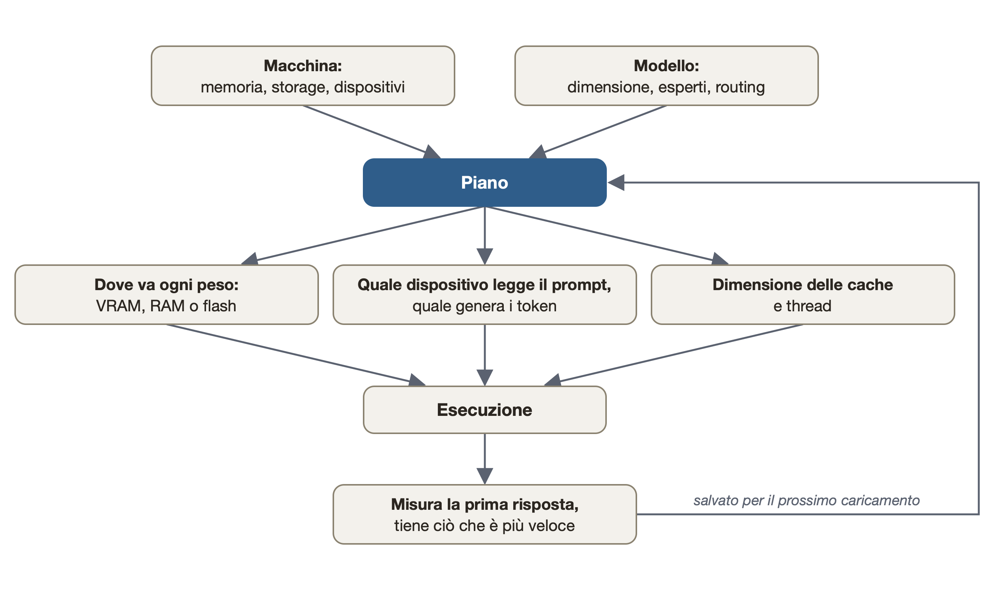

<p align="center">
  <picture>
    <source media="(prefers-color-scheme: dark)" srcset="docs/assets/logo/horizontal-ink.svg">
    
  </picture>
</p>

<p align="center">
  <a href="https://trendshift.io/repositories/85652?utm_source=trendshift-badge&amp;utm_medium=badge&amp;utm_campaign=badge-trendshift-85652" target="_blank" rel="noopener noreferrer"></a>
</p>

<p align="center">
  <a href="https://github.com/Helldez/BigMoeOnEdge/releases/latest"></a>
  <a href="https://github.com/Helldez/BigMoeOnEdge/actions/workflows/ci.yml"></a>
  <a href="LICENSE"></a>
</p>

<p align="center"><a href="README.md">English</a> · <a href="README_zh.md">中文</a> · <a href="README_ja.md">日本語</a> · <a href="README_es.md">Español</a> · <a href="README_fr.md">Français</a> · <a href="README_it.md">Italiano</a></p>

Questa è una traduzione; il README in inglese è il riferimento e potrebbe essere più aggiornato.

Esegui modelli Mixture-of-Experts più grandi della memoria del tuo dispositivo. Il motore tiene in memoria
i pesi che servono a ogni token e gli esperti più usati, e legge il resto dalla flash quando il modello ne ha
bisogno. Un solo motore per telefoni, portatili, GPU desktop e da data center, su Android, iOS, macOS, Windows
e Linux: misura la macchina e il modello e si configura da solo. Costruito su llama.cpp.

<table align="center">
<tr>
<td align="center" width="50%"></td>
<td align="center" width="50%"></td>
</tr>
<tr>
<td align="center">Telefono Android da 12 GB<br>Qwen3.6-35B-A3B · 5-6 tok/s</td>
<td align="center">iPhone da 12 GB<br>Qwen3.6-35B-A3B · 6 tok/s</td>
</tr>
<tr>
<td align="center" colspan="2"></td>
</tr>
<tr>
<td align="center" colspan="2">Portatile Apple silicon da 16 GB<br>Qwen3.6-35B-A3B · 18-24 tok/s</td>
</tr>
</table>

Qwen3.6-35B-A3B, più grande della memoria di ciascun dispositivo; funziona qualsiasi modello MoE
in GGUF, in qualsiasi quantizzazione. Velocità per macchina e release: [Prestazioni](#prestazioni).

**L'agente su un portatile del 2021, senza GPU**: il prompt virale della pagoda in voxel dato all'agente integrato su un ThinkPad con 16 GB di RAM, solo CPU, e Qwen3.6-35B-A3B Q4_K_M. 988 righe a 2,3 tok/s, poi la pagina nell'anteprima dell'app; le parti accelerate sono indicate a schermo.

<p align="center"></p>

## Cosa fa

- **Esegue modelli che non entrano in memoria.** Un modello MoE usa pochi esperti per token. Il motore tiene
  in memoria i pesi che servono a ogni token e gli esperti più usati, e legge il resto dalla flash. L'output
  è lo stesso che con l'intero modello in memoria; i test lo verificano.
- **Si configura da solo.** `--auto` misura la macchina e il modello e sceglie la dimensione della cache, i
  thread e quale dispositivo fa cosa. La schermata Plan mostra ogni scelta e il perché.
- **Qualsiasi GGUF MoE.** Tutto ciò che llama.cpp carica, in qualsiasi quantizzazione. Nessun codice per
  modello.
- **Ogni backend.** CPU, Metal, CUDA, HIP, Vulkan, OpenCL e la Hexagon NPU. Su una scheda
  grafica gli esperti più usati restano nella sua VRAM.
- **App e un server.** Un'app desktop, app per telefono e un server compatibile OpenAI e Anthropic per gli
  agenti di coding, e un agente tutto suo nell'app desktop.
- **Vede le immagini.** Metti accanto al modello il suo file proiettore (`mmproj`) e il server legge le
  immagini su ogni API; la CLI con `--mmproj` e `--image`. Qualsiasi modello di visione che la libreria dei
  proiettori di llama.cpp conosce, in qualsiasi quantizzazione, su ogni backend.

## Piattaforme

| | Android | iOS | macOS | Windows | Linux |
|---|---|---|---|---|---|
| Motore e CLI | arm64 | arm64 (nell'app) | Apple silicon | x86_64, arm64 | x86_64, aarch64 |
| App | app nativa (APK) | app nativa, beta TestFlight | app desktop (`.dmg`) | app desktop (installer) | app desktop (AppImage) |
| Acceleratori | Hexagon NPU, Vulkan, OpenCL | Metal | Metal | CUDA, Vulkan; OpenCL e Hexagon NPU su arm64 | CUDA, HIP (AMD ROCm), Vulkan |
| Provato su | un telefono da 12 GB | iPhone da 12 GB | un portatile da 16 GB | un portatile da 16 GB; portatili e desktop NVIDIA nelle segnalazioni degli utenti | schede NVIDIA a noleggio da 8 a 96 GB, una scheda AMD da 192 GB (ROCm) |

Cosa è misurato, distribuito o ancora da fare su ciascuna: [docs/platforms.md](docs/platforms.md).

## Il confronto

| | **BigMoeOnEdge** | llama.cpp | Strata | Lucebox | ds4 | colibri | KTransformers |
|---|:---:|:---:|:---:|:---:|:---:|:---:|:---:|
| Telefono Android (anche NPU) | ✅ | ✅ | ❌ | ❌ | ❌ | ❌ | ❌ |
| iPhone | ✅ | ✅ | ❌ | ❌ | ❌ | ❌ | ❌ |
| Mac | ✅ | ✅ | ✅ | ❌ | ✅ | ✅ | ❌ |
| Windows | ✅ | ✅ | ✅ | ❌ | ❌ | ✅ | ✅ |
| Solo CPU | ✅ | ✅ | ❌ | ❌ | ❌ | ✅ | ❌ |
| NVIDIA | ✅ | ✅ | ✅ | ✅ | ✅ | ✅ | ✅ |
| AMD | ✅ ROCm, anche MI300X | ✅ | Radeon RX, Strix Halo | R9700, Ryzen AI MAX+ | Strix Halo | Vulkan | ✅ |
| Modelli | qualsiasi GGUF MoE | qualsiasi GGUF | un elenco; il tuo file dalla 0.2.23 | un elenco | i suoi GGUF | formato suo; GGUF per importazione | famiglie elencate |
| Esperti oltre la RAM | in streaming dalla flash | page cache del sistema operativo | sparsi su SSD dal suo planner | in streaming da SSD (DeepSeek V4.1) | in streaming da SSD | in streaming dal disco | tenuti in RAM |
| Si configura da solo | ✅ `--auto`, da misure | `--fit` | sceglie il modello per memoria | un profilo per ogni insieme di GPU | budget della cache degli esperti | `coli setup`, `coli tune` | ❌ |

Su cosa gira ogni motore e le velocità che ciascuno riporta, verificati il 2026-11-28:
[docs/comparison.md](docs/comparison.md). Il confronto sulla stessa macchina:
[Prestazioni](#prestazioni).

## Installazione

Dall'[ultima release](https://github.com/Helldez/BigMoeOnEdge/releases/latest):

- **macOS** (Apple silicon): apri il `.dmg` e trascina l'app in Applicazioni. Non è ancora notarizzata;
  il README.txt del dmg descrive l'unico passo per il primo avvio.
- **Windows**: esegui il `-setup.exe`. Senza diritti di amministratore.
- **Linux**: rendi eseguibile l'`.AppImage` e avvialo. La finestra richiede WebKitGTK 4.1;
  `--server` avvia solo il server.
- **Android**: installa `app-dev-release.apk`. Ogni release si installa sopra la precedente.
- **iOS**: entra nella [beta TestFlight](https://testflight.apple.com/join/fKks3qjJ), compilata dai tag di
  release da un contributore, oppure compila l'app con Xcode da [examples/ios](examples/ios/README.md).
  Sperimentale.

Apri l'app e scegli un modello in **Models**. Una scheda NVIDIA o AMD riceve il suo backend dalle
**Settings** ([docs/desktop-app.md](docs/desktop-app.md)).

Solo gli strumenti da riga di comando (`bmoe-cli`, `bmoe-server`):

```bash
curl -fsSL https://github.com/Helldez/BigMoeOnEdge/releases/latest/download/install.sh | sh
```

```powershell
irm https://github.com/Helldez/BigMoeOnEdge/releases/latest/download/install.ps1 | iex
```

## Uso

```bash
bmoe-cli -m model.gguf --auto -p "Explain MoE routing."   # plan and run
bmoe-cli -m model.gguf --plan                              # print the plan
bmoe-server -m model.gguf -c 32768                         # the server and its web UI, port 8765
```

Il server parla l'API OpenAI (`/v1/chat/completions`, `/v1/responses`) e quella Anthropic
(`/v1/messages`), con streaming, chiamate a strumenti e reasoning. Aggiungi `--host 0.0.0.0 --api-key KEY`
per servire altre macchine. Riferimento: [docs/server-api.md](docs/server-api.md).

Su una macchina che resta accesa, registralo invece come servizio del tuo utente: parte con la macchina,
torna con il suo modello e lo ricarica quando una richiesta non ne trova uno caricato
([eseguirlo come servizio](docs/server-api.md#running-as-a-service)).

```bash
bmoe-server service install --host 0.0.0.0 -m model.gguf -c 65536   # systemd, launchd or Task Scheduler
bmoe-server service status
```

```python
from openai import OpenAI

client = OpenAI(base_url="http://127.0.0.1:8765/v1", api_key="local")
reply = client.chat.completions.create(model="local", messages=[{"role": "user", "content": "Hello"}])
print(reply.choices[0].message.content)
```

**Gli agenti di coding** richiedono un contesto ampio: alcune volte la dimensione della loro prima richiesta. 32768
basta per opencode, 65536 per Claude Code
([dimensionare il contesto](docs/server-api.md#sizing-the-context-for-a-client)).

<details>
<summary>Impostazioni per opencode, Claude Code e Codex CLI</summary>

```jsonc
// opencode, ~/.config/opencode/opencode.json
{
  "$schema": "https://opencode.ai/config.json",
  "provider": {
    "bmoe": {
      "npm": "@ai-sdk/openai-compatible",
      "options": { "baseURL": "http://127.0.0.1:8765/v1", "apiKey": "local" },
      "models": { "<model id from /v1/models>": { "limit": { "context": 32768, "output": 8192 } } }
    }
  },
  "model": "bmoe/<model id from /v1/models>"
}
```

```bash
# Claude Code
export ANTHROPIC_BASE_URL=http://127.0.0.1:8765
export ANTHROPIC_API_KEY=local
export ANTHROPIC_MODEL=<model id from /v1/models>
export ANTHROPIC_DEFAULT_HAIKU_MODEL=$ANTHROPIC_MODEL
export CLAUDE_CODE_MAX_CONTEXT_TOKENS=65536
claude
```

```toml
# Codex CLI, ~/.codex/config.toml
model = "<model id from /v1/models>"
model_provider = "bmoe"

[model_providers.bmoe]
name = "bmoe"
base_url = "http://127.0.0.1:8765/v1"
wire_api = "responses"
env_key = "BMOE_API_KEY"   # export BMOE_API_KEY=local
```

</details>

In **Connect apps**, l'app scrive le impostazioni per opencode e Codex CLI e mostra quelle per
Claude Code.

**L'agente.** L'app desktop ha un suo agente: lavora in una cartella che scegli, legge e modifica file ed
esegue comandi, e chiede prima di cambiare qualcosa, a meno che tu non lo consenta. Una conversazione può
anche essere gestita da OpenCode, Claude Code, Codex o Pi. Vedi [docs/agent.md](docs/agent.md).

## Come funziona

Per ogni token, il router di ogni layer sceglie pochi esperti. Il motore li cerca in un massimo di tre
livelli, ciascuno una cache per quello sottostante:

- **VRAM**, su una scheda grafica: i pesi che ogni token legge e gli esperti più usati.
- **RAM**: una cache di esperti. Senza scheda grafica, anche i pesi che ogni token legge.
- **Flash** (il disco): l'intero modello.

Un esperto che manca alla VRAM viene copiato dalla RAM; uno che manca alla RAM viene letto dalla flash.
Su un telefono o un Mac Apple silicon la GPU usa la stessa RAM della CPU, quindi i livelli sono due. Un
modello che entra nella scheda gira tutto su di essa. Lo streaming legge soltanto, quindi non usura il
disco.

Il motore usa l'API pubblica di llama.cpp, quindi le sue quantizzazioni, i tokenizer e i chat template
funzionano senza modifiche, e un aggiornamento è un bump del submodule. Quali tensori sono esperti viene
letto dal file ([docs/which-models-stream.md](docs/which-models-stream.md)). Design:
[docs/architecture.md](docs/architecture.md).

## Il planner

<p align="center">
  
</p>

Il planner legge l'header del modello e misura la macchina: memoria, velocità dello storage, ogni CPU, GPU
e NPU. Le sue regole non nominano alcun dispositivo o piattaforma, quindi un telefono e un desktop ricevono
piani diversi dallo stesso codice. I valori che imposti tu vengono mantenuti. Vedi
[docs/hardware-planning.md](docs/hardware-planning.md).

<p align="center">
  
</p>

## Prestazioni

Decodifica in token al secondo, `--auto`, un solo flusso. Un intervallo è la variazione tra i run.

**Misurato sulla 0.50** ([bench-data](docs/bench-data/2026-11-25-release-0.50/README.md)):

| Hardware | Memoria | Modello | Su disco | Esperti da | Decodifica tok/s |
|---|---|---|---:|---|---:|
| **GPU desktop** (NVIDIA) | 24 GB + 23 GB RAM | Qwen3.6-35B-A3B | 21 GB | GPU | 156 |
|  |  | Qwen3.8-Flash-Next 125B | 66 GB | flash, cache GPU | 16-19 |
|  |  | Inkling 2 Mini | 17 GB | GPU | 61 |
| **GPU desktop** (NVIDIA) | 12 GB + 61 GB RAM | Qwen3.6-35B-A3B | 21 GB | RAM, cache GPU | 99-102 |
|  |  | Qwen3.8-Flash-Next 125B | 66 GB | RAM, cache GPU | 45-51 |

**In arrivo**, in pull request aperte e non ancora rilasciate. Sono bozze: i numeri possono cambiare, e oggi un'installazione non li dà.

| Hardware | Modello | Prima | Con la PR | PR |
|---|---|---:|---:|---|
| Portatile Apple silicon, 16 GB | Qwen3.8-Flash-Next 125B | 7-9 | 14 | [#741](https://github.com/Helldez/BigMoeOnEdge/pull/741) |
| Portatile Apple silicon, 16 GB | Qwen3.6-35B-A3B | 18-24 | 28-29 | [#741](https://github.com/Helldez/BigMoeOnEdge/pull/741) |
| GPU desktop (NVIDIA), 12 GB | Qwen3.6-35B-A3B | 52 | 59 | [#741](https://github.com/Helldez/BigMoeOnEdge/pull/741) |
| Portatile Apple silicon, 16 GB | Qwen3.6-35B-A3B, codice, con un modello di bozza | 24 | 38 | [#749](https://github.com/Helldez/BigMoeOnEdge/pull/749), [#755](https://github.com/Helldez/BigMoeOnEdge/pull/755) |
| Portatile Apple silicon, 16 GB | Qwen3.6-35B-A3B, lettura di un prompt da 3k token | 215 | 367 | [#749](https://github.com/Helldez/BigMoeOnEdge/pull/749) |

**Release precedenti**, mantenute finché un test di release non le misura di nuovo:

| Hardware | Memoria | Modello | Su disco | Esperti da | Decodifica tok/s |
|---|---|---|---:|---|---:|
| **Telefono Android** | 12 GB | DeepSeek V4 Flash 284B | 91 GB | flash | 1 |
|  |  | Qwen3.8-Flash-Next 125B | 80 GB | flash | 2-4 |
|  |  | Qwen3.6-35B-A3B | 21 GB | flash | 5-6 |
| **iPhone** | 12 GB | Qwen3.6-35B-A3B | 21 GB | flash | 6 |
| **Portatile Apple silicon** | 16 GB | Qwen3.8-Flash-Next 125B | 76 GB | flash | 7-9 |
|  |  | Qwen3.6-35B-A3B | 21 GB | flash | 18-24 |
| **Portatile Windows** | 16 GB | Qwen3.6-35B-A3B | 21 GB | flash | 5 |
| **GPU desktop** (NVIDIA) | 12 GB + 128 GB RAM | Qwen3.8-Flash-Next 125B | 84 GB | RAM, cache GPU | 16-17 |
| **GPU desktop** (NVIDIA) | 16 GB + 32 GB RAM | Qwen3.8-Flash-Next 125B | 66 GB | flash, cache GPU | 19-21 |
| **GPU desktop** (NVIDIA) | 24 GB + 96 GB RAM | Qwen3.8-Flash-Next 125B | 66 GB | RAM, cache GPU | 70 |
|  |  | Qwen3.6-35B-A3B | 21 GB | GPU | 217 |
| **GPU desktop** (NVIDIA) | 24 GB + 62 GB RAM | Qwen3.6-35B-A3B | 21 GB | GPU | 154 |
|  | di cui 12 GB liberi | Qwen3.6-35B-A3B | 21 GB | RAM, cache GPU | 59-67 |
|  |  | Gemma 4 26B-A4B | 17 GB | GPU | 114 |
|  |  | Laguna XS 2.1 33B | 20 GB | GPU | 93-94 |
| **GPU desktop** (NVIDIA) | 8 GB + 31 GB RAM | Qwen3.8-Flash-Next 125B | 66 GB | flash, cache GPU | 16 |
|  |  | Qwen3.6-35B-A3B | 21 GB | RAM, cache GPU | 37-44 |
| **Due GPU desktop** (NVIDIA) | 2 × 16 GB + 60 GB RAM | Qwen3.8-Flash-Next 125B | 66 GB | RAM, cache GPU | 41-48 |
|  |  | DeepSeek V4 Flash 284B | 91 GB | flash, cache GPU | 5 |
| **GPU datacenter** (AMD, ROCm) | 192 GB | Qwen3.8-Flash-Next 125B | 66 GB | GPU | 53 |

**Contro altri motori, stessa macchina e stesso file.** Su Qwen3.6-35B-A3B questo motore è avanti: 55 tok/s
contro i 41 di Strata su una scheda da 12 GB (0.45), 154 contro i 123 di Lucebox su una da 24 GB (0.41). Su
Qwen3.8-Flash-Next Strata è da due a tre volte più veloce: 23 contro 45 su una scheda da 12 GB, 16 contro 49
su una da 8 GB (0.45). Tutti i run: [docs/comparison.md](docs/comparison.md#same-machine-same-file).

Metodo e tutti i run: [docs/benchmarks.md](docs/benchmarks.md). Per aggiungere la tua macchina, esegui
`scripts/bench-report.sh model.gguf` e apri un
[benchmark report](https://github.com/Helldez/BigMoeOnEdge/issues/new?template=benchmark-report.yml).

## Compilare dai sorgenti

```bash
git clone --recursive https://github.com/Helldez/BigMoeOnEdge.git
cd BigMoeOnEdge
cd ui && npm ci && npm run build && cd ..
scripts/build-host.sh
build/bin/bmoe-server --open
```

Un backend di llama.cpp è un'opzione CMake passata così com'è: `scripts/build-host.sh -DGGML_VULKAN=ON`
(o `-DGGML_CUDA=ON`). Test: `cd build && ctest --output-on-failure` (richiede `python3` con `gguf`). Android:
`scripts/build-android.ps1`, poi l'APK in [examples/android](examples/android). Sul telefono
stesso, in Termux: `pkg install git cmake clang make nodejs-lts`, poi i passi sopra con
`scripts/build-host.sh -DBMOE_BACKEND_MODULES=OFF`, una sola libreria CPU per i core di quel telefono invece
di un modulo per ogni livello di set di istruzioni. Altro: [CONTRIBUTING.md](CONTRIBUTING.md).

## Documentazione

[docs/](docs/README.md). Inizia da [hardware-planning.md](docs/hardware-planning.md),
[settings.md](docs/settings.md), [server-api.md](docs/server-api.md) e
[limitations.md](docs/limitations.md).

## Lavori precedenti

AirLLM, *LLM in a flash* di Apple, FlexGen, PowerInfer, EdgeMoE e
[flash-moe](https://github.com/danveloper/flash-moe), un motore Metal che legge in streaming un MoE da 397B
da SSD su Apple silicon.

## Licenza

Apache-2.0 ([LICENSE](LICENSE)). I binari e le app includono anche llama.cpp, ggml e altre librerie
sotto MIT, BSD, Apache-2.0 e SIL OFL 1.1: [THIRD_PARTY_LICENSES](THIRD_PARTY_LICENSES).
