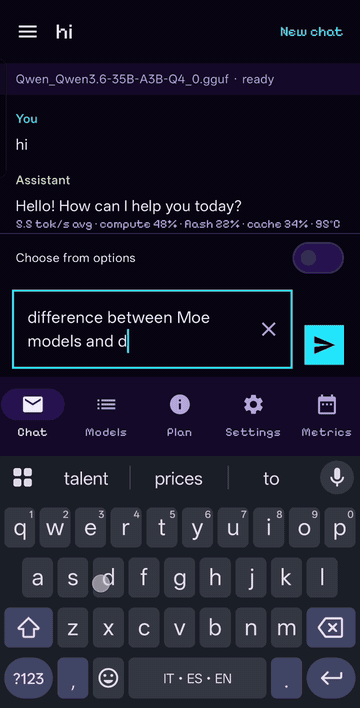
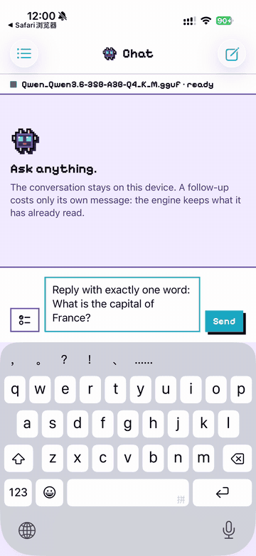
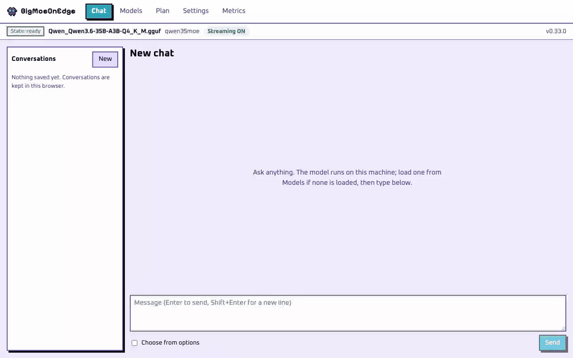
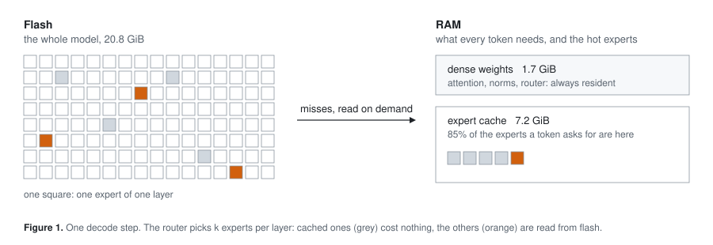
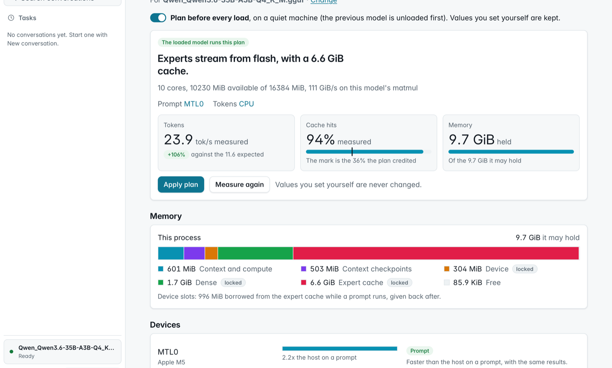

<p align="center">
  <picture>
    <source media="(prefers-color-scheme: dark)" srcset="docs/assets/logo/horizontal-ink.svg">
    
  </picture>
</p>

<p align="center">
  <a href="https://github.com/Helldez/BigMoeOnEdge/releases/latest"></a>
  <a href="https://github.com/Helldez/BigMoeOnEdge/actions/workflows/ci.yml"></a>
  <a href="LICENSE"></a>
</p>

<p align="center"><a href="README.md">English</a> · <a href="README_zh.md">中文</a> · <a href="README_ja.md">日本語</a> · <a href="README_es.md">Español</a> · <a href="README_fr.md">Français</a> · <a href="README_it.md">Italiano</a></p>

Questa è una traduzione; il README in inglese è il riferimento e potrebbe essere più aggiornato.

Esegui modelli Mixture-of-Experts più grandi della memoria del tuo dispositivo. Gli esperti vengono letti
dalla flash quando il modello ne ha bisogno. Android, iOS, macOS, Windows e Linux, costruito su llama.cpp.

<table align="center">
<tr>
<td align="center" width="50%"></td>
<td align="center" width="50%"></td>
</tr>
<tr>
<td align="center">Telefono Android da 12 GB</td>
<td align="center">iPhone da 12 GB</td>
</tr>
<tr>
<td align="center" colspan="2"></td>
</tr>
<tr>
<td align="center" colspan="2">Portatile Apple silicon da 16 GB</td>
</tr>
</table>

Qwen3.6-35B-A3B (21 GB) in tempo reale su ciascun dispositivo. Il modello è più grande della memoria di
ciascun dispositivo.

## Cosa fa

- **Esegue modelli che non entrano in memoria.** Un modello MoE usa pochi esperti per token. Il motore tiene
  in memoria i pesi che servono a ogni token e gli esperti più usati, e legge il resto dalla flash. L'output
  è lo stesso che con l'intero modello in memoria; i test lo verificano.
- **Si configura da solo.** `--auto` misura la macchina e il modello e sceglie la dimensione della cache, i
  thread e quale dispositivo fa cosa. La schermata Plan mostra ogni scelta e il perché.
- **Qualsiasi GGUF MoE.** Tutto ciò che llama.cpp carica, in qualsiasi quantizzazione. Nessun codice per
  modello.
- **Ogni backend.** CPU, Metal, CUDA, HIP, Vulkan, OpenCL e la Hexagon NPU. Su una GPU gli esperti più usati
  restano nella sua memoria.
- **App e un server.** Un'app desktop, app per telefono e un server compatibile OpenAI e Anthropic per gli
  agenti di coding.

## Prestazioni

| Hardware | Memoria | Modello | Su disco | Esperti da | Decodifica tok/s |
|---|---|---|---:|---|---:|
| **Telefono Android** | 12 GB | DeepSeek V4 Flash 284B | 91 GB | flash | 1 |
|  |  | Qwen3.8-Flash-Next 125B | 80 GB | flash | 2-4 |
|  |  | Qwen3.6-35B-A3B | 21 GB | flash | 5 |
| **iPhone** | 12 GB | Qwen3.6-35B-A3B | 21 GB | flash | 3 |
| **Portatile Apple silicon** | 16 GB | Qwen3.8-Flash-Next 125B | 76 GB | flash | 7-9 |
|  |  | Qwen3.6-35B-A3B | 21 GB | flash | 18-24 |
| **Portatile Windows** | 16 GB | Qwen3.6-35B-A3B | 21 GB | flash | 5 |
| **GPU desktop** (NVIDIA) | 16 GB + 32 GB RAM | Qwen3.8-Flash-Next 125B | 66 GB | flash, cache GPU | 19-21 |
| **GPU desktop** (NVIDIA) | 24 GB + 96 GB RAM | Qwen3.8-Flash-Next 125B | 66 GB | RAM, cache GPU | 70 |
|  |  | Qwen3.6-35B-A3B | 21 GB | GPU | 217 |
| **GPU datacenter** (AMD, ROCm) | 192 GB | Qwen3.8-Flash-Next 125B | 66 GB | GPU | 53 |

Tutto con `--auto`. Un intervallo è la variazione tra i run. Metodo e tutti i run:
[docs/benchmarks.md](docs/benchmarks.md). Per aggiungere la tua macchina, esegui
`scripts/bench-report.sh model.gguf` e apri un
[benchmark report](https://github.com/Helldez/BigMoeOnEdge/issues/new?template=benchmark-report.yml).

## Installazione

Dall'[ultima release](https://github.com/Helldez/BigMoeOnEdge/releases/latest):

- **macOS** (Apple silicon): apri il `.dmg` e trascina l'app in Applicazioni. Non è ancora notarizzata;
  il README.txt del dmg descrive l'unico passo per il primo avvio.
- **Windows**: esegui il `-setup.exe`. Senza diritti di amministratore.
- **Linux**: rendi eseguibile l'`.AppImage` e avvialo. La finestra richiede WebKitGTK 4.1;
  `--server` avvia solo il server.
- **Android**: installa `app-dev-release.apk`. Ogni release si installa sopra la precedente.
- **iOS**: compila l'app con Xcode da [examples/ios](examples/ios/README.md). Sperimentale.

Apri l'app e scegli un modello in **Models**. Una scheda NVIDIA o AMD riceve il suo backend dalle
**Settings** ([docs/desktop-app.md](docs/desktop-app.md)).

Solo gli strumenti da riga di comando (`bmoe-cli`, `bmoe-server`):

```bash
curl -fsSL https://github.com/Helldez/BigMoeOnEdge/releases/latest/download/install.sh | sh
```

```powershell
irm https://github.com/Helldez/BigMoeOnEdge/releases/latest/download/install.ps1 | iex
```

## Uso

```bash
bmoe-cli -m model.gguf --auto -p "Explain MoE routing."   # plan and run
bmoe-cli -m model.gguf --plan                              # print the plan
bmoe-server -m model.gguf -c 32768                         # the server and its web UI, port 8765
```

Il server parla l'API OpenAI (`/v1/chat/completions`, `/v1/responses`) e quella Anthropic
(`/v1/messages`), con streaming, chiamate a strumenti e reasoning. Aggiungi `--host 0.0.0.0 --api-key KEY`
per servire altre macchine. Riferimento: [docs/server-api.md](docs/server-api.md).

```python
from openai import OpenAI

client = OpenAI(base_url="http://127.0.0.1:8765/v1", api_key="local")
reply = client.chat.completions.create(model="local", messages=[{"role": "user", "content": "Hello"}])
print(reply.choices[0].message.content)
```

**Gli agenti di coding** richiedono un contesto ampio: alcune volte la dimensione della loro prima richiesta. 32768
basta per opencode, 65536 per Claude Code
([dimensionare il contesto](docs/server-api.md#sizing-the-context-for-a-client)).

```bash
# Claude Code
export ANTHROPIC_BASE_URL=http://127.0.0.1:8765
export ANTHROPIC_API_KEY=local
export ANTHROPIC_MODEL=<model id from /v1/models>
export ANTHROPIC_DEFAULT_HAIKU_MODEL=$ANTHROPIC_MODEL
export CLAUDE_CODE_MAX_CONTEXT_TOKENS=65536
claude
```

```toml
# Codex CLI, ~/.codex/config.toml
model = "<model id from /v1/models>"
model_provider = "bmoe"

[model_providers.bmoe]
name = "bmoe"
base_url = "http://127.0.0.1:8765/v1"
wire_api = "responses"
env_key = "BMOE_API_KEY"
```

Per opencode, aggiungi il server come provider compatibile OpenAI su `http://127.0.0.1:8765/v1`. In
**Connect apps**, l'app scrive le impostazioni per Codex CLI e opencode e mostra quelle per
Claude Code.

**L'agente.** L'app desktop ha un suo agente: lavora in una cartella che scegli, legge e modifica file ed
esegue comandi, e chiede prima di cambiare qualcosa, a meno che tu non lo consenta. Una conversazione può
anche essere gestita da OpenCode, Claude Code, Codex o Pi. Vedi [docs/agent.md](docs/agent.md).

## Come funziona

<p align="center">
  <picture>
    <source media="(prefers-color-scheme: dark)" srcset="docs/assets/diagrams/token-dark.svg">
    
  </picture>
</p>

Tre livelli, ciascuno una cache per quello sottostante:

- **La flash** contiene l'intero modello.
- **La RAM** contiene i pesi che ogni token legge e una cache di esperti.
- **La memoria della GPU**, su una scheda che ne ha una propria, contiene i pesi densi e gli esperti più
  usati.

Un esperto che manca alla scheda viene caricato dalla RAM; uno che manca alla RAM viene letto dalla flash.
Un modello che entra nella scheda gira tutto su di essa. Lo streaming legge soltanto, quindi non usura il
disco.

Il motore usa l'API pubblica di llama.cpp, quindi le sue quantizzazioni, i tokenizer e i chat template
funzionano senza modifiche, e un aggiornamento è un bump del submodule. Quali tensori sono esperti viene
letto dal file ([docs/which-models-stream.md](docs/which-models-stream.md)). Design:
[docs/architecture.md](docs/architecture.md).

## Il planner

<p align="center">
  
</p>

Il planner legge l'header del modello e misura la macchina: memoria, velocità dello storage, ogni CPU, GPU
e NPU. Le sue regole non nominano alcun dispositivo o piattaforma, quindi un telefono e un desktop ricevono
piani diversi dallo stesso codice. I valori che imposti tu vengono mantenuti. Vedi
[docs/hardware-planning.md](docs/hardware-planning.md).

## Piattaforme

| | Android | macOS | Windows | Linux | iOS |
|---|---|---|---|---|---|
| Motore e CLI | arm64 | Apple silicon | x86_64, arm64 | x86_64, aarch64 | arm64 (nell'app) |
| App | app nativa | app desktop | app desktop | app desktop | app nativa, compilata dai sorgenti |
| Acceleratori | Hexagon NPU, Vulkan, OpenCL | Metal | Vulkan, CUDA, OpenCL (arm64), Hexagon NPU (arm64) | Vulkan, CUDA, HIP | Metal |
| Provato su | telefono da 12 GB | portatile da 16 GB | portatile da 16 GB | schede NVIDIA da 12-24 GB e AMD da 192 GB a noleggio | iPhone da 12 GB |

Dettagli: [docs/platforms.md](docs/platforms.md).

## Il confronto

| | **BigMoeOnEdge** | Strata | ds4 | colibri | KTransformers |
|---|:---:|:---:|:---:|:---:|:---:|
| Telefono Android (anche NPU) | ✅ | ❌ | ❌ | ❌ | ❌ |
| iPhone | ✅ | ❌ | ❌ | ❌ | ❌ |
| Mac | ✅ | ✅ | ✅ | ✅ | ❌ |
| Windows / Linux, solo CPU | ✅ | ❌ | ✅ | ✅ | ❌ |
| NVIDIA | ✅ | ✅ | ✅ | ✅ | ✅ |
| AMD (ROCm) | ✅ (anche MI300X) | Radeon RX e Strix Halo | Strix Halo e RDNA | Vulkan | ✅ |
| Qualsiasi modello MoE in GGUF | ✅ | pochi modelli | pochi modelli | formato suo | pochi modelli |
| Si configura da solo | ✅ `--auto` | sceglie il modello per memoria | budget della cache degli esperti | `coli tune` | ❌ |

Dove un modello sta in una GPU da gaming più la RAM, Strata è da due a quattro volte più veloce. Dove viene
letto dalla flash, tutti i motori stanno sotto i dieci token al secondo e a dettare il ritmo è il disco.
Velocità e fonti: [docs/comparison.md](docs/comparison.md).

## Compilare dai sorgenti

```bash
git clone --recursive https://github.com/Helldez/BigMoeOnEdge.git
cd BigMoeOnEdge
cd ui && npm ci && npm run build && cd ..
scripts/build-host.sh
build/bin/bmoe-server --open
```

Test: `cd build && ctest --output-on-failure` (richiede `python3` con `gguf`). Android:
`scripts/build-android.ps1`, poi l'APK in [examples/android](examples/android). Altro:
[CONTRIBUTING.md](CONTRIBUTING.md).

## Documentazione

[docs/](docs/README.md). Inizia da [hardware-planning.md](docs/hardware-planning.md),
[settings.md](docs/settings.md), [server-api.md](docs/server-api.md) e
[limitations.md](docs/limitations.md).

## Lavori precedenti

AirLLM, *LLM in a flash* di Apple, FlexGen, PowerInfer, EdgeMoE e
[flash-moe](https://github.com/danveloper/flash-moe), un motore Metal che legge in streaming un MoE da 397B
da SSD su Apple silicon.

## Licenza

Apache-2.0 ([LICENSE](LICENSE)). I binari e le app includono anche llama.cpp, ggml e altre librerie
sotto MIT, Apache-2.0 e SIL OFL 1.1: [THIRD_PARTY_LICENSES](THIRD_PARTY_LICENSES).
