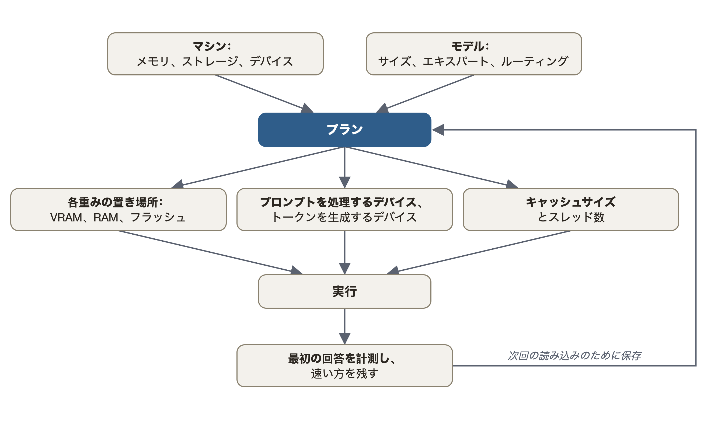

<p align="center">
  <picture>
    <source media="(prefers-color-scheme: dark)" srcset="docs/assets/logo/horizontal-ink.svg">
    
  </picture>
</p>

<p align="center">
  <a href="https://github.com/Helldez/BigMoeOnEdge/releases/latest"></a>
  <a href="https://github.com/Helldez/BigMoeOnEdge/actions/workflows/ci.yml"></a>
  <a href="LICENSE"></a>
</p>
<p align="center"><a href="README.md">English</a> · <a href="README_zh.md">中文</a> · <a href="README_ja.md">日本語</a> · <a href="README_es.md">Español</a> · <a href="README_fr.md">Français</a> · <a href="README_it.md">Italiano</a></p>

> これは翻訳です。英語版 README が正であり、そちらの方が新しい場合があります。

デバイスのメモリより大きな Mixture-of-Experts モデルを実行します。エキスパートは、モデルが必要とするときにフラッシュから読み込まれます。
Android、iOS、macOS、Windows、Linux に対応し、llama.cpp の上に構築されています。

<table align="center">
<tr>
<td align="center" width="50%"></td>
<td align="center" width="50%"></td>
</tr>
<tr>
<td align="center">12 GB Android スマートフォン<br>Qwen3.6-35B-A3B · 5-6 tok/s</td>
<td align="center">12 GB iPhone<br>Qwen3.6-35B-A3B · 6 tok/s</td>
</tr>
<tr>
<td align="center" colspan="2"></td>
</tr>
<tr>
<td align="center" colspan="2">16 GB Apple silicon ノート PC<br>Qwen3.6-35B-A3B · 18-24 tok/s</td>
</tr>
</table>

Qwen3.6-35B-A3B（22 GB）は、いずれのデバイスのメモリよりも大きいモデルです。GGUF 形式の MoE モデルであれば、どの量子化でも動作します。デコード速度は[パフォーマンス](#パフォーマンス)の表の値です。Android スマートフォンとノート PC ではリアルタイムに回答を書き、iPhone ではモデルを読み込んだアプリを示しています。

**2021 年のノート PC、GPU なしでのエージェント**（1:33）：話題のボクセル五重塔プロンプトを、15 GB の RAM を積んだ ThinkPad（CPU のみ）上の内蔵エージェントに、Qwen3.6-35B-A3B Q4_K_M（20.8 GB）で渡しました。2.3 tok/s で 988 行を書き、その後アプリのプレビューでページを表示します。早送りの箇所は画面に表示しています。

<p align="center"></p>

## できること

- **メモリに収まらないモデルを実行します。** MoE モデルは、トークンごとに少数のエキスパートしか使いません。エンジンは、すべてのトークンで必要な重みと、よく使われるエキスパートをメモリに保持し、残りはフラッシュから読み込みます。出力はモデル全体をメモリに置いた場合と同じで、テストでそれを確認しています。
- **自動で設定します。** `--auto` はマシンとモデルを計測し、キャッシュサイズ、スレッド数、どのデバイスが何を処理するかを決めます。Plan 画面には、それぞれの選択とその理由が表示されます。
- **任意の MoE GGUF。** llama.cpp が読み込めるものなら、どの量子化でも使えます。モデルごとのコードはありません。
- **すべてのバックエンド。** CPU、Metal、CUDA、HIP、Vulkan、OpenCL、Hexagon NPU。グラフィックカードでは、よく使われるエキスパートが VRAM に残ります。
- **アプリとサーバー。** デスクトップアプリ、スマートフォンアプリ、そしてコーディングエージェント向けの OpenAI・Anthropic 互換サーバーがあります。
- **画像を読めます。** モデルのプロジェクターファイル（`mmproj`）をモデルの横に置くと、サーバーはすべての API で画像を読み込みます。CLI では `--mmproj` と `--image` を使います。llama.cpp のプロジェクターライブラリが対応するビジョンモデルなら、どの量子化でも、すべてのバックエンドで動きます。

## パフォーマンス

| ハードウェア | メモリ | モデル | ディスク上のサイズ | エキスパートの読み出し元 | デコード tok/s |
|---|---|---|---:|---|---:|
| **Android スマートフォン** | 12 GB | DeepSeek V4 Flash 284B | 91 GB | フラッシュ | 1 |
|  |  | Qwen3.8-Flash-Next 125B | 80 GB | フラッシュ | 2-4 |
|  |  | Qwen3.6-35B-A3B | 21 GB | フラッシュ | 5-6 |
| **iPhone** | 12 GB | Qwen3.6-35B-A3B | 21 GB | フラッシュ | 6 |
| **Apple silicon ノート PC** | 16 GB | Qwen3.8-Flash-Next 125B | 76 GB | フラッシュ | 7-9 |
|  |  | Qwen3.6-35B-A3B | 21 GB | フラッシュ | 18-24 |
| **Windows ノート PC** | 16 GB | Qwen3.6-35B-A3B | 21 GB | フラッシュ | 5 |
| **デスクトップ GPU**（NVIDIA） | 12 GB + 128 GB RAM | Qwen3.8-Flash-Next 125B | 84 GB | RAM、GPU キャッシュ | 16-17 |
| **デスクトップ GPU**（NVIDIA） | 16 GB + 32 GB RAM | Qwen3.8-Flash-Next 125B | 66 GB | フラッシュ、GPU キャッシュ | 19-21 |
| **デスクトップ GPU**（NVIDIA） | 24 GB + 96 GB RAM | Qwen3.8-Flash-Next 125B | 66 GB | RAM、GPU キャッシュ | 70 |
|  |  | Qwen3.6-35B-A3B | 21 GB | GPU | 217 |
| **デスクトップ GPU**（NVIDIA） | 24 GB + 62 GB RAM | Qwen3.6-35B-A3B | 21 GB | GPU | 154 |
|  | うち 12 GB が空き | Qwen3.6-35B-A3B | 21 GB | RAM、GPU キャッシュ | 59-67 |
|  |  | Gemma 4 26B-A4B | 17 GB | GPU | 114 |
|  |  | Laguna XS 2.1 33B | 20 GB | GPU | 93-94 |
| **デスクトップ GPU**（NVIDIA） | 8 GB + 125 GB RAM | Qwen3.6-35B-A3B | 21 GB | RAM、GPU | 32-33 |
| **データセンター GPU**（AMD、ROCm） | 192 GB | Qwen3.8-Flash-Next 125B | 66 GB | GPU | 53 |

範囲は複数回の実行でのばらつきです。計測方法とすべての実行結果：
[docs/benchmarks.md](docs/benchmarks.md)。自分のマシンを追加するには、
`scripts/bench-report.sh model.gguf` を実行して
[ベンチマークレポート](https://github.com/Helldez/BigMoeOnEdge/issues/new?template=benchmark-report.yml)を作成してください。

## インストール

[最新リリース](https://github.com/Helldez/BigMoeOnEdge/releases/latest)から：

- **macOS**（Apple silicon）：`.dmg` を開き、アプリをアプリケーションにドラッグします。まだ公証されていません。
  初回起動に必要な 1 つの手順は dmg 内の README.txt にあります。
- **Windows**：`-setup.exe` を実行します。管理者権限は不要です。
- **Linux**：`.AppImage` に実行権限を付けて実行します。ウィンドウには WebKitGTK 4.1 が必要です。
  `--server` でサーバーのみを実行します。
- **Android**：`app-dev-release.apk` をインストールします。各リリースは前のバージョンの上にインストールされます。
- **iOS**：[examples/ios](examples/ios/README.md) から Xcode でビルドします。実験的な対応です。

アプリを開き、**Models** でモデルを選びます。NVIDIA や AMD のカードは、そのバックエンドを
**Settings** から入手します（[docs/desktop-app.md](docs/desktop-app.md)）。

コマンドラインツール（`bmoe-cli`、`bmoe-server`）のみ：

```bash
curl -fsSL https://github.com/Helldez/BigMoeOnEdge/releases/latest/download/install.sh | sh
```

```powershell
irm https://github.com/Helldez/BigMoeOnEdge/releases/latest/download/install.ps1 | iex
```

## 使い方

```bash
bmoe-cli -m model.gguf --auto -p "Explain MoE routing."   # plan and run
bmoe-cli -m model.gguf --plan                              # print the plan
bmoe-server -m model.gguf -c 32768                         # the server and its web UI, port 8765
```

サーバーは OpenAI API（`/v1/chat/completions`、`/v1/responses`）と Anthropic API（`/v1/messages`）に対応し、
ストリーミング、ツール呼び出し、推論（reasoning）を扱えます。他のマシンに提供するには `--host 0.0.0.0 --api-key KEY`
を追加します。リファレンス：[docs/server-api.md](docs/server-api.md)。

```python
from openai import OpenAI

client = OpenAI(base_url="http://127.0.0.1:8765/v1", api_key="local")
reply = client.chat.completions.create(model="local", messages=[{"role": "user", "content": "Hello"}])
print(reply.choices[0].message.content)
```

**コーディングエージェント**には大きなコンテキストが必要です。目安は最初のリクエストの数倍です。opencode には 32768、
Claude Code には 65536 で足ります
（[コンテキストのサイズ設定](docs/server-api.md#sizing-the-context-for-a-client)）。

```jsonc
// opencode, ~/.config/opencode/opencode.json
{
  "$schema": "https://opencode.ai/config.json",
  "provider": {
    "bmoe": {
      "npm": "@ai-sdk/openai-compatible",
      "options": { "baseURL": "http://127.0.0.1:8765/v1", "apiKey": "local" },
      "models": { "<model id from /v1/models>": { "limit": { "context": 32768, "output": 8192 } } }
    }
  },
  "model": "bmoe/<model id from /v1/models>"
}
```

```bash
# Claude Code
export ANTHROPIC_BASE_URL=http://127.0.0.1:8765
export ANTHROPIC_API_KEY=local
export ANTHROPIC_MODEL=<model id from /v1/models>
export ANTHROPIC_DEFAULT_HAIKU_MODEL=$ANTHROPIC_MODEL
export CLAUDE_CODE_MAX_CONTEXT_TOKENS=65536
claude
```

```toml
# Codex CLI, ~/.codex/config.toml
model = "<model id from /v1/models>"
model_provider = "bmoe"

[model_providers.bmoe]
name = "bmoe"
base_url = "http://127.0.0.1:8765/v1"
wire_api = "responses"
env_key = "BMOE_API_KEY"   # export BMOE_API_KEY=local
```

**Connect apps** では、アプリが opencode と Codex CLI 向けの設定を書き込み、Claude Code 向けの設定を表示します。

**エージェント。** デスクトップアプリには独自のエージェントがあります。選んだフォルダーの中で作業し、ファイルを読んで編集し、
コマンドを実行します。許可しない限り、何かを変更する前に確認を求めます。会話は OpenCode、Claude Code、Codex、Pi で
実行することもできます。[docs/agent.md](docs/agent.md) を参照してください。

## 仕組み

各トークンで、各層のルーターがいくつかのエキスパートを選びます。エンジンはそれを最大 3 つの階層で探します。それぞれが
下の階層のキャッシュです：

- **VRAM**（グラフィックカードの場合）：すべてのトークンが読む重みと、よく使われるエキスパート。
- **RAM**：エキスパートのキャッシュ。グラフィックカードがない場合は、すべてのトークンが読む重みも。
- **フラッシュ**（ドライブ）：モデル全体。

VRAM にないエキスパートは RAM からコピーされ、RAM にないものはフラッシュから読み込まれます。スマートフォンや
Apple silicon の Mac では GPU が CPU と同じ RAM を使うため、階層は 2 つです。カードに収まるモデルは、
すべてカード上で実行されます。ストリーミングは読み込みだけなので、ドライブを消耗させません。

エンジンは llama.cpp の公開 API を使用しているため、その量子化、トークナイザー、チャットテンプレートがそのまま動作し、
アップグレードはサブモジュールの更新だけで済みます。どのテンソルがエキスパートかはファイルから読み取ります
（[docs/which-models-stream.md](docs/which-models-stream.md)）。設計：
[docs/architecture.md](docs/architecture.md)。

## プランナー

<p align="center">
  
</p>

プランナーはモデルのヘッダーを読み、マシンを計測します：メモリ、ストレージ速度、各 CPU・GPU・NPU。そのルールは
特定のデバイスやプラットフォームを名指ししないため、同じコードからスマートフォンとデスクトップに異なるプランが
導かれます。自分で設定した値は維持されます。[docs/hardware-planning.md](docs/hardware-planning.md) を参照してください。

<p align="center">
  
</p>

## プラットフォーム

| | Android | macOS | Windows | Linux | iOS |
|---|---|---|---|---|---|
| エンジンと CLI | arm64 | Apple silicon | x86_64, arm64 | x86_64, aarch64 | arm64（アプリ内） |
| アプリ | ネイティブアプリ | デスクトップアプリ | デスクトップアプリ | デスクトップアプリ | ネイティブアプリ（ソースからビルド） |
| アクセラレーター | Hexagon NPU, Vulkan, OpenCL | Metal | Vulkan, CUDA, OpenCL (arm64), Hexagon NPU (arm64) | Vulkan, CUDA, HIP | Metal |
| テスト環境 | 12 GB スマートフォン | 16 GB ノート PC | 16 GB ノート PC | レンタルした 12-24 GB の NVIDIA カードと 192 GB の AMD カード | 12 GB iPhone |

詳細：[docs/platforms.md](docs/platforms.md)。

## 他のエンジンとの比較

| | **BigMoeOnEdge** | Strata | ds4 | colibri | KTransformers |
|---|:---:|:---:|:---:|:---:|:---:|
| Android スマートフォン（NPU も） | ✅ | ❌ | ❌ | ❌ | ❌ |
| iPhone | ✅ | ❌ | ❌ | ❌ | ❌ |
| Mac | ✅ | ✅ | ✅ | ✅ | ❌ |
| Windows / Linux（CPU のみ） | ✅ | ❌ | Linux（デバッグ用） | ✅ | ❌ |
| NVIDIA | ✅ | ✅ | ✅ | ✅ | ✅ |
| AMD（ROCm） | ✅（MI300X も） | Radeon RX と Strix Halo | Strix Halo と RDNA | Vulkan | ✅ |
| GGUF の任意の MoE モデル | ✅ | 少数のモデル | 少数のモデル | 独自形式 | 少数のモデル |
| 自動設定 | ✅ `--auto` | メモリに応じてモデルを選択 | エキスパートキャッシュの予算 | `coli tune` | ❌ |

速度と出典：[docs/comparison.md](docs/comparison.md)。

## ソースからのビルド

```bash
git clone --recursive https://github.com/Helldez/BigMoeOnEdge.git
cd BigMoeOnEdge
cd ui && npm ci && npm run build && cd ..
scripts/build-host.sh
build/bin/bmoe-server --open
```

llama.cpp のバックエンドは CMake のフラグをそのまま渡すだけです：`scripts/build-host.sh -DGGML_VULKAN=ON`
（または `-DGGML_CUDA=ON`）。テスト：`cd build && ctest --output-on-failure`（`gguf` を入れた `python3` が必要）。Android：
`scripts/build-android.ps1` の後、[examples/android](examples/android) で APK をビルドします。詳しくは：
[CONTRIBUTING.md](CONTRIBUTING.md)。

## ドキュメント

[docs/](docs/README.md)。まずは [hardware-planning.md](docs/hardware-planning.md)、
[settings.md](docs/settings.md)、[server-api.md](docs/server-api.md)、
[limitations.md](docs/limitations.md) から始めてください。

## 先行研究

AirLLM、Apple の *LLM in a flash*、FlexGen、PowerInfer、EdgeMoE、そして
[flash-moe](https://github.com/danveloper/flash-moe)。flash-moe は Apple silicon 上で 397B の MoE を SSD から
ストリーミングする Metal エンジンです。

## ライセンス

Apache-2.0（[LICENSE](LICENSE)）。バイナリとアプリには、MIT、BSD、Apache-2.0、SIL OFL 1.1 の下で提供される llama.cpp、
ggml、その他のライブラリも含まれます：[THIRD_PARTY_LICENSES](THIRD_PARTY_LICENSES)。
