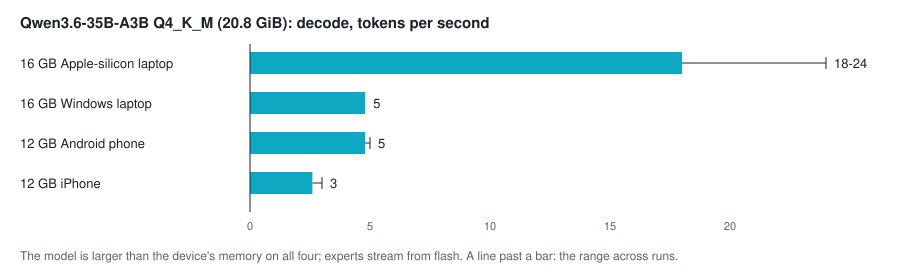
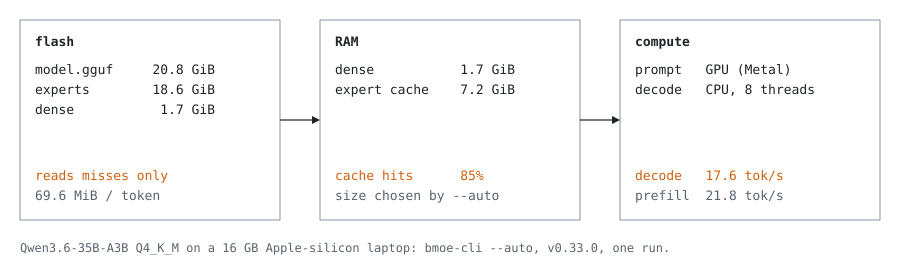

<p align="center">
  <picture>
    <source media="(prefers-color-scheme: dark)" srcset="docs/assets/logo/horizontal-ink.svg">
    
  </picture>
</p>

<p align="center">
  <a href="https://github.com/Helldez/BigMoeOnEdge/releases/latest"></a>
  <a href="https://github.com/Helldez/BigMoeOnEdge/actions/workflows/ci.yml"></a>
  <a href="LICENSE"></a>
</p>
<p align="center"><a href="README.md">English</a> · <a href="README_zh.md">中文</a> · <a href="README_ja.md">日本語</a> · <a href="README_es.md">Español</a> · <a href="README_fr.md">Français</a> · <a href="README_it.md">Italiano</a></p>

> 本文为译文；以英文 README 为准，英文版可能更新。

通过从闪存流式读取专家，运行比设备内存更大的混合专家（Mixture-of-Experts）模型。
基于 llama.cpp 的公开 API 构建；支持 Android、iOS、macOS、Windows 和 Linux；每个平台上都提供本地 OpenAI 兼容服务器。

<table align="center">
<tr>
<td align="center" width="50%"></td>
<td align="center" width="50%"></td>
</tr>
<tr>
<td align="center">12 GB Android 手机</td>
<td align="center">12 GB iPhone</td>
</tr>
<tr>
<td align="center" colspan="2"></td>
</tr>
<tr>
<td align="center" colspan="2">16 GB Apple silicon 笔记本</td>
</tr>
</table>

Qwen3.6-35B-A3B 在各设备上、在发布的应用中实时生成。该模型大于每台设备的内存。

## 简介

混合专家模型在每个 token 上只使用少数几个专家。BigMoeOnEdge 将每个 token 都需要的权重以及最近使用过的专家缓存保留在内存中，其余专家在路由器请求时从闪存读取。输出与将模型完全加载到内存中运行时完全一致；测试会对此进行验证。

- **规划器。** `--auto` 会测量机器（可用内存、存储速度、每个 CPU、GPU 和 NPU）以及模型的文件头，然后设定缓存大小、哪些内容常驻内存，以及由哪个设备处理提示词、哪个设备生成回答。其规则不指定任何平台或设备。手动给出的设置会被保留。
- **模型。** llama.cpp 能加载的任意 MoE gguf，任意量化格式。专家张量从文件中识别，因此新架构无需在此添加代码。
- **后端。** CPU、Metal、Vulkan、OpenCL 和 Hexagon NPU，以模块形式加载；使用各自工具链构建的 CUDA、HIP 和 SYCL 模块也以同样方式加载。
- **应用与服务器。** Android 和 iOS 上的原生应用、桌面端的 Web 应用，以及在所有平台上的 OpenAI 兼容服务器。

## 性能

解码速度，在以下设备上测得。引擎会根据机器自动调整规模，因此更强的硬件运行更快。

<p align="center">
  <picture>
    <source media="(prefers-color-scheme: dark)" srcset="docs/assets/diagrams/speed-dark.svg">
    
  </picture>
</p>

| 模型 | 磁盘占用 | 设备 | 模型 / RAM | 解码 |
|---|---:|---|---:|---:|
| DeepSeek V4 Flash 284B | 91 GB | 12 GB Android 手机 | 7.6× | 0.94 tok/s |
| Qwen3.8-Flash-Next 125B | 80 GB | 12 GB Android 手机 | 6.7× | 2.2-3.5 tok/s |
| gpt-oss-120b | 60 GB | 12 GB Android 手机 | 5× | 1.3 tok/s |
| Qwen3.6-35B-A3B | 21 GB | 12 GB Android 手机 | 1.9× | 4.8-5.0 tok/s |
| Qwen3.6-35B-A3B | 21 GB | 12 GB iPhone | 1.9× | 2.6-3.0 tok/s |
| Qwen3-30B-A3B | 18.5 GB | 12 GB Android 手机 | 1.5× | 5.2 tok/s |
| Gemma-4-26B-A4B | 17 GB | 12 GB Android 手机 | 1.4× | 4.1 tok/s |
| Qwen3.8-Flash-Next 125B | 76 GB | 16 GB Apple silicon 笔记本 | 4.8× | 6.5-9 tok/s |
| Qwen3.6-35B-A3B | 21 GB | 16 GB Apple silicon 笔记本 | 1.3× | 18-24 tok/s |
| Qwen3-Coder-30B-A3B | 18.6 GB | 16 GB Apple silicon 笔记本 | 1.2× | 23 tok/s；在 opencode 中为 7-9 |
| Qwen3.6-35B-A3B | 21 GB | 16 GB Windows 笔记本 | 1.3× | 4.8 tok/s |

配置与方法：[docs/benchmarks.md](docs/benchmarks.md)。如需添加一台机器，请运行
`scripts/bench-report.sh /path/to/model.gguf`，并将表格粘贴到
[基准测试报告](https://github.com/Helldez/BigMoeOnEdge/issues/new?template=benchmark-report.yml)中。

## 快速开始

**Android。** 从[最新版本](https://github.com/Helldez/BigMoeOnEdge/releases/latest)安装 APK，
然后在 **Models** 中选择一个模型。**Settings → Serve on the network** 可通过密钥共享该模型。

**iOS。** 使用 Xcode 从 [examples/ios](examples/ios/README.md) 构建应用。实验性功能。

**桌面端（macOS、Windows、Linux）。** 从同一版本下载 `bmoe-desktop` 压缩包并运行
`bmoe-server --open`；应用将在 `http://127.0.0.1:8765/` 打开。

**命令行。**

```bash
bmoe-cli -m model.gguf --auto -p "Explain MoE routing."   # measure, plan, run
bmoe-cli -m model.gguf --plan                              # print the plan and exit
```

## OpenAI 兼容服务器

```python
from openai import OpenAI

client = OpenAI(base_url="http://127.0.0.1:8765/v1", api_key="local")
reply = client.chat.completions.create(
    model="local",
    messages=[{"role": "user", "content": "Write a haiku about experts on flash."}],
)
print(reply.choices[0].message.content)
```

支持流式输出、工具调用和推理。对于 opencode，将该服务器添加为 OpenAI 兼容的提供方，并将 `baseURL` 设为
`http://127.0.0.1:8765/v1`。如需为其他机器提供服务，请使用 `--host` 和 `--api-key` 启动服务器。
API 参考：[docs/server-api.md](docs/server-api.md)。

## 工作原理

<p align="center">
  <picture>
    <source media="(prefers-color-scheme: dark)" srcset="docs/assets/diagrams/token-dark.svg">
    
  </picture>
</p>

引擎使用 llama.cpp 的公开 API：llama.cpp 支持的所有量化格式、分词器和对话模板都可直接使用，
升级 llama.cpp 只需更新子模块。路由专家按照文件的张量布局读取
（[docs/which-models-stream.md](docs/which-models-stream.md)）。
`ctest` 在缓存、驱逐、重叠、会话和分片模型等场景下，检查流式输出与完全常驻内存时的输出是否一致
（[docs/architecture.md](docs/architecture.md)）。

## 规划器

<p align="center">
  <picture>
    <source media="(prefers-color-scheme: dark)" srcset="docs/assets/diagrams/plan-dark.svg">
    
  </picture>
</p>

规划器从模型文件头读取模型结构，并测量机器。同一套规则会为手机和笔记本给出不同的方案。
Plan 界面展示结果：内存的去向、每个设备承担的工作，以及每项决策的原因。
[docs/hardware-planning.md](docs/hardware-planning.md)。

## 平台

| | Android | macOS | Windows | Linux | iOS |
|---|---|---|---|---|---|
| 引擎与 CLI | arm64 | Apple silicon | x86_64, arm64 | x86_64, aarch64 | arm64（内置于应用中） |
| 应用与服务器 | 原生应用 | Web 应用 | Web 应用 | Web 应用 | 原生应用，从源码构建 |
| 加速器 | Hexagon NPU, Vulkan, OpenCL | Metal | Vulkan, OpenCL (arm64), Hexagon NPU (arm64, opt-in) | Vulkan | Metal |
| 实机运行 | 12 GB 手机 | 16 GB 笔记本 | 16 GB 笔记本 | CI、社区 | 12 GB iPhone（[#235](https://github.com/Helldez/BigMoeOnEdge/issues/235)） |

详细信息以及各项在何处测得：[docs/platforms.md](docs/platforms.md)。

## 从源码构建

```bash
git clone --recursive https://github.com/Helldez/BigMoeOnEdge.git
cd BigMoeOnEdge
cd ui && npm ci && npm run build && cd ..
scripts/build-host.sh
build/bin/bmoe-server --open
```

测试：`cd build && ctest --output-on-failure`（需要安装了 `gguf` 包的 `python3`）。Android：
`scripts/build-android.ps1`，然后在 [`examples/android`](examples/android) 中构建 APK。
[CONTRIBUTING.md](CONTRIBUTING.md)。

## 文档

[docs/](docs/README.md)，按任务索引。建议从 [hardware-planning.md](docs/hardware-planning.md)、
[settings.md](docs/settings.md)、[server-api.md](docs/server-api.md)、
[platforms.md](docs/platforms.md) 和 [limitations.md](docs/limitations.md) 开始。

## 相关工作

AirLLM、Apple 的 *LLM in a flash*、FlexGen、PowerInfer 和 EdgeMoE。最接近的近期工作是
[flash-moe](https://github.com/danveloper/flash-moe)，一个在 Apple silicon 上从 SSD 流式读取 397B MoE 的 Metal 引擎；
BigMoeOnEdge 则跨架构、跨平台使用 llama.cpp 的公开 API。

## 许可证

Apache-2.0。参见 [LICENSE](LICENSE)。二进制文件和应用还包含 llama.cpp 与 ggml、cpp-httplib、
nlohmann/json、Web UI 的 JavaScript 库(MIT、Apache-2.0)以及两种字体(SIL OFL 1.1):它们的许可证见
[THIRD_PARTY_LICENSES](THIRD_PARTY_LICENSES),随每个归档文件和 APK 一同发布。
