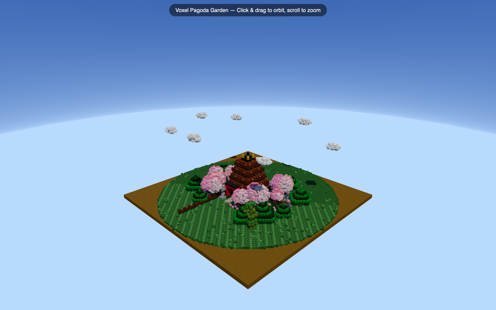
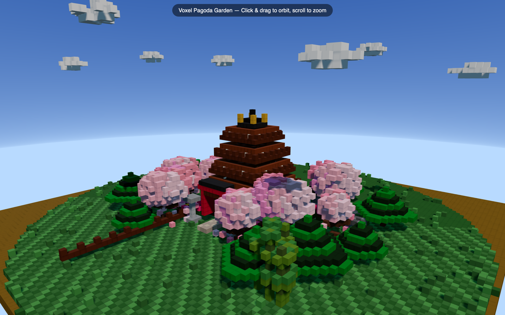

# 2026-11-07 — a coding agent on a 16 GB laptop: one prompt, a 22 GB model streamed

An end-to-end run of the released engine as a contributor runs it: the published 0.40.1 macOS
archive, `bmoe-server` with nothing but a model and a context size, and a coding agent (opencode)
given one prompt and no further input. The task is the one a contributor ran for 24 hours on a
mini-PC in [#462](https://github.com/Helldez/BigMoeOnEdge/issues/462): build a voxel pagoda garden
as a single HTML page. The model is larger than the machine's memory, so its experts stream from
the SSD for the whole session.

This measures the product path (server, plan, an agent's request pattern, KV reuse across turns),
not a decode benchmark: for those, see [../../benchmark-method.md](../../benchmark-method.md).

## Result

| | |
|---|---|
| Wall time, prompt to the agent's last answer | **23 min 46 s** |
| Model answers | 4 (one title, three agent turns) |
| Output | `pagoda-garden.html`, 24.6 KB, one file, Three.js 0.164.1 from a CDN; its script parses |
| Human input after the prompt | none |
| Errors in the server log | none |



The same page with the camera moved closer (only the camera's start position was changed for this
capture; the scene is the model's):



A four-tier dark-wood pagoda with a gold finial, cherry trees, pines, a red torii, a stone lantern,
a fence and voxel clouds. The pond and the arched bridge the model lists are in the scene but sit
behind the pagoda and are mostly hidden by trees; the default camera starts far out, so the scene
reads small on first open. One write, no repair turn: the agent did not open or check its page.

## Machine and software

| | |
|---|---|
| Machine | a 16 GB Apple-silicon laptop, 10 cores, internal SSD |
| Free at start | 10 100 MiB of 16 384 (other apps open as in daily use) |
| Engine | 0.40.1, the `bmoe-cli-v0.40.1-macos-arm64` archive built by the release workflow |
| Model | Qwen3.6-35B-A3B Q4_K_M, 22 GB, one file |
| Agent | opencode 1.19.2, OpenAI-compatible provider at the server's `/v1` |
| Server | `bmoe-server -m <model> -c 65536` and a fresh `--data-dir`; no engine flag |

## What the plan chose

From [`plan.json`](plan.json) (the server's `GET /api/plan`):

| Knob | Value | Why, in the plan's words |
|---|---|---|
| regime | experts stream | the model needs 22.3 GiB, 9.0 GiB is usable |
| expert cache | 5.5 GiB | what the cache earns most with, after the dense weights |
| dense weights | 1.5 GiB, pinned | memory pressure cannot take them |
| prefill | on the GPU (Metal) | 2.1× faster than the CPU, same results |
| decode | CPU | the GPU shares this memory and reads no faster |
| storage | 6.6 GiB/s, 4 parallel O_DIRECT reads | the fastest rate this SSD gave |
| KV cache | q8_0, 680 MiB at 64k | the server's default KV type |
| context checkpoints | 62.8 MiB each, up to 8 | lets a hybrid model reuse its state across turns |
| lossy knobs | off | nothing that changes the output |

The knob trial on the first long answer settled two lossless knobs on this machine: 4 decode threads
decoded 16.6 % faster than 10 (median of 3 rounds) and were kept; overlap stayed on (off measured
7.6 % slower).

## The session, answer by answer

From [`server.log`](server.log):

| # | What | Prompt tokens (prefill) | Answer tokens | Decode | Cache hit | Context |
|---:|---|---:|---:|---:|---:|---:|
| 1 | opencode's title request | 645 (2.8 s) | 1 238 | 12.3 tok/s | 78 % | 1 883 |
| 2 | turn 1: system prompt, tools, task; lists the folder | 10 972 (33.8 s, 325 tok/s) | 248 | 8.2 tok/s | 79 % | 11 220 |
| 3 | turn 2: writes the page | 23 (1.2 s) | 10 400 | 8.6 tok/s | 86 % | 21 643 |
| 4 | turn 3: summary to the user | 21 (1.4 s) | 291 | 8.3 tok/s | 87 % | 21 955 |

- **One long prefill.** After the first agent turn every request re-sent only what was new (21-23
  tokens): the server kept the conversation's state between requests, so a turn started in about a
  second instead of re-reading 11-22 k tokens.
- **Decode held at 8.2-8.6 tok/s** through a 10 400-token answer, with the cache hit rising from 79
  to 87 % as the cache settled on what this task routes to. The misses add up: the session read
  951 517 MiB of experts from the SSD (the `experts ... MiB read` field), 742 GiB of it during the
  long write, about 0.6 GiB/s sustained for twenty minutes.
- The engine was busy for about 23.6 min of the 23.8: the agent adds almost nothing on top.

## Against earlier runs of the same task

| Run | Machine | Model | Wall | Notes |
|---|---|---|---|---|
| [#462](https://github.com/Helldez/BigMoeOnEdge/issues/462) (contributor) | Ryzen mini-PC, 96 GB, NVMe, Radeon iGPU | Qwen3.8-Flash-Next IQ3_XS, 60 GB | ~24 h | compaction after compaction at 6-7 tok/s, expert cache hit ~98 %; ended when the agent tried to look at a screenshot |
| 2026-11-05, pre-release build | this laptop | Qwen3.6-35B-A3B Q4_K_M | 1 h 34 min | 9 turns; two repeated the 12 k-token write after a permission rule in our own agent config denied the first |
| **2026-11-07, 0.40.1** | this laptop | Qwen3.6-35B-A3B Q4_K_M | **23 min 46 s** | 4 answers, one write |

These are not a speed comparison: the agent decides how many turns a task takes, and the earlier
laptop run lost most of its time to a denied write, not to the engine. They show the same task
completing on a 125B model on a mini-PC and on a 35B model on a 16 GB laptop, both from flash.

## Two things a contributor should know

- **Close what holds memory before loading.** A first attempt the same afternoon started with an
  iOS simulator still running from earlier work: 4 330 MiB free instead of 10 100, and the plan
  sized the expert cache at 870 MiB instead of 5.5 GiB: the plan sizes the cache from the memory
  free when the model loads.
- **Give the agent room.** 64k of context left room to spare here (22k used); opencode's first
  request was 11k tokens. See [sizing the context for a client](../../server-api.md#sizing-the-context-for-a-client).

## Reproducing it

```bash
# the release archive, unpacked
./bmoe-server -m Qwen3.6-35B-A3B-Q4_K_M.gguf -c 65536 --port 18770 --data-dir ./bmoe-data &
# in an empty folder holding AGENTS.md and opencode.json from this directory
opencode run "$(cat prompt.txt)"
```

Files here: [`prompt.txt`](prompt.txt) and [`AGENTS.md`](AGENTS.md) are the contributor's, verbatim
apart from the folder path; [`opencode.json`](opencode.json) is the run's provider and permission
config (file edits allowed, a short list of read-only shell commands, no web); the agent's output is
[`pagoda-garden.html`](pagoda-garden.html) as written, and [`opencode.log`](opencode.log) its
transcript. The screenshots were taken from an offscreen WebKit view of the page.
