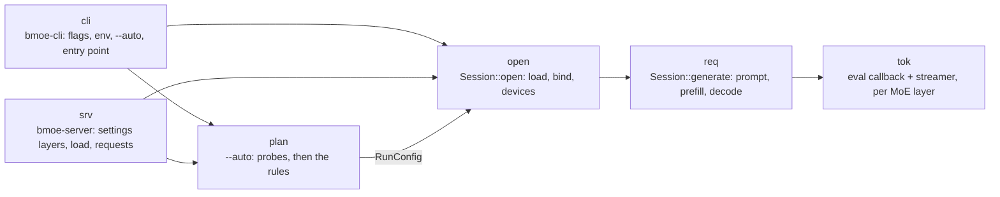
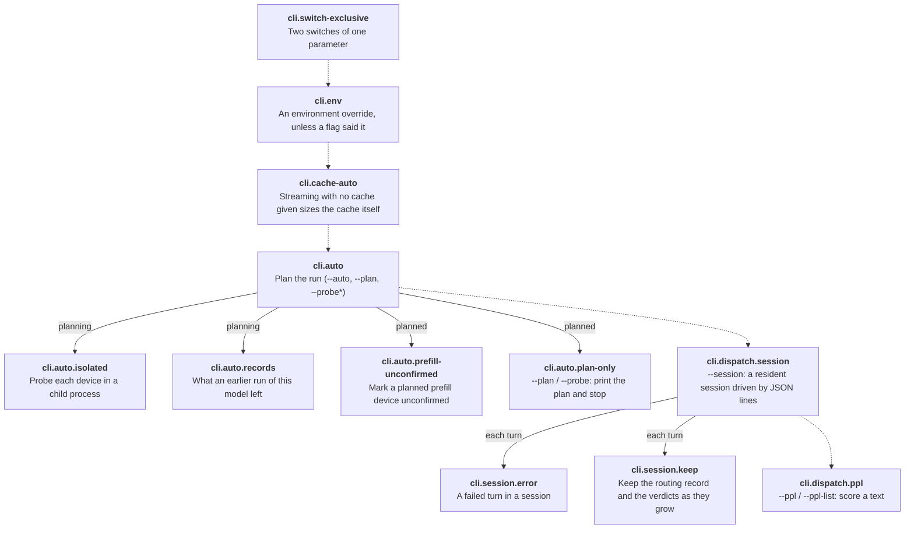
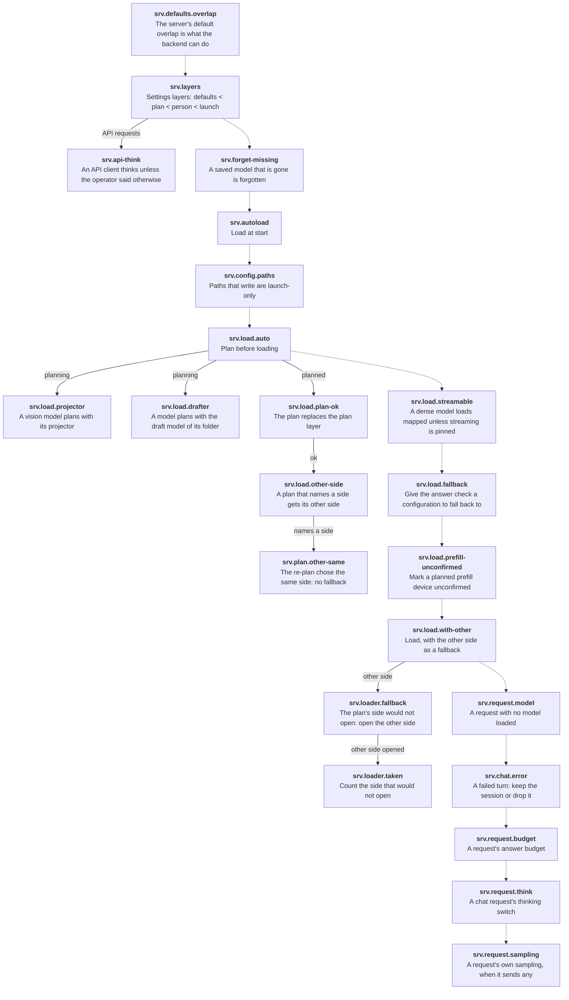
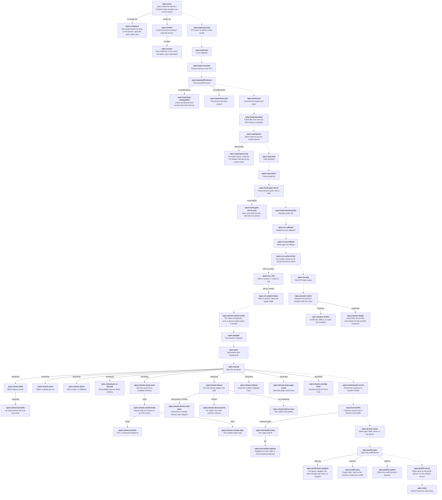
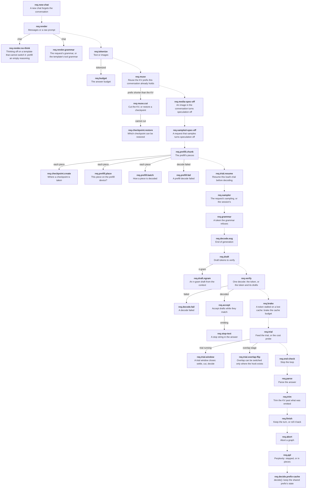
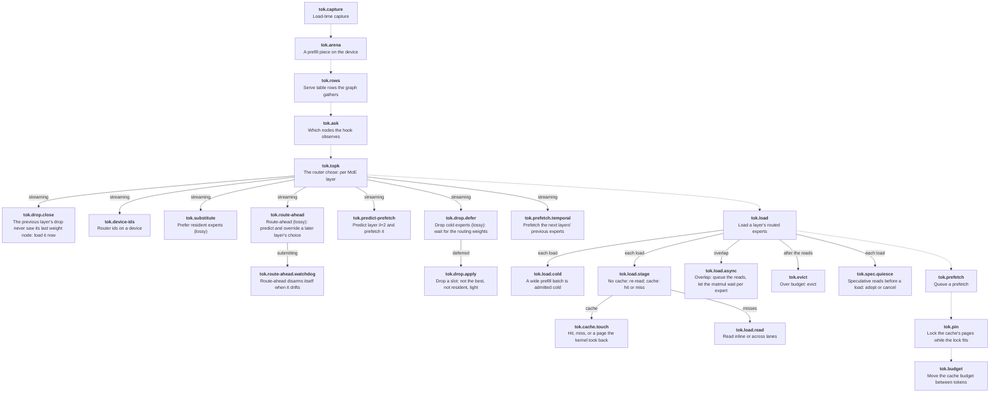

# Decision tree

Every choice the engine makes, from the command line to one MoE layer of one token, as a tree
held to the code. Each node is one branch in the source: its condition is copied from the code,
and a `// dt:<id>` marker sits on the line above it. `scripts/decision-tree.py check` (run in CI)
fails when a node and the code drift apart, so this page cannot describe a branch the code no
longer has.

Use it on every issue and every PR: name the nodes the change touches, and show them.
`scripts/decision-tree.py touched` does that from the diff.

## Reading it

- Six phases, in the order a run meets them. The phases are `cli` (the `bmoe-cli` front-end),
  `srv` (the `bmoe-server` front-end), `plan` (the `--auto` planner), `open` (loading a model),
  `req` (one request) and `tok` (one token, one MoE layer, inside the eval callback and the
  streamer).
- A node: `#### \`id\` — title`, then
  - `parent`, the node it hangs from;
  - `when`, the parent's branch that leads here (the label on the graph's edge);
  - `code`, the file holding its marker, and the function;
  - `condition`, what the code tests, copied verbatim (one line per expression when a node
    names more than one, all within a few lines of the marker);
  - then what each outcome does, and what drives it.
- The graphs are generated from the nodes (`scripts/decision-tree.py render`); never edit them
  by hand.
- `scripts/decision-tree.py tree [id]` prints the tree, or one subtree, as text.

## What is a node

A node is a branch that changes **what runs or what is chosen**: a path taken, a value picked,
a fallback, a mode. Two kinds of branch are not nodes:

- **Checks that only refuse input.** Their only effect is an error message.
  `validate()` (`core/src/config.cpp`) is one node, `cfg.validate`, and so is each request
  parser. The list of refused combinations is in the code and in [settings.md](settings.md).
- **Branches that only log, trace or format output.** Metrics rows, `--plan-explain` text,
  notes in a plan's decisions. Those are covered by [telemetry.md](telemetry.md).

A range guard on its own (`il < 0 || il >= n_layer_`) is not a node either. When a guard sits
at the top of a function that is a node, it is part of that node's outcomes.

## Keeping it true

The tree is part of the code, under the same rule as the docs (AGENTS.md, hard rule 6):

1. **A change that adds, removes or alters a branch updates its node in the same PR.** That
   means the node's text, its `condition` line and its marker. A new branch gets a new node and
   a marker. A removed branch loses both.
2. **A marker moves with its branch.** It always sits on the line directly above the condition
   it names: on a refactor, carry it along.
3. **Run `python3 scripts/decision-tree.py check`** before pushing. It fails when:
   - a node has no marker;
   - a marker has no node;
   - a marker is not in the file the node names;
   - a node's condition is not within 14 lines below its marker;
   - the graphs are stale (run `render`).

   CI runs it on every PR.
4. **Put the touched nodes in the PR.**
   - Run `python3 scripts/decision-tree.py touched origin/main --mermaid`.
   - Paste its output under "Decision tree" in the PR template: the nodes, their path from the
     root, and the graph with them marked.
   - Code it reports "outside every node" is a branch the tree does not have yet, or code that
     decides nothing. Say which in the PR.
5. **IDs are stable.** Rename a node only when its meaning changes, since issues and PRs quote
   the IDs. A node that moves to another file keeps its ID; its `code` line changes.

## The phases

`cfg.validate` is the gate between a front-end and `open`. Both front-ends call it:
`run()` and `EngineHost::load` validate, but `Session::open` itself does not.

#### `cfg.validate` — Refuse a configuration that does not combine
- parent: —
- code: `core/src/config.cpp` · `validate`
- condition: `if (cfg.fallback) {`
- Every check in `validate()` is an early `return fail(...)`: the run does not start, and nothing
  else changes. Several `open` branches are safe only because of these refusals. For instance:
  - the answer check (`open.answer-check`) needs `n_gpu_layers > 0` with streaming off, and no
    host buffer or prefill device (a device cache is checked once armed, `open.answer-check-cache`);
  - `expert_host_buffer` needs a device cache with streaming off;
  - a prefill device needs `n_gpu_layers == 0` and no row streaming.

#### `cfg.graph-width` — The graph width a configuration asks for
- parent: —
- code: `core/include/bmoe/config.h` · `graph_width`
- condition: `int w = n_ubatch > 0 ? n_ubatch : ubatch_auto_max;`
- condition: `if (n_ubatch <= 0 && w < graph_width_floor()) w = graph_width_floor();`
- An `n_ubatch` that was set is the width. Unset, the width is `ubatch_auto_max` (8192).
- An image model's floor is `graph_width_floor()`: `image_max_tokens`, capped at `n_ctx`. It raises
  the default but never a width the caller set.
- The result is capped at `n_ctx`. `session_config_from` (`core/src/engine/runtime.cpp`) makes it
  the session's `n_ubatch`, and makes `n_batch = n_ctx`.

#### `cfg.wide-matmuls` — May llama.cpp move a wide host matmul to a device?
- parent: —
- code: `core/src/config.cpp` · `offloads_wide_matmuls`
- condition: `if (prefill_device) return false;`
- condition: `if (moe.enabled && moe.overlap && n_gpu_layers != 0) return false;`
- condition: `if (moe.enabled && n_gpu_layers == 0) return false;`
- false → the context is created with `op_offload = false` (`open.ctx.op-offload`). This happens with
  a prefill device of ours, with overlap streaming next to device layers, or with streaming on
  the CPU alone.
- true → llama.cpp's own op offload stays on. The planner reads this rule too
  (`plan.overlap.prompts`).

## cli — bmoe-cli

`cli/main.cpp`, `main`. The flags are parsed first: a typed table parameter becomes a pin.
Front-end flags (`--auto`, `--plan`, `--probe*`, `--session`, `--ppl*`, traces) only set locals.

<!-- dt:graph cli -->

<!-- /dt:graph -->

#### `cli.switch-exclusive` — Two switches of one parameter
- parent: —
- code: `cli/main.cpp` · `main`
- condition: `if (r.via_switch && r.param->exclusive_switches) {`
- The `spec` parameter only, through `--mtp` and `--ngram`. Giving both is an error (exit 2), not a
  precedence. `bmoe-server` has no such check: the last switch wins there.

#### `cli.env` — An environment override, unless a flag said it
- parent: —
- code: `cli/main.cpp` · `main`
- condition: `if (seen.count(e.key) || !v || !*v) continue;`
- The variables are the `kEnvOverrides` table: `BMOE_CACHE_MB`, `BMOE_IO_THREADS`, `BMOE_OVERLAP`,
  `BMOE_PREFETCH`, `BMOE_N_EXPERT_USED`, `BMOE_PREDICT_LOG`, `BMOE_PREDICT_PREFETCH` and
  `BMOE_PROGRESS`.
- A typed flag wins, and an unset or empty variable is skipped.
- Otherwise the value is set through the parameter's own row. A boolean is read as "any non-zero
  integer is on". A value that does not parse is a warning, and the default stays.
- This is the only `getenv` of engine settings in the project (AGENTS.md, hard rule 3).

#### `cli.cache-auto` — Streaming with no cache given sizes the cache itself
- parent: —
- code: `cli/main.cpp` · `main`
- condition: `if (cfg.moe.enabled && !cfg.moe.cache_auto && !seen.count("cache-mb") && std::getenv("BMOE_CACHE_MB") == nullptr)`
- yes → `cache_auto = true`. The streamer sizes its cache at load (`open.stream.cache-auto`).
- no → the cache the caller gave, an explicit 0 included.
- A set-but-empty `BMOE_CACHE_MB` is skipped by `cli.env` but still blocks this default. Streaming
  then runs with no cache.

#### `cli.auto` — Plan the run (`--auto`, `--plan`, `--probe*`)
- parent: —
- code: `cli/main.cpp` · `main`
- condition: `if (auto_plan && !cfg.model_path.empty()) {`
- yes → the plan's pins are every typed key, plus every env variable that is set (even one that did
  not parse). The run then goes through `probe_and_plan` (`plan.*`), and `cfg = plan.config`
  replaces the whole configuration.
- no → the flags as given. `--auto` without `-m` plans nothing, silently.

#### `cli.auto.isolated` — Probe each device in a child process
- parent: `cli.auto`
- when: planning
- code: `cli/main.cpp` · `main`
- condition: `if (isolated_probes) {`
- yes (default) → a device is probed by `bmoe-cli -m <model> --probe-device <dev>`, so a driver
  crash costs the child, not the run.
- no (`--no-isolated-probes`) → probed in this process.

#### `cli.auto.records` — What an earlier run of this model left
- parent: `cli.auto`
- when: planning
- code: `cli/main.cpp` · `main`
- condition: `if (routing.load(kept)) opt.routing = &kept;`
- condition: `if (routing.load_knobs(knobs_kept)) opt.knobs = &knobs_kept;`
- Each record is kept per model fingerprint, in `<data>/routing` (or `--routing-dir`). When it
  loads:
  - the routing record gives the cache its measured hit curve (`plan.facts.routing`);
  - the knob verdicts (`plan.facts.knobs`) come with it.
- `measure_knobs` is on whenever a place to keep the records exists.

#### `cli.auto.prefill-unconfirmed` — Mark a planned prefill device unconfirmed
- parent: `cli.auto`
- when: planned
- code: `cli/main.cpp` · `main`
- condition: `if (!plan_only && !cfg.prefill.device.empty()) {`
- yes → this model's knob record says "armed, unconfirmed" before the session opens.
  `open.prefill-record` replaces the word. A run that dies first leaves it, and after two of those
  the planner stops arming the device (`plan.prefill.survey`).

#### `cli.auto.plan-only` — `--plan` / `--probe`: print the plan and stop
- parent: `cli.auto`
- when: planned
- code: `cli/main.cpp` · `main`
- condition: `if (plan_only) return 0;`

#### `cli.dispatch.session` — `--session`: a resident session driven by JSON lines
- parent: —
- code: `cli/main.cpp` · `main`
- condition: `if (session_mode)`
- yes → `run_session_loop`: one `Session::open`, then one `generate`, `decide` or `cancel` per
  stdin line. This beats `--ppl` and `-p`.

#### `cli.session.error` — A failed turn in a session
- parent: `cli.dispatch.session`
- when: each turn
- code: `cli/main.cpp` · `run_session_loop`
- condition: `if (!recoverable) {`
- `recoverable` comes from `run_error_recoverable(kind)`.
- A recoverable failure (a bad request, a full context) → the session goes on.
- Any other failure → the loop ends with exit code 1.

#### `cli.session.keep` — Keep the routing record and the verdicts as they grow
- parent: `cli.dispatch.session`
- when: each turn
- code: `cli/main.cpp` · `run_session_loop`
- condition: `if (routing.kept()) {`
- The routing record is written whenever it grew, and the knob record whenever it gained a
  verdict. Either way, a session ended any way at all has kept what it measured.

#### `cli.dispatch.ppl` — `--ppl` / `--ppl-list`: score a text
- parent: —
- code: `cli/main.cpp` · `main`
- condition: `if (!ppl_path.empty() || !ppl_list.empty()) {`
- yes → opens one session and runs `Session::perplexity` per file (`req.ppl`).
- no → a one-shot generation: `run(cfg, outs)`, which validates, opens and generates. The routing
  record and the knob verdicts are then kept.

## srv — bmoe-server

`server/`. A configuration is built in layers, the later layer winning:

1. `server_defaults()`;
2. the plan;
3. the person's settings (`settings.json`);
4. the launch flags.

A model is loaded by `load_current_locked`. A request then runs on the session that is open.

<!-- dt:graph srv -->

<!-- /dt:graph -->

#### `srv.defaults.overlap` — The server's default overlap is what the backend can do
- parent: —
- code: `server/http_server.cpp` · `server_defaults`
- condition: `c.moe.overlap = expert_ready_hook_available();`
- The server's own defaults also differ from the library's in four ways:
  - `chatml`, streaming and `decide` are on;
  - `cache_auto` is always on (the CLI sets it only when streaming is on, `cli.cache-auto`);
  - `n_ctx = ctx_for_clients`;
  - `n_predict` is the chat answer budget.
- Overlap is on only where the loaded CPU backend exposes the fork's expert-ready hook.

#### `srv.layers` — Settings layers: defaults < plan < person < launch
- parent: —
- code: `server/settings_store.cpp` · `SettingsStore::build_locked`
- condition: `if (!plan_in_force_locked(c)) return c;`
- condition: `for (const auto * layer : {&plan_, &user_, &launch_})`
- The plan layer counts only while the other layers name the model it was made for (#718).
- Each layer sets its keys through the parameter table. A value that fails to set is dropped
  silently.
- `planning_config` builds without the plan layer, which is what the planner is given. The keys of
  the person and launch layers are the planner's pins (`operator_keys`).

#### `srv.api-think` — An API client thinks unless the operator said otherwise
- parent: `srv.layers`
- when: API requests
- code: `server/settings_store.cpp` · `SettingsStore::api_config`
- condition: `if (!launch_.count("think") && !user_.count("think")) c.think = true;`

#### `srv.forget-missing` — A saved model that is gone is forgotten
- parent: —
- code: `server/settings_store.cpp` · `SettingsStore::forget_missing_model`
- condition: `if (it == user_.end() || it->second.empty() || exists(it->second)) return false;`
- A model given at launch is never forgotten. A saved one whose file no longer exists is erased
  from the settings. An unreadable path counts as existing.

#### `srv.autoload` — Load at start
- parent: —
- code: `server/http_server.cpp` · `run`
- condition: `if (o.launch.count("model") || o.autoload) {`
- yes → `load_current()` at start. A failure only logs.
- no → the server waits for `POST /api/session/load`, or for a request (`srv.request.model`).

#### `srv.config.paths` — Paths that write are launch-only
- parent: —
- code: `server/http_server.cpp` · `register_routes` (`PUT /api/config`)
- condition: `if (d && d->type == ParamType::Path && it.key() != "model")`
- `PUT /api/config` refuses a path parameter other than the model (a trace file, a records folder).
  The model must lie under the model roots, unless the request comes from loopback.
- Accepted values go to the person's layer. They neither load nor re-plan.

#### `srv.load.auto` — Plan before loading
- parent: —
- code: `server/http_server.cpp` · `load_current_locked`
- condition: `if (auto_plan()) {`
- `auto_plan()` is on unless it was turned off, from the UI or with `--no-auto`.
- yes → the current model is unloaded first, so the probes measure a quiet machine. Then
  `measure_plan` plans on `planning_config()`, with the operator's keys pinned and
  `measure_knobs` on (`plan.*`).
- no → no plan, but the plan layer an earlier load or `/api/plan/apply` left is NOT cleared. It
  keeps shaping the configuration.

#### `srv.load.projector` — A vision model plans with its projector
- parent: `srv.load.auto`
- when: planning
- code: `server/http_server.cpp` · `measure_plan`
- condition: `if (cfg.mmproj.empty()) cfg.mmproj = lib.projector_for(cfg.model_path);`
- The projector is the companion `.gguf` in the same folder.

#### `srv.load.drafter` — A model plans with the draft model of its folder
- parent: `srv.load.auto`
- when: planning
- code: `server/http_server.cpp` · `measure_plan`
- condition: `if (!cfg.spec.enabled() && cfg.spec.drafter_file.empty()) cfg.spec.drafter_file = lib.drafter_for(cfg.model_path);`
- Where no draft is named, the draft model whose header reads another model's layers and names this
  model as its base (`drafter_for`) is paired. The plan weighs it (`plan.facts.drafter`, `plan.spec`)
  and names it in the run only where it arms it.

#### `srv.load.plan-ok` — The plan replaces the plan layer
- parent: `srv.load.auto`
- when: planned
- code: `server/http_server.cpp` · `load_current_locked`
- condition: `if (p.ok) {`
- ok → `store.apply_plan(p.values, ...)`, and the plan becomes `load_plan`.
- failed → nothing replaces the layer, and the previous plan layer (possibly another model's) keeps
  applying.

#### `srv.load.other-side` — A plan that names a side gets its other side
- parent: `srv.load.plan-ok`
- when: ok
- code: `server/http_server.cpp` · `load_current_locked`
- condition: `if (p.names_side()) {`
- `names_side` is true when the plan times one side against another: a device tier, a width side,
  or a shared device side. Then `plan_other_side` re-plans on the same facts with the named side
  counted as lost.
- An `other` that differs is passed to the host as the fallback (`srv.loader.fallback`).

#### `srv.plan.other-same` — The re-plan chose the same side: no fallback
- parent: `srv.load.other-side`
- when: names a side
- code: `server/planner_adapter.cpp` · `plan_other_side`
- condition: `if (now.device_tier == named.device_tier && now.width_side == named.width_side &&`
- The four sides compared: the device tier, the width, the shared-memory device, the draft head.

#### `srv.load.streamable` — A dense model loads mapped unless streaming is pinned
- parent: —
- code: `server/http_server.cpp` · `effective_config`
- condition: `if (effective.moe.enabled && !pinned && !facts.arch.empty() && !facts.streamable) effective.moe.enabled = false;`
- condition: `if (!effective.moe.enabled) drop_streaming_only(effective);`
- A file whose header reads as not-MoE turns streaming off. Then `drop_streaming_only` clears:
  overlap, two-wave, the predictors, route-ahead, row streaming and the overlap trial.
- A file that cannot be read (empty arch) keeps streaming on, and the engine decides.

#### `srv.load.fallback` — Give the answer check a configuration to fall back to
- parent: —
- code: `server/http_server.cpp` · `load_current_locked`
- condition: `if (load_plan.ok && load_plan.has_fallback && !effective.trial.answer_device.empty())`
- yes → `effective.fallback` is the plan's other half (`plan.held-whole`). `open.entry` opens it
  when the device's answers are not confirmed.

#### `srv.load.prefill-unconfirmed` — Mark a planned prefill device unconfirmed
- parent: —
- code: `server/http_server.cpp` · `mark_prefill_unconfirmed`
- condition: `if (c.prefill.device.empty()) return;`
- The same rule as `cli.auto.prefill-unconfirmed`. It applies only where this model's plan names
  the machine.

#### `srv.load.with-other` — Load, with the other side as a fallback
- parent: —
- code: `server/http_server.cpp` · `load_current_locked`
- condition: `if (!other.ok) return host.load(effective, requested);`
- no other side → a plain load.
- other side → `host.load(..., fallback_for(named, other))`.

#### `srv.loader.fallback` — The plan's side would not open: open the other side
- parent: `srv.load.with-other`
- when: other side
- code: `server/engine_host.cpp` · `EngineHost::start_loader`
- condition: `if (!s && fallback && !load_cancelled_.load()) {`
- The other side opens on the engine thread. When it opens, `taken` runs (`srv.loader.taken`).
- When both fail, the first error is the one reported.

#### `srv.loader.taken` — Count the side that would not open
- parent: `srv.loader.fallback`
- when: other side opened
- code: `server/http_server.cpp` · `fallback_for`
- condition: `if (named.names_side() && !model.empty() && !named.hardware.empty()) {`
- The failure goes on the model's knob record for this machine (`*_unviable`). From
  `MeasuredKnobs::unviable_max` (2) failures on, the side loses in every plan
  (`plan.tier.measured`, `plan.width.loads`, `plan.shared.sides`, `plan.spec.sides`). The other plan becomes the
  plan layer.

#### `srv.request.model` — A request with no model loaded
- parent: —
- code: `server/http_server.cpp` · `model_for_request`
- condition: `if (host.model_coming()) return "";`
- condition: `if (!opt.autoload) return "no model is loaded: load one from the Models page";`
- A model that is loaded, loading or planning → the request waits its turn.
- With `--autoload` → the selected model is loaded now.
- Otherwise → refused.

#### `srv.chat.error` — A failed turn: keep the session or drop it
- parent: —
- code: `server/engine_host.cpp` · `EngineHost::chat`
- condition: `if (run_error_recoverable(r.error_kind)) {`
- recoverable → 400 (500 for output that broke the grammar), and the session stays.
- not recoverable → 500, the session is dropped and the host goes to Error. A failed decode leaves
  the context in an unknown state.

#### `srv.request.budget` — A request's answer budget
- parent: —
- code: `server/openai_chat.cpp` · `read_token_budget`
- condition: `if (n == 0) return true;`
- condition: `const unsigned long long top = (unsigned long long) (budget && budget->bounded ? budget->max : cfg.n_predict);`
- Missing, null or 0 → the configured `n_predict`.
- Otherwise → the request's number, capped at the `n-predict` row's bound (`tokens_max`). The
  request may ask for more than the configured budget.

#### `srv.request.think` — A chat request's thinking switch
- parent: —
- code: `server/openai_chat.cpp` · `parse_chat_request`
- condition: `if (body.contains("think") && body["think"].is_boolean()) {`
- The first of these that is given wins:
  1. `think`;
  2. `chat_template_kwargs.enable_thinking`;
  3. `reasoning_effort != "none"`.
- Otherwise → `api_config().think` (`srv.api-think`). The Anthropic dialect reads `thinking.type`;
  the Responses dialect reads `reasoning.effort`.

#### `srv.request.sampling` — A request's own sampling, when it sends any
- parent: —
- code: `server/request_sampling.cpp` · `parse_request_sampling`
- condition: `if (any) turn.sampling = r;`
- Only a request that sends a sampling field gets an override. The session applies it in
  `req.sampler`; one that moves the choice turns the draft off for its conversation
  (`req.sampled-spec-off`).

## plan — the hardware planner (`--auto`)

`core/src/plan/`. `probe_and_plan` first measures the facts:

1. devices;
2. model;
3. compute;
4. storage;
5. memory;
6. placement.

It then runs the rules: `plan_on_facts` = `give_way(plan_layout(...))`. `plan_layout` calls
`plan_run`, which calls `plan_from`, which calls `plan_once`, whose stages run in the order of the
nodes below. One plan can run `plan_once` several times: a narrower width, a shorter context, the
model held whole, the dense layers sent home, a prior hit curve.

A pinned key (a flag, a setting, an env variable) is never changed by a rule. Each rule's first
check is its own pin.

```mermaid
flowchart TD
    plan_facts_isolated["<b>plan.facts.isolated</b><br/>Devices probed out of process"]
    plan_facts_routing["<b>plan.facts.routing</b><br/>The model's own hit curve, when a routing record fits"]
    plan_facts_knobs["<b>plan.facts.knobs</b><br/>Verdicts measured on this machine, this engine version"]
    plan_facts_drafter["<b>plan.facts.drafter</b><br/>A draft model named without --drafter is a paired one"]
    plan_facts_gate["<b>plan.facts.gate</b><br/>Time the gate GEMV (route-ahead only)"]
    plan_facts_storage["<b>plan.facts.storage</b><br/>Measure the storage"]
    plan_facts_backends["<b>plan.facts.backends</b><br/>Which backend of a card the fitter sees"]
    plan_layout_narrow["<b>plan.layout.narrow</b><br/>Re-place at the narrower width the plan chose"]
    plan_layout_whole["<b>plan.layout.whole</b><br/>Narrow the graph until the whole model fits the device"]
    plan_give_way["<b>plan.give-way</b><br/>Shrink checkpoints, then context, until the cache holds one token cycle"]
    plan_give_way_checkpoints["<b>plan.give-way.checkpoints</b><br/>Halve the context checkpoints"]
    plan_give_way_ctx["<b>plan.give-way.ctx</b><br/>Halve the context"]
    plan_prior_curve["<b>plan.prior-curve</b><br/>No measured curve: price the cache on the prior"]
    plan_backends["<b>plan.backends</b><br/>One backend per card"]
    plan_held_whole["<b>plan.held-whole</b><br/>Shared memory: hold the whole model on the device, streaming as the fallback"]
    plan_shared_cache["<b>plan.shared-cache</b><br/>Shared memory: a streamed model's experts computed on the device, from a cache filled in place [EXPERIMENTAL]"]
    plan_host_call["<b>plan.host-call</b><br/>A device expert cache's lookup inside the device's graph, decided across loads [EXPERIMENTAL]"]
    plan_unplannable["<b>plan.unplannable</b><br/>Nothing to plan: unknown model, dense model, unknown memory"]
    plan_tier["<b>plan.tier</b><br/>Device memory as a tier of the expert cache"]
    plan_tier_rates["<b>plan.tier.rates</b><br/>The device must read experts faster than the host"]
    plan_tier_measured["<b>plan.tier.measured</b><br/>Cache on the device or not: priced, then measured"]
    plan_tier_arm["<b>plan.tier.arm</b><br/>Arm the device cache"]
    plan_width["<b>plan.width</b><br/>The graph width (n_ubatch)"]
    plan_width_bound["<b>plan.width.bound</b><br/>The device bound or the full width: weigh across loads"]
    plan_width_loads["<b>plan.width.loads</b><br/>Narrow (layers on the device) or wide (prompts faster)"]
    plan_regime["<b>plan.regime</b><br/>Does the model fit, stream its experts, or not even hold its dense part?"]
    plan_placement["<b>plan.placement</b><br/>Apply the fitter's placement"]
    plan_layers_home["<b>plan.layers-home</b><br/>Price bringing the split layers home to the host"]
    plan_staging["<b>plan.staging</b><br/>Copy the experts into the device's host buffer"]
    plan_resident["<b>plan.resident</b><br/>The model is held resident: no streaming"]
    plan_shared["<b>plan.shared</b><br/>A shared-memory device computes the whole resident model"]
    plan_shared_sides["<b>plan.shared.sides</b><br/>Device or cores: lost, unmeasured, priced"]
    plan_dense["<b>plan.dense</b><br/>How the dense weights are held"]
    plan_decode_cost["<b>plan.decode-cost</b><br/>Calibrate the price on what an earlier load measured"]
    plan_prefill["<b>plan.prefill</b><br/>A prefill device (prompts on a device, answers on the cores)"]
    plan_prefill_survey["<b>plan.prefill.survey</b><br/>Which device, if any, prefills faster"]
    plan_prefill_fit["<b>plan.prefill.fit</b><br/>Fit the prefill device's slots"]
    plan_layers_home_funded["<b>plan.layers-home.funded</b><br/>The ledger funds the layers' move: re-plan on it"]
    plan_ledger["<b>plan.ledger</b><br/>Spend the memory: the allocator"]
    plan_dense_settle["<b>plan.dense.settle</b><br/>Keep the dense pin only if the ledger could pin it"]
    plan_tables["<b>plan.tables</b><br/>Leave the embedding tables mapped"]
    plan_cache_lock["<b>plan.cache-lock</b><br/>Lock the cache only if the ledger could lock it"]
    plan_cache["<b>plan.cache</b><br/>Stream, and with what cache"]
    plan_io_lanes["<b>plan.io-lanes</b><br/>Read lanes"]
    plan_direct_io["<b>plan.direct-io</b><br/>Direct I/O"]
    plan_release_mmap["<b>plan.release-mmap</b><br/>Hand the model's mapping back"]
    plan_lossy["<b>plan.lossy</b><br/>Lossy knobs stay off"]
    plan_gate_mirror["<b>plan.gate-mirror</b><br/>Route-ahead's gate: int8 or float, as timed"]
    plan_devices["<b>plan.devices</b><br/>Leave out failed devices; no device in use → CPU only"]
    plan_overlap["<b>plan.overlap</b><br/>Overlap I/O with compute"]
    plan_overlap_prompts["<b>plan.overlap.prompts</b><br/>Overlap would keep prompts off the device"]
    plan_threads["<b>plan.threads</b><br/>Threads"]
    plan_threads_trial["<b>plan.threads.trial</b><br/>Time other thread counts on this load"]
    plan_spec["<b>plan.spec</b><br/>A model drafts where a verify's reads stay in memory"]
    plan_spec_sides["<b>plan.spec.sides</b><br/>Which draft, or none: lost, untimed, measured"]
    plan_give_way -->|"cache under one cycle"| plan_give_way_checkpoints
    plan_give_way -->|"still under one cycle"| plan_give_way_ctx
    plan_tier -->|"a device qualifies"| plan_tier_rates
    plan_tier_rates -->|"faster"| plan_tier_measured
    plan_tier_measured -->|"cache wins"| plan_tier_arm
    plan_width -->|"not pinned"| plan_width_bound
    plan_width_bound -->|"bound or full"| plan_width_loads
    plan_resident -->|"resident"| plan_shared
    plan_shared -->|"a candidate"| plan_shared_sides
    plan_prefill -->|"not pinned"| plan_prefill_survey
    plan_prefill_survey -->|"a faster device"| plan_prefill_fit
    plan_layers_home -->|"priced"| plan_layers_home_funded
    plan_dense -->|"Pinned candidate"| plan_dense_settle
    plan_overlap -->|"not pinned"| plan_overlap_prompts
    plan_threads -->|"unmeasured"| plan_threads_trial
    plan_spec -->|"asked"| plan_spec_sides
    plan_facts_isolated -.-> plan_facts_routing
    plan_facts_routing -.-> plan_facts_knobs
    plan_facts_knobs -.-> plan_facts_drafter
    plan_facts_drafter -.-> plan_facts_gate
    plan_facts_gate -.-> plan_facts_storage
    plan_facts_storage -.-> plan_facts_backends
    plan_facts_backends -.-> plan_layout_narrow
    plan_layout_narrow -.-> plan_layout_whole
    plan_layout_whole -.-> plan_give_way
    plan_give_way -.-> plan_prior_curve
    plan_prior_curve -.-> plan_backends
    plan_backends -.-> plan_held_whole
    plan_held_whole -.-> plan_shared_cache
    plan_shared_cache -.-> plan_host_call
    plan_host_call -.-> plan_unplannable
    plan_unplannable -.-> plan_tier
    plan_tier -.-> plan_width
    plan_width -.-> plan_regime
    plan_regime -.-> plan_placement
    plan_placement -.-> plan_layers_home
    plan_layers_home -.-> plan_staging
    plan_staging -.-> plan_resident
    plan_resident -.-> plan_dense
    plan_dense -.-> plan_decode_cost
    plan_decode_cost -.-> plan_prefill
    plan_prefill -.-> plan_ledger
    plan_ledger -.-> plan_tables
    plan_tables -.-> plan_cache_lock
    plan_cache_lock -.-> plan_cache
    plan_cache -.-> plan_io_lanes
    plan_io_lanes -.-> plan_direct_io
    plan_direct_io -.-> plan_release_mmap
    plan_release_mmap -.-> plan_lossy
    plan_lossy -.-> plan_gate_mirror
    plan_gate_mirror -.-> plan_devices
    plan_devices -.-> plan_overlap
    plan_overlap -.-> plan_threads
    plan_threads -.-> plan_spec
```

<!-- dt:graph plan -->

<!-- /dt:graph -->

### The facts

#### `plan.facts.isolated` — Devices probed out of process
- parent: —
- code: `core/src/plan/auto_plan.cpp` · `probe_and_plan`
- condition: `if (opt.isolated_probe_args)`
- yes → each non-host device is probed in a child (`cli.auto.isolated`). A device that crashes it
  is `usable = No`.

#### `plan.facts.routing` — The model's own hit curve, when a routing record fits
- parent: —
- code: `core/src/plan/auto_plan.cpp` · `probe_and_plan`
- condition: `if (opt.routing)`
- `attach_routing` (`core/src/plan/routing.cpp`) rejects a record in any of these cases, and the
  cache is then priced on the prior curve (`plan.prior-curve`):
  - it is empty;
  - it is from another model shape or top-k;
  - it has under 32 decode tokens;
  - its expert bytes are off by more than 1%.

#### `plan.facts.knobs` — Verdicts measured on this machine, this engine version
- parent: —
- code: `core/src/plan/auto_plan.cpp` · `probe_and_plan`
- condition: `if (const MeasuredKnobs * k = find_measured_knobs(*opt.knobs, hardware_fingerprint(r.hw), version()))`
- found → `model.knobs` holds the earlier loads' rates and verdicts. Every rule that names a
  "measured" side reads them.
- not found → every knob is unmeasured.
- The match is exact: the hardware fingerprint and the engine version.

#### `plan.facts.drafter` — A draft model named without `--drafter` is a paired one
- parent: —
- code: `core/src/plan/auto_plan.cpp` · `plan_on_facts`
- condition: `if (!cfg.spec.drafter_file.empty() && !cfg.spec.is_drafter()) {`
- A `drafter-file` with no `spec=drafter` (typed with `--auto`, or paired by the server) → the plan
  starts from a configuration without it, and `ModelProfile::drafter` (its size, blocks and
  `target_layers` from its header) makes it a side of `plan.spec`. The engine never looks for a file.

#### `plan.facts.gate` — Time the gate GEMV (route-ahead only)
- parent: —
- code: `core/src/plan/auto_plan.cpp` · `probe_and_plan`
- condition: `if (cfg.moe.route_ahead > 0) probe_gate_gemv(r.hw, r.model);`
- It feeds `plan.gate-mirror`.

#### `plan.facts.storage` — Measure the storage
- parent: —
- code: `core/src/plan/auto_plan.cpp` · `probe_and_plan`
- condition: `if (opt.probe_io)`
- yes → the probe measures, on the expert file:
  - the read rate per lane and slice;
  - whether direct I/O works;
  - whether the mapping serialises reads;
  - the refault rate.
- no (`--no-probe-io`) → storage is unprobed, and the rules that need it keep their defaults.
- The server always probes.

#### `plan.facts.backends` — Which backend of a card the fitter sees
- parent: —
- code: `core/src/plan/auto_plan.cpp` · `probe_and_plan`
- condition: `const BackendChoice backends = req.is_pinned("device-list") || req.is_pinned("devices") ? BackendChoice{}`
- pinned → the fitter sees what was pinned.
- otherwise → `choose_backends`: one backend per physical card, the one at least 10% faster than
  the first (`plan.backends`).

### The rules

#### `plan.layout.narrow` — Re-place at the narrower width the plan chose
- parent: —
- code: `core/src/plan/auto_plan.cpp` · `plan_layout`
- condition: `if (!req.is_pinned("ubatch") && placement.fitted && !placement.shared_memory_placement &&`
- The first plan narrowed the graph below the width the fitter placed. The fitter is asked again at
  that width, since a narrower graph frees device memory.
- fitted → `plan_run` again on that placement. The first plan's `ubatch` decision and its width
  trial are carried over.
- not fitted → the first plan stands.

#### `plan.layout.whole` — Narrow the graph until the whole model fits the device
- parent: —
- code: `core/src/plan/auto_plan.cpp` · `plan_layout`
- condition: `else if (!req.is_pinned("ubatch") && placement.fitted && !placement.shared_memory_placement &&`
- It runs when some expert layers stay on the host. The width is halved down to
  `max(512, image floor)`.
- The first width where every layer fits → re-plan there, with `ubatch` Measured.
- No progress, or no fit → the first plan.

#### `plan.give-way` — Shrink checkpoints, then context, until the cache holds one token cycle
- parent: —
- code: `core/src/plan/auto_plan.cpp` · `give_way`
- condition: `if (plan.streaming_declined || !plan.config.moe.enabled || cycle == 0 || plan.cache_budget_bytes >= cycle)`
- The cache holds a token cycle, or nothing streams → the plan is unchanged.

#### `plan.give-way.checkpoints` — Halve the context checkpoints
- parent: `plan.give-way`
- when: cache under one cycle
- code: `core/src/plan/auto_plan.cpp` · `give_way`
- condition: `if (!req.is_pinned("ctx-checkpoints") && cfg.chatml && kept > 1) {`
- Halve the count down to 1, re-planning each time. The first plan whose cache clears one cycle
  wins.

#### `plan.give-way.ctx` — Halve the context
- parent: `plan.give-way`
- when: still under one cycle
- code: `core/src/plan/auto_plan.cpp` · `give_way`
- condition: `if (req.is_pinned("ctx-size") || given / 2 < (int) floor) return plan;`
- Halve `n_ctx` down to `max(4096, ctx_for_clients)` (16384), re-probing the placement each time.
  In effect only a context of 32768 or more shrinks.
- The first plan that clears wins. Nothing clears → the original plan, and the halved checkpoints
  are discarded too.

#### `plan.prior-curve` — No measured curve: price the cache on the prior
- parent: —
- code: `core/src/plan/planner.cpp` · `plan_run`
- condition: `if (!model.hit_curve.credited() && model.is_moe && model.expert_bytes > 0 && model.token_cycle_bytes > 0) {`
- The prior is `hit = max(held, 0.92 (1 - exp(-cycles / 2.25)))`. The rest of the plan is the same.

#### `plan.backends` — One backend per card
- parent: —
- code: `core/src/plan/planner.cpp` · `plan_run`
- condition: `if (req.is_pinned("device-list") || req.is_pinned("devices"))`
- pinned → every device.
- otherwise → the backends `choose_backends` leaves out are dropped from the facts. `device_list`
  is set, Measured.

#### `plan.held-whole` — Shared memory: hold the whole model on the device, streaming as the fallback
- parent: —
- code: `core/src/plan/planner.cpp` · `plan_from`
- condition: `if (!devices_share_host_memory(hw) || projected.fitted || room == 0) return shared_device_cache(std::move(p), hw, model, projected, req, pol);`
- It runs after a plan that streams experts, on a machine whose devices share host memory
  (Apple, an iGPU), when the model fits the memory it can hold.
- A second `plan_once` with the whole room → when it places everything on one device without
  streaming, that plan wins, with `fallback` = the streaming plan. `open.entry` falls back to the
  streaming plan if the device's answers are not confirmed.
- Pinned `moe-stream` or `cache-mb` → the streaming plan.
- Wherever this node keeps the streaming plan, `plan.shared-cache` weighs it next.

#### `plan.shared-cache` — Shared memory: a streamed model's experts computed on the device, from a cache filled in place [EXPERIMENTAL]
- parent: —
- code: `core/src/plan/planner.cpp` · `shared_device_cache`
- condition: `if (p.regime != Regime::ExpertsStream || !p.config.moe.enabled || p.streaming_declined || !m.is_moe) return p;`
- It runs on a plan that streams experts, on a machine whose devices read the host's memory, when no
  whole-model placement was taken (`plan.held-whole`).
- The device must execute the model's expert matmul with the cores' result, not have differed from
  the cores on this model before (`device_answer`), and have measured dense and expert rates; nothing is pinned among `moe-stream`, `gpu-layers`, `tensor-overrides`,
  `device-cache-mb`, `device-split`, `cache-mb`; no other cross-load decision is pending.
- Both sides are priced: the stream at its own allocation, the device from its rates, the model's hit
  curve at the stream's cache size and the storage rate at the expert slice. A side a load measured
  (`device_cache_tps`, `no_device_cache_tps`) stands at its measurement.
- The device wins past the stream by `min_backend_win` once a side is measured, and on two prices alone
  the faster price wins → every layer on it, the experts
  overridden to the host, the stream's cache becomes `device_cache_mb`, `device_cache_fill_lanes` =
  the storage's best lanes and `device_cache_read_ahead` = the model's top-k (each unless pinned),
  `device_cache_lend` (unless pinned) with `n_ubatch` widened to the widest graph whose buffers fit in
  the cache plus the small batches' buffers (unless `ubatch` is pinned), `trial.device_tier = 1`,
  `trial.answer_device` unless confirmed, `fallback` = the streaming plan.
- Otherwise the stream stays, timed as it serves (`trial.device_tier = 0`).

#### `plan.host-call` — A device expert cache's lookup inside the device's graph, decided across loads [EXPERIMENTAL]
- parent: —
- code: `core/src/plan/planner.cpp` · `choose_host_call`
- condition: `if (t.device_tier >= 0 || t.width_side >= 0 || t.shared_device_side >= 0 || t.host_call_side >= 0) return;`
- It runs last, on any plan with a device expert cache (`device_cache_mb > 0`), when neither
  `device-cache-host-call` nor `trial-host-call` is pinned and no other cross-load side is timed.
- The cache's side needs a rate first (`no_host_call_tps`, or `device_cache_tps`, timed without it).
- Loads with it failed `unviable_max` times (`host_call_unviable`) → off.
- `host_call_tps` not measured → on, `trial.host_call_side = 1`: the load times it.
- Both measured → the faster serves, and nothing is timed again.

#### `plan.unplannable` — Nothing to plan: unknown model, dense model, unknown memory
- parent: —
- code: `core/src/plan/planner.cpp` · `declines_unplannable`
- condition: `if (!s.model.ok) {`
- condition: `if (!s.model.is_moe) {`
- condition: `if (s.hw.residency_budget == 0) {`
- An unreadable model or unknown memory → regime Unknown, streaming declined.
- A dense model → regime NotMoe, streaming declined, and the fitter's placement is applied
  (`place_dense`). The shared device then gets its chance (`plan.shared`).
- Declining clears every streaming-only knob: overlap, the predictors, route-ahead and row
  streaming. Nothing past this node runs for these plans: no threads, no device checks.

#### `plan.tier` — Device memory as a tier of the expert cache
- parent: —
- code: `core/src/plan/planner.cpp` · `choose_device_tier`
- condition: `if (!pl.fitted || pl.n_gpu_layers <= 0 || !m.is_moe || m.n_moe_layer == 0) return;`
- It applies to a device with memory of its own, once every layer's dense part is on it. The
  device's spare memory then holds experts (`device_cache_mb`, llama.cpp's MoE cache).
- It returns early in any of these cases:
  - `device-cache-mb`, `gpu-layers` or `tensor-overrides` is pinned;
  - overlap is pinned on;
  - some dense layers are on the host;
  - no expert layer is left on the host;
  - the budget is under one token cycle;
  - no device runs the expert op correctly.
- A draft typed for the run (`spec`) is charged before the budget (`draft_device_bytes`: its weights, KV
  and compute at its width), since it opens on the device after the fitter's placement.

#### `plan.tier.rates` — The device must read experts faster than the host
- parent: `plan.tier`
- when: a device qualifies
- code: `core/src/plan/planner.cpp` · `choose_device_tier`
- condition: `if (rates.device <= rates.host * (1.0 + (double) s.pol.min_backend_win)) {`
- not 10% faster → `device_cache_mb = 0`, Measured.

#### `plan.tier.measured` — Cache on the device or not: priced, then measured
- parent: `plan.tier.rates`
- when: faster
- code: `core/src/plan/planner.cpp` · `choose_device_tier`
- condition: `if (lost(mk.device_cache_unviable)) {`
- condition: `if (fitter_wins) {`
- Each side's rate is the measured tps where one exists, else the price.
- Device cache lost to failures (2 or more) → off.
- The fitter's own placement 10% faster → off. With no measured tps for it,
  `trial.device_tier = 0` times it on this load.
- Otherwise → the cache is armed. With no measured tps for it, `trial.device_tier = 1`.

#### `plan.tier.arm` — Arm the device cache
- parent: `plan.tier.measured`
- when: cache wins
- code: `core/src/plan/planner.cpp` · `choose_device_tier`
- condition: `if (tier.resplit) {`
- Every expert layer goes to the host overrides, and the cache is armed on the device.
- A better split across cards is applied when it holds more.
- An MTP head goes on the devices when it fits with one token cycle to spare.
- Overlap, two-wave and the overlap trial go off: they do not combine with a device cache.

#### `plan.width` — The graph width (`n_ubatch`)
- parent: —
- code: `core/src/plan/planner.cpp` · `choose_graph_width`
- condition: `if (s.req.is_pinned("ubatch")) {`
- The width is the widest graph whose compute buffers fit two limits:
  - 10% of the holdable memory;
  - on a device short of memory, its share.
- It is bounded at 8192 when a device computes the graph, and never narrower than 512 or an
  image's floor.
- Pinned, or the placement unprobed → the default.

#### `plan.width.bound` — The device bound or the full width: weigh across loads
- parent: `plan.width`
- when: not pinned
- code: `core/src/plan/planner.cpp` · `choose_graph_width`
- condition: `if (bound > 0 && w == top && top < full) {`
- condition: `if (w == full) {`
- At the device bound, or at the full width → `plan.width.loads` may still pick the narrow side.
- Narrowed for memory → that width, and the loads are not weighed.

#### `plan.width.loads` — Narrow (layers on the device) or wide (prompts faster)
- parent: `plan.width.bound`
- when: bound or full
- code: `core/src/plan/planner.cpp` · `width_across_loads`
- condition: `if (s.req.is_pinned("ubatch") || devices_share_host_memory(s.hw) || !pl.fitted || pl.n_gpu_layers == 0 ||`
- condition: `if (same && (lost(mk.narrow_unviable) || lost(mk.wide_unviable))) {`
- The narrow width frees device memory for more layers or cache. The wide one prefills faster.
- A side lost twice loses.
- Otherwise each side is priced on the request mix this model has served (a prior of 4096-token
  prompts and 300-token answers, until measured), and measured rates correct the prices.
- Unless the device tier is timing (`trial.device_tier >= 0`), `trial.width_narrow` is set; an
  unmeasured winner sets `trial.width_side`.

#### `plan.regime` — Does the model fit, stream its experts, or not even hold its dense part?
- parent: —
- code: `core/src/plan/planner.cpp` · `residency_regime`
- condition: `s.held_all() <= s.usable ? Regime::Fits : s.held_dense() <= s.usable ? Regime::ExpertsStream : Regime::DenseOversized;`
- `usable` is the holdable memory less a margin. The margin depends on how the system overflows:
  10% when it compresses, 4% when it swaps, 20% when it kills, 15% otherwise, and never under
  256 MiB.
- A whole-room pass (`plan.held-whole`) is Fits.
- Fits, but reclaim is cheap (compress, refault) and the air left is under what the model holds →
  demoted to ExpertsStream or DenseOversized.

#### `plan.placement` — Apply the fitter's placement
- parent: —
- code: `core/src/plan/planner.cpp` · `apply_placement`
- condition: `if (!placement.fitted) {`
- fitted → `n_gpu_layers`, `buft_overrides` and `device_split` come from the placement (or from
  `plan.tier.arm`), and `n_ctx` comes from the placement unless pinned.
- not fitted → the configuration as given.

#### `plan.layers-home` — Price bringing the split layers home to the host
- parent: —
- code: `core/src/plan/planner.cpp` · `price_layers_home`
- condition: `if (!s.home.considered || !pl.fitted || pl.n_gpu_layers == 0 || m.n_layer == 0) return;`
- It looks at split layers: the fitter put their dense part on a device and their experts on the
  host, so each costs two crossings a token.
- Unmeasured, or the device side (its matmuls plus the hops) costs at most 10% more than the same
  matmuls on the host → the split stands.
- The device side costs more than that, and each device can hold its whole layers at the top → bringing the split layers onto the host whole is a ledger candidate
  (`plan.ledger`).
- When the ledger funds it → the whole plan is made again on that placement (`plan.layers-home.funded`).

#### `plan.staging` — Copy the experts into the device's host buffer
- parent: —
- code: `core/src/plan/planner.cpp` · `choose_expert_staging`
- condition: `if (moe.device_cache_mb <= 0 || s.p.regime != Regime::Fits || s.req.is_pinned("expert-host-buffer")) return;`
- It applies to a resident model with a device cache. When the device uploads from its own host
  buffer 10% faster than from the mapping, and the copy fits →
  `expert_host_buffer = <device>`.

#### `plan.resident` — The model is held resident: no streaming
- parent: —
- code: `core/src/plan/planner.cpp` · `declines_residency`
- condition: `if (s.placement.fitted && s.host_layers == 0) {`
- condition: `if (s.p.regime == Regime::Fits) {`
- Every expert layer is on devices, or the model fits → streaming is declined. Three stages then run
  and end the plan: `plan.shared`, `plan.devices` and `plan.threads`. `plan.spec` asks after it, on
  every plan.

#### `plan.shared` — A shared-memory device computes the whole resident model
- parent: `plan.resident`
- when: resident
- code: `core/src/plan/planner.cpp` · `choose_shared_device`
- condition: `if (s.placement.fitted || !s.devices_share_host_memory) return;`
- It is for an iGPU or Metal, when no other side is being timed. A candidate is refused in any of
  these cases:
  - its answers differed before;
  - it is unusable;
  - it fails the identity checks;
  - it needs repacking;
  - it lacks the expert op;
  - the model plus its compute does not fit with air.
- The fastest candidate left is the one weighed.

#### `plan.shared.sides` — Device or cores: lost, unmeasured, priced
- parent: `plan.shared`
- when: a candidate
- code: `core/src/plan/planner.cpp` · `choose_shared_device`
- condition: `if (lost(mk.shared_device_unviable) && !more_room) {`
- condition: `if (lost(mk.no_shared_device_unviable)) {`
- The device lost twice → cores, until it reports more free memory than at the failure by
  `PlannerPolicy::shared_device_regrowth`. The cores lost twice → device.
- Not both measured → device, with `trial.shared_device_side = 1`, so this load times it. The answer
  is checked too (`trial.answer_device`, `open.answer-check`).
- Both measured, or priced → the faster by 10%. On the device, `n_gpu_layers = all` and
  `device_split = {dev}`. Unless already confirmed, the device's answers are checked at load.

#### `plan.dense` — How the dense weights are held
- parent: —
- code: `core/src/plan/planner.cpp` · `choose_dense_policy`
- condition: `if (hw.reclaim_exempt_max > 0 && hw.lockable_bytes_known && hw.anon_overflow == Overflow::Compress) {`
- On a system that compresses, with lockable memory known → Pinned, as a candidate settled by the
  ledger (`plan.dense.settle`).
- Otherwise → Anonymous: read once into private memory. The planner never picks Mmap.

#### `plan.decode-cost` — Calibrate the price on what an earlier load measured
- parent: —
- code: `core/src/plan/planner.cpp` · `calibrate_decode_cost`
- condition: `if (mk.decode_gpu_layers != c.n_gpu_layers || (mk.decode_device_cache_mb > 0) != (c.moe.device_cache_mb > 0)) {`
- Measured on the same placement → the compute price and the hit credit are scaled to the measured
  ones (`compute_scale`, `hit_scale`).
- Another placement → unchanged.

#### `plan.prefill` — A prefill device (prompts on a device, answers on the cores)
- parent: —
- code: `core/src/plan/planner.cpp` · `plan_prefill`
- condition: `if (s.req.is_pinned("prefill-device")) {`
- condition: `if (p.config.moe.device_cache_mb > 0) {`
- Pinned, or a device cache armed → off.

#### `plan.prefill.survey` — Which device, if any, prefills faster
- parent: `plan.prefill`
- when: not pinned
- code: `core/src/plan/planner.cpp` · `plan_prefill`
- condition: `if (v.n_accel == 0) {`
- The first of these that applies decides:
  1. no device, or all broken → off;
  2. refused for this model (it failed its check, or was armed unconfirmed twice) → off;
  3. wide matmuls unmeasured → off;
  4. wrong results → off;
  5. not 10% faster than the host on a long prompt (the layer timed 512 tokens wide, the
     narrowest graph a plan computes one in) → off;
  6. a conflict: device layers, row streaming, a draft as wide as the prefill floor, decide's
     prefix cache, a width or context under the floor → off;
  7. otherwise → `plan.prefill.fit`.

#### `plan.prefill.fit` — Fit the prefill device's slots
- parent: `plan.prefill.survey`
- when: a faster device
- code: `core/src/plan/planner.cpp` · `fit_prefill_device`
- condition: `if (!own_short && keeps_cache && keeps_dense && fits_held && armed.turn_fits) {`
- It tries 2 expert slots, then 1. The first count kept is the one that:
  - keeps the expert cache;
  - keeps the dense pin and cache lock;
  - fits the memory it can hold.
- A count that only fits by giving up cache is a trade. It is priced on the model's request mix,
  and taken only if it wins by 10%.
- None → off.
- Armed → `prefill.device`, best-effort, the slot count, and slots taken per prefill. The width is
  bounded to the device's pass.

#### `plan.layers-home.funded` — The ledger funds the layers' move: re-plan on it
- parent: `plan.layers-home`
- when: priced
- code: `core/src/plan/planner.cpp` · `plan_once`
- condition: `if (alloc.layers_home) {`

#### `plan.ledger` — Spend the memory: the allocator
- parent: —
- code: `core/src/plan/allocate.cpp` · `spend_ranking`
- condition: `if (k.curve_piece > 0 && !curve_open) continue;`
- Every group is priced: experts on the stream, embeddings, tables, layers home. Its seconds saved
  per byte held give its density.
- The budget is spent densest first. The expert cache takes concave pieces of its hit curve, never
  under one token cycle. Whole groups go in only if they fit.
- `bound_cache` then gives the cache the remainder. It may lock the cache (`cache_pin`), or offer it
  as discardable memory. A cache the ranking left off stays off (under one token cycle), unless the
  lock or offer raise carries it past the floor (`cache-raised`). A person's `--cache-ceil-mb`
  bounds the cache the plan sizes (`cache-ceil-mb`); a pinned `--cache-mb` is left whole.

#### `plan.dense.settle` — Keep the dense pin only if the ledger could pin it
- parent: `plan.dense`
- when: Pinned candidate
- code: `core/src/plan/planner.cpp` · `settle_dense_pin`
- condition: `if (alloc.dense_pinned) {`
- pinned → Pinned. not → Anonymous.

#### `plan.tables` — Leave the embedding tables mapped
- parent: —
- code: `core/src/plan/planner.cpp` · `settle_mapped_tables`
- condition: `if (ranked_resident && (charged || fits_uncharged)) return;`
- Under Anonymous/Pinned, the tables are copied only when the ledger ranked them resident and
  funded them. Otherwise `dense_mapped` = the embedding tables, which stay mapped.

#### `plan.cache-lock` — Lock the cache only if the ledger could lock it
- parent: —
- code: `core/src/plan/planner.cpp` · `settle_cache_lock`
- condition: `if (!s.req.is_pinned("cache-pin") && c.moe.cache_pin && !attempt && !cache_by_caller) {`
- A discardable cache → unchanged. Otherwise `cache_pin_fit` follows the ledger's attempt, and
  `cache_pin` goes off when no lock was attempted.

#### `plan.cache` — Stream, and with what cache
- parent: —
- code: `core/src/plan/planner.cpp` · `size_cache`
- condition: `if (cycle == 0) {`
- condition: `} else if (budget < cycle) {`
- No token cycle → decline (nothing to stream).
- Budget under one cycle:
  - unpriced storage → decline;
  - otherwise → stream with no cache (`cache_mb = 0`).
- Otherwise → `moe.enabled`, with `cache_mb` = the ledger's budget, forced past the 1500 MiB floor
  when smaller.
- A pinned `cache-mb` is kept.

#### `plan.io-lanes` — Read lanes
- parent: —
- code: `core/src/plan/planner.cpp` · `choose_io_lanes`
- condition: `if (want > 0) {`
- measured → the fewest lanes within 95% of the best rate for an expert slice, from 1 to 8.
- unmeasured → the default.

#### `plan.direct-io` — Direct I/O
- parent: —
- code: `core/src/plan/planner.cpp` · `choose_direct_io`
- condition: `if (s.hw.storage.direct_ok == Tri::Yes) {`
- It works → on. It failed → off. Unprobed → unchanged.

#### `plan.release-mmap` — Hand the model's mapping back
- parent: —
- code: `core/src/plan/planner.cpp` · `choose_release_mmap`
- condition: `if (!safe_shape) {`
- condition: `} else if (card_holds_model(s)) {`
- condition: `} else if (storage.mapping_serialises_reads == Tri::Yes) {`
- Unsafe shape (a tied output head, MTP in use, dense under Mmap or some tables mapped) → a note.
  The field is not written.
- A card with memory of its own holds part of the model (layers placed on it, or a device expert
  cache; a prefill device alone does not count) → a note: the mapping stays. The field is not written.
- The mapping serialises reads → `release_mmap = true`.

#### `plan.lossy` — Lossy knobs stay off
- parent: —
- code: `core/src/plan/planner.cpp` · `disarm_lossy`
- condition: `if (lossy_pinned) {`
- Pinned → kept. Otherwise → `drop_cold_frac`, `substitute_lambda` and `route_ahead` are 0. The
  planner never arms a lossy knob.

#### `plan.gate-mirror` — Route-ahead's gate: int8 or float, as timed
- parent: —
- code: `core/src/plan/planner.cpp` · `choose_gate_mirror`
- condition: `if (f > 0.0 && q > 0.0) {`
- It is reached only with a pinned route-ahead. Both timed → int8 when it is no slower. Otherwise
  → auto, timed at load (`open.hook.gate-mirror`).

#### `plan.devices` — Leave out failed devices; no device in use → CPU only
- parent: —
- code: `core/src/plan/planner.cpp` · `leave_out_failed_devices`
- condition: `if (!broken.empty()) {`
- A device whose probe failed:
  - pinned devices → a note;
  - layers on devices and survivors left → `device_list` = the survivors;
  - otherwise → `device_use = cpu` (unless a prefill device is set), and no device layers.
- With no device used at all (no layers, no prefill device, devices not pinned) →
  `device_use = cpu`.

#### `plan.overlap` — Overlap I/O with compute
- parent: —
- code: `core/src/plan/planner.cpp` · `note_overlap`
- condition: `if (c.moe.device_cache_mb > 0) return;`
- condition: `if (mk.overlap >= 0 && overlap_switchable(c)) {`
- Pinned → kept. With a device cache → unchanged (already off).
- A measured verdict on the CPU alone → that verdict.
- Not measured, and the run can keep records → `trial.overlap = true`, so this load times both.
- The plan never turns overlap on without a verdict.

#### `plan.overlap.prompts` — Overlap would keep prompts off the device
- parent: `plan.overlap`
- when: not pinned
- code: `core/src/plan/planner.cpp` · `overlap_keeps_prompts_on_host`
- condition: `if (!c.moe.overlap || offloads_wide_matmuls(c)) return false;`
- Overlap streaming next to device layers, with no prefill device, would disable llama.cpp's op
  offload (`cfg.wide-matmuls`) → overlap off.

#### `plan.threads` — Threads
- parent: —
- code: `core/src/plan/planner.cpp` · `choose_threads`
- condition: `if (s.model.knobs.threads > 0) {`
- measured verdict → those threads. The batch threads stay at the sweep's best when that differs.
- unmeasured → the bandwidth sweep's best count, else the default.

#### `plan.threads.trial` — Time other thread counts on this load
- parent: `plan.threads`
- when: unmeasured
- code: `core/src/plan/planner.cpp` · `arm_thread_trial`
- condition: `if (!s.req.measure_knobs || s.req.is_pinned("trial-threads") || !c.trial.threads.empty()) return;`
- Up to 2 candidates nearest the incumbent, from the core classes' running sums. Candidates the
  sweep already answered are left out.

#### `plan.spec` — A model drafts where a verify's reads stay in memory
- parent: —
- code: `core/src/plan/planner.cpp` · `choose_spec`
- condition: `if (all.empty() || !req.measure_knobs) return;`
- condition: `if (!verify_reads_held(a.config, m, draft, a.where)) continue;`
- Asked by `plan_run` on the plan as it will serve, after `plan.host-call`. The model has a draft
  (`draft_options`: its own MTP head, and a draft model the front-end paired with it,
  `ModelProfile::drafter`), the front-end keeps records, `spec`, `mtp-head` and `trial-spec` are
  not pinned, no draft is armed, and this load times no other side and checks no device's answers.
  Otherwise → nothing.
- Each draft is armed as it would run: a draft model names the paired file and goes on the device
  of a device expert cache (unless `drafter-on-devices` is pinned). On a device with memory of its
  own the cache first gives the draft its bytes (`draft_device_bytes`: weights, KV, compute and the
  target's layer input a drafter reads); a draft that leaves less than a verify's cycles is out.
- `verify_reads_held`: the model held whole, or a device expert cache of at least `1 + draft` token
  cycles (`token_cycle_bytes`), on any device. Streamed on the cores → that draft is out.
- The width is `PlannerPolicy::draft_tokens` (3), or a typed `--draft`.
- An armed draft that `validate()` refuses (a sampling session, `temp` above 0) → off, and the plan
  says why.

#### `plan.spec.sides` — Which draft, or none: lost, untimed, measured
- parent: `plan.spec`
- when: asked
- code: `core/src/plan/planner.cpp` · `choose_spec`
- condition: `if (alive.empty()) {`
- condition: `if (a->o.tps <= 0.0) {`
- condition: `if (off > 0.0) {`
- condition: `if (lost(mk.no_spec_unviable)) {`
- Every draft failed to open twice → off.
- A draft not timed → this load arms it (`spec = mtp` or `drafter`, `trial.spec_side` 1 or 2) and
  times it: one draft a load, the head first.
- Every draft timed and the decode without one too → the fastest draft only where it decodes faster
  than none by `PlannerPolicy::min_draft_win` (10%); otherwise off.
- Every draft timed, not the decode without one → `trial.spec_side = 0`, unless loads without a draft
  failed twice (→ the fastest draft).

## open — loading a model

`core/src/engine/session.cpp`. `Session::open` wraps `Session::open_placed`, whose steps run in a
fixed order:

1. `load_model`;
2. `read_model`;
3. `build_hook`;
4. `create_contexts`;
5. the answer check;
6. the sampler;
7. speculation;
8. streaming;
9. the unstreamed record;
10. the host buffer;
11. the device cache;
12. the prefill device, then its check;
13. the trials.

A failing step ends the open with an error.

<!-- dt:graph open -->

<!-- /dt:graph -->

#### `open.entry` — Open; when the device's answers were checked, act on the verdict
- parent: —
- code: `core/src/engine/session.cpp` · `Session::open`
- condition: `if (!check.ran) {`
- The check did not run → `open.unopened`.
- The check ran → `open.verdict`.

#### `open.unopened` — The model would not open on the device: open the plan's other part
- parent: `open.entry`
- when: no check ran
- code: `core/src/engine/session.cpp` · `Session::open`
- condition: `if (self || !cfg.fallback || cfg.device_split.empty()) return self;`
- Opened, or no fallback, or no device placement → as is.
- Otherwise → `cfg.fallback` opens. The device is marked unviable for this model
  (`shared_device_unviable = max`), with what it reported free (`shared_device_unviable_free_mib`).

#### `open.verdict` — Confirmed and not slower: keep the device
- parent: `open.entry`
- when: check ran
- code: `core/src/engine/session.cpp` · `Session::open`
- condition: `if (check.result.verdict == Verdict::Confirmed && !check.cores_faster) {`
- yes → the session stays on the device. The answer is recorded `+1`, with both rates.
- no → `open.reopen`.

#### `open.reopen` — Not confirmed, or the cores are faster: open elsewhere
- parent: `open.verdict`
- when: not kept
- code: `core/src/engine/session.cpp` · `Session::open`
- condition: `self = open_placed(cfg.fallback ? *cfg.fallback : detail::on_cores(cfg), error, route_trace, compute_trace,`
- `cfg.fallback` (the streaming plan) where there is one. Otherwise the same configuration on the
  cores (`on_cores`: no device layers, CPU only).
- Answers that differed → the device's answer is recorded `-1`. Cores faster → `+1` and both rates.
  Could not compare → nothing is kept, and the next load asks again.

#### `open.load.cpu-only` — CPU only: no device in the model
- parent: —
- code: `core/src/engine/session.cpp` · `Session::Impl::load_model`
- condition: `cfg.device_use == DeviceUse::CpuOnly || (cfg.device_use == DeviceUse::Auto && cfg.n_gpu_layers == 0);`
- yes → `mparams.devices` is empty: no GPU backend joins the run.
- Always: memory-mapped, `use_extra_bufts = false` (hard rule 2) and `n_gpu_layers` from the
  configuration.

#### `open.load.lazy` — Lazy mapping
- parent: —
- code: `core/src/engine/session.cpp` · `Session::Impl::load_model`
- condition: `cfg.moe.row_stream || !cfg.moe.dense_mapped.empty() ? LLAMA_LAZY_MODE_OFF : LLAMA_LAZY_MODE_AUTO;`
- Row streaming, or tables left mapped → off. Otherwise → llama.cpp's auto.

#### `open.load.overrides` — Tensors pinned to the CPU
- parent: —
- code: `core/src/engine/session.cpp` · `Session::Impl::load_model`
- condition: `if (!cfg.buft_overrides.empty()) {`
- Each pattern goes to the CPU buffer type. These are the plan's host expert layers.

#### `open.load.prefill-device` — Find the prefill device
- parent: —
- code: `core/src/engine/session.cpp` · `Session::Impl::load_model`
- condition: `if (cfg.prefill.enabled()) {`
- found and opens → the model's only device is the prefill device, with `no_host`.
- not found → a warning, and the prefill stays on the CPU (`prefill.device` cleared in the session).

#### `open.load.drop-unmappable` — Leave out devices that cannot map host memory
- parent: `open.load.prefill-device`
- when: no prefill device
- code: `core/src/engine/session.cpp` · `Session::Impl::load_model`
- condition: `if (!prefill && !cpu_only) {`
- A GPU without host buffers or host-pointer buffers (the Hexagon NPU) is dropped from the model's
  devices. Only then are the GPUs kept, or else the first backend's iGPUs. Nothing dropped →
  llama.cpp's own choice.

#### `open.load.device-list` — The devices the plan named
- parent: `open.load.prefill-device`
- when: no prefill device
- code: `core/src/engine/session.cpp` · `Session::Impl::load_model`
- condition: `if (!prefill && !cpu_only && !cfg.device_list.empty()) {`
- condition: `if (!prefill && !cpu_only && !cfg.device_split.empty()) {`
- `device_list` → those devices. A name that is not here fails the open ("plan again").
- `device_split` → those devices, each with its layer count. It overrides `device_list`.

#### `open.load.top-k` — Override the experts per token
- parent: —
- code: `core/src/engine/session.cpp` · `Session::Impl::load_model`
- condition: `if (cfg.n_expert_used > 0) {`
- yes → a llama.cpp kv override `<arch>.expert_used_count`, checked against the file's expert count.

#### `open.load.mtp-head` — A draft file of its own (an MTP head or a drafter)
- parent: —
- code: `core/src/engine/session.cpp` · `Session::Impl::load_model`
- condition: `if (cfg.spec.has_draft_file()) {`
- yes → its kind is read from its header by llama.cpp's speculative driver; a file the driver has no
  draft for, or a drafter whose vocabulary is not the model's, fails the open. Otherwise it loads as a
  second model, on the devices if `draft_file_on_devices()`.

#### `open.read.layout` — Which tensors are the routed experts
- parent: —
- code: `core/src/engine/session.cpp` · `Session::Impl::read_model`
- condition: `if (cfg.moe.enabled) {`
- condition: `} else if (!cfg.moe.expert_host_buffer.empty()) {`
- Streaming → `discover_expert_layout` must succeed, else the open fails ("not a MoE this engine
  streams").
- Host buffer only → the same discovery, with failure tolerated.
- Neither → no layout, so the hook binds no experts.

#### `open.read.layout.rule` — An expert tensor: a block's 3-D weight indexed by the expert count
- parent: `open.read.layout`
- when: discovering
- code: `core/src/moe/expert_layout.cpp` · `discover_expert_layout`
- condition: `if (t.third != (uint64_t) n_expert) continue;`
- The rule has no table of architectures (hard rule 4). A layout fails in four cases:
  - a dense model (`n_expert <= 1`);
  - no such tensor;
  - layers that disagree;
  - more slots than the engine streams.

#### `open.read.chat` — Chat template
- parent: —
- code: `core/src/engine/session.cpp` · `Session::Impl::read_model`
- condition: `if (cfg.chatml) {`
- yes → the GGUF's template. Its thinking control is probed once here.
- A template that does not load → a warning, and raw prompts.

#### `open.read.vision` — Vision projector
- parent: —
- code: `core/src/engine/session.cpp` · `Session::Impl::read_model`
- condition: `if (!cfg.mmproj.empty()) {`
- yes → `MediaInput::open`, on devices if the run uses them. A projector without a vision encoder
  fails the open.

#### `open.hook.gate-mirror` — Route-ahead's gate: int8 or float
- parent: —
- code: `core/src/engine/session.cpp` · `Session::Impl::build_hook`
- condition: `if (cfg.moe.route_ahead > 0) hook->set_gate_mirror(resolve_gate_mirror(cfg.moe.gate_mirror, o));`
- Only with route-ahead armed → `open.hook.gate-mirror.auto`.

#### `open.hook.gate-mirror.auto` — Auto: time both kernels, int8 when no slower
- parent: `open.hook.gate-mirror`
- when: route-ahead
- code: `core/src/engine/session.cpp` · `Session::Impl::resolve_gate_mirror`
- condition: `if (m != GateMirror::Auto) return m == GateMirror::On;`
- condition: `const bool mirror = t.int8_us <= t.f32_us;`
- An explicit setting wins. Auto → `gate_gemv::measure`; unmeasured → float.

#### `open.hook.decide-probe` — Decide's probe file
- parent: —
- code: `core/src/engine/session.cpp` · `Session::Impl::build_hook`
- condition: `if (cfg.decide.enabled && !cfg.decide.probe_path.empty()) {`

#### `open.ctx.callback` — Install the eval callback?
- parent: —
- code: `core/src/engine/session.cpp` · `Session::Impl::create_contexts`
- condition: `if (cfg.moe.enabled || o.compute_trace || prefill || records_unstreamed(cfg) || copy_capture) {`
- yes → `RouterHook::c_eval` sees every node (`tok.*`).
- no → llama.cpp runs with no callback at all: a resident model, nothing traced.

#### `open.ctx.op-offload` — llama.cpp's op offload
- parent: —
- code: `core/src/engine/session.cpp` · `Session::Impl::create_contexts`
- condition: `if (!offloads_wide_matmuls(cfg.moe, cfg.n_gpu_layers, prefill != nullptr)) cparams.op_offload = false;`
- The rule is `cfg.wide-matmuls`.

#### `open.ctx.cache-shrink` — The context would not fit: shrink the device cache
- parent: —
- code: `core/src/engine/context_fallback.cpp` · `open_with_fallbacks`
- condition: `if (largest_cache(first, ContextRetry::SmallerCache)) return out;`
- The device cache alone steps down by a quarter each try, never below one token cycle: the largest
  size that opens. What opened (cache, V type, width) becomes the session's configuration.

#### `open.ctx.v-f16` — Still no context: V cache to F16
- parent: `open.ctx.cache-shrink`
- when: still no context
- code: `core/src/engine/context_fallback.cpp` · `open_with_fallbacks`
- condition: `if (first.v_quantized && with_cache(unquantized, ContextRetry::UnquantizedV)) return out;`
- A quantized V cache needs flash attention. Refused → F16, asked with the cache as planned first;
  where the cache was in the way too, the largest cache that opens beside F16.

#### `open.ctx.ubatch-halve` — Still no context: halve the graph width
- parent: `open.ctx.v-f16`
- when: still no context
- code: `core/src/engine/context_fallback.cpp` · `open_with_fallbacks`
- condition: `for (uint32_t width = first.width / 2; width >= width_floor; width /= 2) {`
- It halves down to llama.cpp's default width, or the image floor: each width with V as planned,
  then F16, the cache as planned first. Still nothing → the open fails.

#### `open.ctx.mtp` — The MTP draft context
- parent: —
- code: `core/src/engine/session.cpp` · `Session::Impl::create_contexts`
- condition: `if (cfg.spec.uses_driver()) {`
- A draft context of at least `draft_max + 1` width (`detail::draft_context_params`): of the MTP type
  for a head, with the per-sequence output cap the driver needs for a drafter. A separate head file has no eval callback, so it
  is not streamed. A head inside the model streams with it.

#### `open.answer-check` — Compare the device's answers with the cores'
- parent: —
- code: `core/src/engine/session.cpp` · `Session::open_placed`
- condition: `if (check && !cfg.trial.answer_device.empty() && !check_after_cache && !run_answer_check()) return nullptr;`
- It runs when the plan put the whole resident model on a shared device (`plan.shared`), right after
  the contexts are created; with a device expert cache it runs later (`open.answer-check-cache`). A
  reference copy is loaded on the cores. A probe text is decoded on both, row by row, then once
  wide.
- Not confirmed → this opening ends (`open.reopen`).

#### `open.answer-check-cache` — The same comparison, once a device expert cache is armed
- parent: —
- code: `core/src/engine/session.cpp` · `Session::open_placed`
- condition: `if (check && !cfg.trial.answer_device.empty() && check_after_cache) {`
- With `device_cache_mb > 0` (`plan.shared-cache`) the comparison waits for the cache, so the device
  is checked computing the experts from it. Not confirmed → `open.reopen`. Confirmed → the context's
  memory is cleared with its data, since no context is made again after the check.

#### `open.answer.verdict` — Confirmed, differs, or could not compare
- parent: `open.answer-check`
- when: checking
- code: `core/src/engine/device_answer.cpp` · `check_device_answer`
- condition: `a.verdict = a.agreement.matches() ? DeviceAnswer::Verdict::Confirmed : DeviceAnswer::Verdict::Differs;`
- `matches` = the rows' next tokens agree at `verify_min_agree`.
- The context too narrow, the probe not tokenizing, or a decode or copy failing → Unchecked.

#### `open.answer.weigh` — Confirmed, but are the cores faster for this model's requests?
- parent: `open.answer-check`
- when: confirmed
- code: `core/src/engine/device_answer.cpp` · `weigh_answer_sides`
- condition: `w.side = s.cores_sooner ? AnswerSide::Cores : AnswerSide::Device;`
- Both sides are timed per request, at the plan's prompt-to-answer ratio, the prompt at the widest
  width the climb reached (`answer_prompt_widths`), by `weigh_sides` (`bmoe/serving_side.h`), the
  rule later plans use too. The cores win by 10% → `open.reopen` on the cores.
- Not timed → the device.

#### `open.sampler` — The session's sampler
- parent: —
- code: `core/src/engine/session.cpp` · `Session::Impl::build_sampler`
- condition: `if (c.sampling.temp > 0.0f) {`
- `temp > 0` → top-k, top-p, temperature, then a seeded draw. Otherwise → none, which is argmax.

#### `open.spec` — Speculation and checkpoints
- parent: —
- code: `core/src/engine/session.cpp` · `Session::Impl::init_speculation`
- condition: `if (cfg.spec.uses_driver() && !init_draft_driver(o)) return false;`
- condition: `const bool recurrent_state = llama_model_is_recurrent(model.get()) || llama_model_is_hybrid(model.get());`
- MTP → the upstream speculative driver. Any draft → a batch wide enough to verify it.
- Checkpoints are configured from `ctx_checkpoints`:
  - a recurrent or hybrid model keeps whole state, with no SWA window;
  - otherwise the model's SWA window.

#### `open.stream` — Bind the streamer
- parent: —
- code: `core/src/engine/session.cpp` · `Session::open_placed`
- condition: `if (cfg.moe.enabled && !im.bind_streaming(o)) return nullptr;`
- Streaming on → a one-token warm-up decode, during which the hook captures every expert tensor.
  The steps below then run in order.

#### `open.stream.bind` — Which layers stream
- parent: `open.stream`
- when: streaming
- code: `core/src/engine/session.cpp` · `Session::Impl::bind_expert_offsets`
- condition: `if (!L.bound) continue;`
- condition: `if (L.on_device)`
- A layer whose experts all sit in a device buffer → not streamed.
- A layer whose experts sit partly on a device and partly on the host → the open fails.
- No bound layer at all → the open fails.

#### `open.stream.servable` — An expert tensor the host can serve
- parent: `open.stream.bind`
- when: capturing
- code: `core/src/moe/router_hook.cpp` · `RouterHook::capture_sources`
- condition: `const bool servable = !src->buffer || ggml_backend_buffer_is_host(src->buffer);`
- A host buffer, or none → bound for streaming. A device buffer → the layer is `on_device`.

#### `open.stream.rows` — Tables to gather by row
- parent: `open.stream`
- when: streaming
- code: `core/src/engine/session.cpp` · `Session::Impl::hand_over_dense_weights`
- condition: `const std::unordered_set<std::string> row_names =`
- With row streaming on, the tables the graph only `GET_ROWS` from are handed to the row stream
  (`tok.rows`). Every other host weight is the streamer's dense set (`open.stream.dense`).

#### `open.stream.direct` — Direct reads, or buffered
- parent: `open.stream`
- when: streaming
- code: `core/src/io/file_reader.cpp` · `FileReader::open`
- condition: `if (!pio::fd_ok(primary) && direct) {`
- condition: `if (bad) {`
- The platform refuses the direct open → buffered.
- One block read direct must match the buffered read, else that file reads buffered. The block
  check runs where direct needs alignment; Apple's `F_NOCACHE` needs none.

#### `open.stream.pin-or-discard` — Discardable memory beats locking
- parent: `open.stream`
- when: streaming
- code: `core/src/moe/expert_stream_source.cpp` · `ExpertStreamSource::init`
- condition: `if (discard_wanted_ && platform_span_ops().supported()) pin_ = false;`
- `cache_discard` on a platform that can offer spans → the cache is offered to the kernel, not
  locked.

#### `open.stream.cache-auto` — Size the cache from available memory
- parent: `open.stream`
- when: streaming
- code: `core/src/moe/expert_stream_source.cpp` · `ExpertStreamSource::init`
- condition: `if (cfg.cache_auto) {`
- condition: `if (avail == 0) {`
- The budget is the available memory, less the dense weights still to be copied and the row
  budget. It is clamped between the cache floor and the ceiling (or all the experts).
- Memory unknown → the floor.

#### `open.stream.cache-mode` — Shared slots (no cache) or an LRU cache
- parent: `open.stream.cache-auto`
- when: sized
- code: `core/src/moe/expert_stream_source.cpp` · `ExpertStreamSource::init`
- condition: `if (cache_max_ == 0) {`
- 0 → one shared slot per projection. Every routed expert is re-read every token.
- Otherwise → a reserved span per (layer, projection), with each expert tensor's data rebound into
  it. A hit reads nothing.

#### `open.stream.eviction` — LRU, or decayed frequency
- parent: `open.stream.cache-mode`
- when: cache
- code: `core/src/moe/expert_stream_source.cpp` · `ExpertStreamSource::init`
- condition: `if (freq_half_life_ > 0) {`
- `cache_freq_half_life > 0` → eviction by a frequency that decays per token pass. Otherwise
  → LRU.

#### `open.stream.overlap-map` — The overlap ready map
- parent: `open.stream.cache-mode`
- when: sized
- code: `core/src/moe/expert_stream_source.cpp` · `ExpertStreamSource::init`
- condition: `if (overlap_) build_ready_map();`

#### `open.stream.dense` — How the dense weights are held
- parent: `open.stream`
- when: streaming
- code: `core/src/moe/dense_weights.cpp` · `DenseWeights::init`
- condition: `if (mode_ == DenseWeightsMode::Anonymous || mode_ == DenseWeightsMode::Pinned) {`
- condition: `} else if (mode_ == DenseWeightsMode::Warmed) {`
- Anonymous / Pinned → read once with direct I/O into private memory, and the tensors are rebound.
  Pinned on a platform with no reclaim-exempt memory fails the open.
- Warmed → the mapping is read through once, best effort.
- Mmap → nothing; llama.cpp's mapping serves.

#### `open.stream.dense.held-back` — Oversized or named tensors stay mapped
- parent: `open.stream.dense`
- when: Anonymous / Pinned
- code: `core/src/moe/dense_weights.cpp` · `DenseWeights::hold_back_oversized`
- condition: `const bool too_large = avail && d.size > avail;`
- A tensor larger than the memory available, or named in `dense_mapped` → left mapped.

#### `open.stream.dense.pin-fit` — Pin while it fits, then ordinary memory
- parent: `open.stream.dense`
- when: Pinned
- code: `core/src/moe/dense_weights.cpp` · `DenseWeights::read_anonymous`
- condition: `const bool too_big = pinned && held > pio::pinned_max_bytes();`
- Past the platform's pinned maximum, or after a pinned allocation fails → the rest is ordinary
  private memory.

#### `open.stream.dense.rows` — Row tables that qualify
- parent: `open.stream.dense`
- when: row streaming
- code: `core/src/moe/dense_weights.cpp` · `DenseWeights::take_row_gathered`
- condition: `if (!rows_->init(take, paths_, row_budget_) || rows_->empty()) {`
- The row stream opens → those tables leave the resident set. Otherwise → they keep the asked mode.

#### `open.stream.release` — Hand the model's mapping back
- parent: `open.stream`
- when: streaming
- code: `core/src/engine/session.cpp` · `Session::Impl::release_mapping`
- condition: `if (!cfg.moe.release_mmap) return;`
- condition: `if (still_mapped) {`
- condition: `} else if (!unaccounted.empty() && cfg.spec.is_mtp()) {`
- A weight still reading the mapping → kept. MTP with untouched tensors → kept.
- Otherwise → unmapped (`mapping_release.cpp`), and the readers reopen.

#### `open.stream.drop-page-cache` — Hand the page cache back
- parent: `open.stream`
- when: streaming
- code: `core/src/engine/session.cpp` · `Session::Impl::bind_streaming`
- condition: `if (cfg.moe.dense_weights == DenseWeightsMode::Anonymous || cfg.moe.dense_weights == DenseWeightsMode::Pinned) {`
- The dense copy is private now, so the read-ahead pages are dropped.

#### `open.stream.overlap-hook` — Overlap needs the fork's hook
- parent: `open.stream`
- when: streaming
- code: `core/src/engine/session.cpp` · `Session::Impl::bind_streaming`
- condition: `if (cfg.moe.overlap && !source.enable_overlap_hook())`
- No `ggml_cpu_set_expert_ready_hook` in the CPU backend → the open fails ([seam.md](seam.md)).

#### `open.unstreamed-record` — Record the routing of a resident model
- parent: —
- code: `core/src/engine/session.cpp` · `Session::open_placed`
- condition: `if (records_unstreamed(cfg) && !im.arm_unstreamed_record(o)) return nullptr;`
- Streaming off, `record_unstreamed`, a token budget → a warm-up capture arms the routing record.

#### `open.host-buffer` — Copy the experts into a device's host buffer
- parent: —
- code: `core/src/engine/session.cpp` · `Session::open_placed`
- condition: `if (!cfg.moe.expert_host_buffer.empty() && !im.stage_experts_in_host_buffer(o)) return nullptr;`
- No such device or buffer, or no expert tensor → kept on the mapping.

#### `open.host-buffer.room` — The copy must fit
- parent: `open.host-buffer`
- when: a device buffer
- code: `core/src/engine/session.cpp` · `Session::Impl::stage_experts_in_host_buffer`
- condition: `if (room > 0 && (uint64_t) total > room) {`
- Larger than the memory available (or the cgroup's) → kept on the mapping.

#### `open.host-buffer.register` — Register our own copy, or let the backend allocate
- parent: `open.host-buffer.room`
- when: fits
- code: `core/src/engine/session.cpp` · `Session::Impl::stage_experts_in_host_buffer`
- condition: `if (fits && do_register && do_unregister && pins()) {`
- condition: `if (!buf) {`
- The backend registers and pins host memory → copy into our pages and register them.
- Otherwise → the backend's own host buffer. Not allocated → kept on the mapping.

#### `open.device-cache` — llama.cpp's MoE cache on the device
- parent: —
- code: `core/src/engine/session.cpp` · `Session::Impl::arm_device_cache`
- condition: `if (cfg.moe.overlap)`
- `device_cache_mb > 0` → the contexts are made again with the cache (`open.ctx.cache-shrink`).
- It fails the open with overlap, with a prefill device, or with no device layers.

#### `open.prefill.open` — Open the prefill device
- parent: —
- code: `core/src/engine/session.cpp` · `Session::Impl::open_prefill_device`
- condition: `if (!cfg.prefill.best_effort) return o.fail(perr);`
- It fails to open:
  - best-effort (the plan's) → handed back; prompts run on the CPU;
  - otherwise → the open fails.

#### `open.prefill.layer-weights` — The layers' weights: per layer through the arena, or resident
- parent: `open.prefill.open`
- when: opening
- code: `core/src/engine/prefill_path.cpp` · `PrefillPath::open`
- condition: `if (moe.enabled && hook.learned_layer_ends()) {`
- Streaming, with layer ends learnt at capture → uploaded per layer through the arena.
- Streaming without them → resident on the device.

#### `open.prefill.slots` — Expert slots: held for the session or taken per prefill
- parent: `open.prefill.open`
- when: opening
- code: `core/src/moe/device_arena.cpp` · `DeviceExpertArena::init`
- condition: `if (!on_demand_ && !build_slots(err)) return false;`
- `slots_on_demand` → slots taken per prefill, with the host cache lent while they are held
  (`req.prefill.place`). Otherwise → held from the open.

#### `open.prefill.confirm` — Check the prefill device's answers
- parent: `open.prefill.open`
- when: opened
- code: `core/src/engine/session.cpp` · `Session::Impl::confirm_prefill_device`
- condition: `if (!unchecked.empty()) {`
- condition: `if (!why.empty()) {`
- It runs when `prefill.verify` is set.
- Could not check (no tokens, no graph as wide) → kept as set.
- Disagrees, no room or failed → refused (`prefill_check_refused`). Then:
  - best-effort → handed back;
  - otherwise → the open fails.

#### `open.prefill-record` — What came of the prefill device, for this model's record
- parent: —
- code: `core/src/engine/session.cpp` · `Session::open_placed`
- condition: `if (!cfg.prefill.device.empty())`
- The record holds one of three words:
  - `+1` → kept;
  - `-1` → refused by its check;
  - `0` → it would not open. That is one more load that did not keep it, not a verdict.

#### `open.trials` — Which knobs this load times
- parent: —
- code: `core/src/engine/session.cpp` · `Session::Impl::arm_trials`
- condition: `if (!t.enabled()) return;`
- The stages run in order, each when armed:
  1. threads (the incumbent and the candidates);
  2. overlap (both sides, when the hook exists);
  3. rate, timing one side (`device_tier`, `width_side`, `shared_device_side` or `spec_side`).
- A cost probe always measures the plain decode cost (`req.trial`).

## req — one request

`core/src/engine/session.cpp`, `Session::generate`. The steps run in this order:

1. `begin_generate`;
2. render the prompt;
3. tokenize it;
4. reuse the KV prefix;
5. prefill;
6. decode;
7. parse the answer;
8. trim the speculative KV;
9. finish.

`Session::perplexity` and `Session::decide` are the two other entry points.

<!-- dt:graph req -->

<!-- /dt:graph -->

#### `req.new-chat` — A new chat forgets the conversation
- parent: —
- code: `core/src/engine/session.cpp` · `Session::Impl::begin_generate`
- condition: `if (req.clear_kv) {`
- yes → the KV cells are cleared (not the data), along with the draft context, the history, the
  checkpoints and the sampler.
- Always: the cancel latch is reset, and a kept `decide()` prefix is dropped.

#### `req.render` — Messages or a raw prompt
- parent: —
- code: `core/src/engine/session.cpp` · `Turn::render_prompt`
- condition: `if (!chat_on) {`
- No chat template, or a raw request (`req.raw`, a text completion, which needs `clear_kv` and takes
  no messages, tools, schema or grammar) → the prompt as given.
- Otherwise → messages replace the history, or a user message is pushed. The template is then
  applied.
- A template that throws:
  - with a structured request → refused;
  - otherwise → raw for this turn.

#### `req.render.no-think` — Thinking off on a template that cannot switch it: prefill an empty reasoning
- parent: `req.render`
- when: chat
- code: `core/src/engine/thinking_control.cpp` · `build_turn_inputs`
- condition: `if (!think && ctl == ThinkControl::Prefill) {`
- The answer then starts after an empty reasoning block.

#### `req.render.grammar` — The request's grammar, or the template's tool grammar
- parent: `req.render`
- when: chat
- code: `core/src/engine/session.cpp` · `Turn::render_prompt`
- condition: `if (!req.grammar.empty()) {`
- condition: `if (!prefilled_answer || constrained()) {`
- A request GBNF replaces the template's grammar (not lazy).
- A constrained request whose grammar will not load → refused. A tool grammar that will not load
  → a warning, and the turn runs unconstrained.

#### `req.tokenize` — Text or images
- parent: —
- code: `core/src/engine/session.cpp` · `Turn::tokenize_prompt`
- condition: `if (!images.empty()) {`
- Images → `MediaInput::tokenize`.
- A non-causal image wider than the graph → refused (`width_refusal`).

#### `req.budget` — The answer budget
- parent: `req.tokenize`
- when: tokenized
- code: `core/src/engine/session.cpp` · `Turn::tokenize_prompt`
- condition: `n_predict = req.n_predict > 0 ? std::min(req.n_predict, ctx_room) : ctx_room;`
- No room left (8 tokens are kept for the turn's end) → ContextFull.
- Otherwise → the request's budget, capped at the room, or the whole room.

#### `req.reuse` — Reuse the KV prefix this conversation already holds
- parent: —
- code: `core/src/engine/session.cpp` · `Turn::reuse_kv_prefix`
- condition: `if (!chat_on || im.kv.empty()) return;`
- Raw prompts, or an empty KV → prefill everything.
- Otherwise → the common prefix is kept, but at least one token is always prefilled. An image must
  be the same span at the same place.

#### `req.reuse.cut` — Cut the KV, or restore a checkpoint
- parent: `req.reuse`
- when: prefix shorter than the KV
- code: `core/src/engine/session.cpp` · `Session::Impl::keep_kv_prefix`
- condition: `if (!checkpoints.memory_covers(checkpoint_contexts(), (int64_t) n) ||`
- A cut inside an image moves to the image's start.
- The memory covers the cut (no SWA hole), and llama.cpp removes the tail → kept to the cut.
- Otherwise → the newest checkpoint at or before the cut is restored (`req.checkpoint.restore`).
  None → the KV is cleared.

#### `req.checkpoint.restore` — Which checkpoint can be restored
- parent: `req.reuse.cut`
- when: cannot cut
- code: `core/src/engine/context_checkpoints.cpp` · `ContextCheckpoints::restore`
- condition: `if (k.pos_max >= pos_eval || !(k.pos_min < thold || k.pos_min == 0)) continue;`
- It walks the checkpoints newest first. One within the SWA window rule restores, and the
  checkpoints after it are dropped.

#### `req.media-spec-off` — An image in the conversation turns speculation off
- parent: —
- code: `core/src/engine/session.cpp` · `Turn::prefill`
- condition: `if (im.media_in_conversation && (spec_on || driver_on)) {`
- Speculation stays off until the next new chat.

#### `req.sampled-spec-off` — A request that samples turns speculation off
- parent: —
- code: `core/src/engine/session.cpp` · `Turn::prefill`
- condition: `if (im.sampled_in_conversation && (spec_on || driver_on)) {`
- A request whose sampling can move the choice (temperature above 0, a penalty, a bias) marks the
  conversation. Speculation is then off until the next new chat, as for an image: the draft context
  misses the turn.

#### `req.prefill.chunk` — The prefill's pieces
- parent: —
- code: `core/src/engine/session.cpp` · `Turn::prefill`
- condition: `int chunk = span ? (int) span->n_tokens : std::min(pf_step, run_end - i);`
- An image → its whole span.
- Text → up to `pf_step`, which is the device's piece with a prefill device, else `n_batch`. Text
  never runs past the next image. With chat, it is cut again at a checkpoint stop.

#### `req.checkpoint.create` — Where a checkpoint is taken
- parent: `req.prefill.chunk`
- when: each piece
- code: `core/src/engine/session.cpp` · `Turn::prefill`
- condition: `if (chat_on && i > (int) n_common && im.checkpoints.wanted_at(stops, i, chunk))`
- At user turn starts, and near the prompt's end (`k_checkpoint_tail_tokens + n_ubatch`, and 4),
  each spaced at least `checkpoint_min_step` apart. Then one at the end of an image, and one at
  the prompt's end.
- When the store is full, older near-duplicates are pruned first, then the oldest unheld entry.

#### `req.prefill.place` — This piece on the prefill device?
- parent: `req.prefill.chunk`
- when: each piece
- code: `core/src/engine/session.cpp` · `Turn::prefill`
- condition: `const bool on_dev = im.place_prefill(chunk >= im.cfg.prefill.min_tokens);`
- At least `prefill.min_tokens` wide → on the device. The arena takes its slots (lending the host
  cache with on-demand slots), and the hook switches to `tok.arena`.
- Slots that cannot be taken → this piece runs on the host.
- Narrower → the host.

#### `req.prefill.batch` — How a piece is decoded
- parent: `req.prefill.chunk`
- when: each piece
- code: `core/src/engine/session.cpp` · `Turn::prefill`
- condition: `if (span) {`
- An image → `MediaInput::decode_media` (non-causal attention where the model asks for it).
- MTP → its batch, so the head sees it.
- Media in the conversation → positions from the stream's map.
- Otherwise → a plain batch.

#### `req.prefill.fail` — A prefill decode failed
- parent: `req.prefill.chunk`
- when: decode failed
- code: `core/src/engine/session.cpp` · `Turn::prefill`
- condition: `if (im.cancelled()) {`
- condition: `if (im.source.fatal())`
- Cancelled → the turn rolls back, and the answer is a cancel.
- The expert stream failed → an I/O error.
- Otherwise → a decode error.

#### `req.trial.resume` — Resume this load's trial before decoding
- parent: —
- code: `core/src/engine/session.cpp` · `Session::Impl::resume_trial`
- condition: `if (trials.stage == stage_done && !costing) return;`
- A trial in progress → its current arm is applied: a thread count, or overlap on/off.

#### `req.sampler` — The request's sampling, or the session's
- parent: —
- code: `core/src/engine/session.cpp` · `Turn::arm_sampler`
- condition: `if (!req.sampling && !d.penalized()) return true;`
- condition: `if (spec_on) return true;`
- No override and no session penalty → the session's chain (`open.sampler`).
- The turn drafts → greedy. It drafts only when the request asked nothing that moves the choice
  (`req.sampled-spec-off`), so nothing is ignored. A session penalty never reaches it:
  `cfg.validate` refuses one with speculation.
- Otherwise → a chain of its own, the request's values over the session's. A session penalty
  (`--presence-penalty` and the rest) is only ever in this chain: the session's chain is never
  reset between the turns of a chat, so a penalty there would count every earlier conversation.
  Zero temperature with no penalties or bias is argmax.

#### `req.grammar` — A token the grammar refuses
- parent: —
- code: `core/src/engine/session.cpp` · `Turn::sample`
- condition: `if (!grammar.allows(t)) {`
- The vocabulary is masked, and the token re-drawn from what is allowed. With nothing allowed:
  - constrained → InvalidOutput;
  - a tool guide → the token stands.

#### `req.decode.eog` — End of generation
- parent: —
- code: `core/src/engine/session.cpp` · `Turn::decode`
- condition: `if (llama_vocab_is_eog(im.vocab, tok)) break;`
- The EOG token is never decoded or emitted.

#### `req.draft` — Draft tokens to verify
- parent: —
- code: `core/src/engine/session.cpp` · `Turn::draft`
- condition: `if (!spec_on || room <= 0) return true;`
- condition: `if (driver_on) {`
- A head or a drafter → the upstream driver's draft, capped at the room.
- n-gram → `req.draft.ngram`.

#### `req.draft.ngram` — An n-gram draft from the context
- parent: `req.draft`
- when: n-gram
- code: `core/src/engine/ngram_draft.cpp` · `ngram_draft`
- condition: `if (best_m < min_match) return 0;`
- The longest earlier match of the context's tail is found. When it is at least `ngram_min_match`
  long, the tokens that followed it are drafted.

#### `req.verify` — One decode: the token, or the token and its drafts
- parent: —
- code: `core/src/engine/session.cpp` · `Turn::verify_decode`
- condition: `s.wide = spec_on && s.n_draft > 0;`
- With drafts → one wide batch with every row's logits. Otherwise → one token.
- A decode never goes to the prefill device.

#### `req.decode.fail` — A decode failed
- parent: `req.verify`
- when: failed
- code: `core/src/engine/session.cpp` · `Turn::decode`
- condition: `if (verify_decode(s) != 0) {`
- Cancelled → the loop ends, and `finish` rolls back.
- The stream failed → an I/O error. Otherwise → a decode error.

#### `req.accept` — Accept drafts while they match
- parent: `req.verify`
- when: decoded
- code: `core/src/engine/session.cpp` · `Turn::accept`
- condition: `if (want != im.draft_buf[i]) break;`
- Each draft is accepted while it is the target's argmax and the grammar allows it. An EOG ends the
  run, counted but not emitted.
- After a partial accept → the target KV is cut after the accepted tokens.

#### `req.stop-text` — A stop string in the answer
- parent: `req.accept`
- when: emitting
- code: `core/src/engine/session.cpp` · `Turn::emit`
- condition: `if (!req.stop_text.empty()) {`
- A stop is searched only once the answer has started (after any reasoning). When found → the
  answer is cut there and the turn ends. A tail that could still begin a stop is held back.

#### `req.brake` — A token stalled on a lost cache: brake the cache budget
- parent: —
- code: `core/src/engine/session.cpp` · `Turn::brake_cache`
- condition: `if (!im.brake.stalled(last_compute_s)) return;`
- A stall is twice the median of the recent tokens. When one happens and the kernel took cache
  pages back, the budget halves, down to the floor (`tok.budget`).
- Off without `cache_brake`, with no cache, or under a trial candidate.

#### `req.trial` — Feed the trial, or the cost probe
- parent: —
- code: `core/src/engine/session.cpp` · `Turn::decode`
- condition: `if (im.trials.stage != im.stage_done)`
- A trial running → `req.trial.window`. Otherwise → the cost probe records the plain decode cost
  for the next plan (`plan.decode-cost`).

#### `req.trial.window` — A trial window closes: settle, cut, decide
- parent: `req.trial`
- when: trial running
- code: `core/src/engine/knob_trial.cpp` · `KnobTrial::close_window`
- condition: `if (phase_ == Phase::Settle) {`
- The trial alternates its arms over windows:
  - it settles first, until the hit rate holds;
  - a candidate clearly slower is cut early, or after losing most rounds;
  - once every round is in, the winner is the candidate faster by 10%, else the incumbent.
- The winner is recorded (threads, overlap), and the next stage starts.

#### `req.trial.overlap-flip` — Overlap can be switched only where the hook exists
- parent: `req.trial`
- when: overlap stage
- code: `core/src/engine/session.cpp` · `Session::Impl::apply_trial_arm`
- condition: `if (source.overlap() == on || source.set_overlap(on)) return true;`
- The switch fails → the configured setting stays, and the stage is abandoned.

#### `req.end-check` — Stop the loop
- parent: —
- code: `core/src/engine/session.cpp` · `Turn::decode`
- condition: `if (s.eog_hit || stop_hit || (constrained() && n_gen >= n_predict)) break;`
- Under a grammar, a cancel is checked here too. Unconstrained, a cancel arrives through the abort
  callback (`req.abort`).

#### `req.parse` — Parse the answer
- parent: —
- code: `core/src/engine/session.cpp` · `Turn::parse_result`
- condition: `if (structured() && complete) {`
- Structured and complete → it must parse and validate against the schema, else InvalidOutput.
- An unstructured parse that finds nothing → the raw text.

#### `req.trim` — Trim the KV past what was emitted
- parent: —
- code: `core/src/engine/session.cpp` · `Turn::trim_speculative_kv`
- condition: `if (!spec_on) return;`
- With speculation, rejected drafts may sit in the KV past the answer. They are cut:
  - with chat → to the kept prefix;
  - otherwise → removed (cleared if that fails).

#### `req.finish` — Keep the turn, or roll it back
- parent: —
- code: `core/src/engine/session.cpp` · `Turn::finish`
- condition: `if (res.cancelled) {`
- Cancelled → rolled back to before the turn.
- Chat → the assistant's message joins the history.

#### `req.abort` — Abort a graph
- parent: —
- code: `core/src/engine/session.cpp` · `Session::Impl::install_abort_callback`
- condition: `if (p->cancelled()) {`
- A cancel (or the caller's stop) aborts the running graph. So does a fatal stream error:
  - an I/O error;
  - a row-stream failure;
  - an overlap failure.

#### `req.ppl` — Perplexity: stepped, or in pieces
- parent: —
- code: `core/src/engine/session.cpp` · `Session::perplexity`
- condition: `if (req.step) {`
- Stepped → one token per decode, as a decode would.
- Otherwise → prefill pieces, each placed on the prefill device when wide enough.
- The conversation is dropped first.

#### `req.decide.prefix-cache` — `decide()`: keep the shared prefix's state
- parent: —
- code: `core/src/engine/session.cpp` · `Session::decide`
- condition: `if (!im.decide_cache_chosen) {`
- Chosen once per session. With a prefill device → off. Otherwise → `decide.prefix_cache` (auto is
  on).

## tok — one token, one MoE layer

`core/src/moe/router_hook.cpp` (`RouterHook::on_eval`, called twice per node: once to ask whether
to observe it, once to observe it) and `core/src/moe/expert_stream_source.cpp` (the streamer).
On each MoE layer, the top-k node (the router's choice) is where experts are read.

<!-- dt:graph tok -->

<!-- /dt:graph -->

#### `tok.capture` — Load-time capture
- parent: —
- code: `core/src/moe/router_hook.cpp` · `RouterHook::on_eval`
- condition: `if (capturing_) {`
- Only during a warm-up decode at open: every node's sources are recorded (`open.stream.servable`).

#### `tok.arena` — A prefill piece on the device
- parent: —
- code: `core/src/moe/router_hook.cpp` · `RouterHook::on_eval`
- condition: `if (device_arena_) return arena_eval(t, ask, probe_ask);`
- While a piece is placed (`req.prefill.place`) → only the arena's barriers. The routed experts are
  uploaded per layer, and the dense weights at each layer's end.
- None of the host streaming below runs.

#### `tok.rows` — Serve table rows the graph gathers
- parent: —
- code: `core/src/moe/router_hook.cpp` · `RouterHook::serve_rows`
- condition: `if (table && row_source_->serves(table)) {`
- A `GET_ROWS` on a streamed table → only the rows the indices name are read (`RowStream::gather`).
  Any other reader → the whole table.
- A failure marks the stream fatal, and the graph aborts.

#### `tok.ask` — Which nodes the hook observes
- parent: —
- code: `core/src/moe/router_hook.cpp` · `RouterHook::on_eval`
- condition: `return ctrace_iso || want_topk || weights_iso || (is_logits && predict_log_) || probe_ask;`
- Five kinds of node are observed:
  - the top-k node, when streaming or recording;
  - the routing weights, while dropping is armed (until the chain's last weight node is learnt);
  - the gate logits, for the prediction log;
  - decide's probe nodes;
  - the compute trace.
- Route-ahead and prefetch do not isolate the gate matmul.

#### `tok.topk` — The router chose: per MoE layer
- parent: —
- code: `core/src/moe/router_hook.cpp` · `RouterHook::on_eval`
- condition: `if (is_topk && t->data && t->type == GGML_TYPE_I32) {`
- Streaming → `RouterHook::on_topk`, whose steps follow in order.
- Not streaming → the routing record only.

#### `tok.drop.close` — The previous layer's drop never saw its last weight node: load it now
- parent: `tok.topk`
- when: streaming
- code: `core/src/moe/router_hook.cpp` · `RouterHook::close_drop_layer`
- condition: `if (D.deferred && source_) {`
- A layer deferred for dropping whose terminal node never came → loaded undropped, and its
  terminal is forgotten.

#### `tok.device-ids` — Router ids on a device
- parent: `tok.topk`
- when: streaming
- code: `core/src/moe/router_hook.cpp` · `RouterHook::on_topk`
- condition: `if (!on_host) {`
- The ids are copied to the host. Such a layer skips substitution, route-ahead and drop. It still
  loads.

#### `tok.substitute` — Prefer resident experts (lossy)
- parent: `tok.topk`
- when: streaming
- code: `core/src/moe/router_hook.cpp` · `RouterHook::on_topk`
- condition: `if (on_host && substitute_armed()) apply_substitute(t, il, nu, nt);`
- It runs on decode, with `substitute_lambda > 0`. The scores of resident experts are boosted by
  `lambda × spread`, and the top-k is re-ranked. Changed ids are written into the graph.

#### `tok.route-ahead` — Route-ahead (lossy): predict and override a later layer's choice
- parent: `tok.topk`
- when: streaming
- code: `core/src/moe/router_hook.cpp` · `RouterHook::on_topk`
- condition: `if (on_host && route_ahead_ > 0 && batch_phase_ == 1) {`
- It runs on decode, in three parts:
  1. A worker's finished prediction is collected. Its resident experts are retained, and the rest
     are prefetched.
  2. This layer's input is submitted to predict layer `il + route_ahead`.
  3. When this layer was predicted and the batch is one token → its ids are overwritten with the
     prediction. A wide batch keeps the router's choice.

#### `tok.route-ahead.watchdog` — Route-ahead disarms itself when it drifts
- parent: `tok.route-ahead`
- when: submitting
- code: `core/src/moe/router_hook.cpp` · `RouterHook::route_ahead_submit`
- condition: `if (wd_slots_ >= wd_min_slots && (double) wd_hits_ < wd_min_frac * (double) wd_slots_) {`
- Every 512 routings, the prediction is checked against the router. Under 98% agreement over 2048
  slots → route-ahead is off for the session.

#### `tok.predict-prefetch` — Predict layer il+2 and prefetch it
- parent: `tok.topk`
- when: streaming
- code: `core/src/moe/router_hook.cpp` · `RouterHook::predict_at_topk`
- condition: `if (!predict_prefetch_ || wd_tripped_ || batch_phase_ != 1 || !source_) return;`
- It runs on decode, with its own watchdog. The prediction's resident experts are retained after
  the load, and the rest are prefetched.

#### `tok.drop.defer` — Drop cold experts (lossy): wait for the routing weights
- parent: `tok.topk`
- when: streaming
- code: `core/src/moe/router_hook.cpp` · `RouterHook::on_topk`
- condition: `if (defer) {`
- With dropping armed and the layer's terminal weight node known → the load waits for that node
  (`tok.drop.apply`).
- Otherwise → `tok.load` now, then the predictors' prefetch.

#### `tok.drop.apply` — Drop a slot: not the best, not resident, light
- parent: `tok.drop.defer`
- when: deferred
- code: `core/src/moe/router_hook.cpp` · `RouterHook::apply_drop`
- condition: `const bool drop = k != best && drop_res_[idx] == route_miss && drop_w_[idx] < thr;`
- A slot is dropped when it is not the token's heaviest, would be a miss, and weighs under
  `drop_cold_frac / k`. Its weight goes to 0 and its id to the best one. The survivors are
  renormalized when `drop_renorm` is set. Then `tok.load`.

#### `tok.prefetch.temporal` — Prefetch the next layers' previous experts
- parent: `tok.topk`
- when: streaming
- code: `core/src/moe/router_hook.cpp` · `RouterHook::on_topk`
- condition: `if (prefetch_layers_ > 0 && il >= 0 && il < n_layer_) {`
- For the next `prefetch_layers` layers, the experts the last token used there are prefetched. Not
  phase-gated: it runs during prefill too.

#### `tok.load` — Load a layer's routed experts
- parent: —
- code: `core/src/moe/expert_stream_source.cpp` · `ExpertStreamSource::load_layer`
- condition: `if (!active_ || il < 0 || il >= n_layer_ || !layers_[il].bound || !ids || n_ids <= 0) return false;`
- An unbound layer (experts on a device) → nothing; it stays as mapped.
- Overlap → `tok.load.async`. Otherwise the read is synchronous, here.

#### `tok.load.cold` — A wide prefill batch is admitted cold
- parent: `tok.load`
- when: each load
- code: `core/src/moe/expert_stream_source.cpp` · `ExpertStreamSource::load_layer`
- condition: `cold_batch_ = prefill_cold_ && cache_max_ && top_k_ > 0 && n_ids >= top_k_ * cold_min_tokens_;`
- A batch of at least 32 tokens' worth of ids → its misses go to the cache's cold end, and its hits
  do not bump frequency. A long prompt then does not flush the decode's working set.

#### `tok.load.stage` — No cache: re-read; cache: hit or miss
- parent: `tok.load`
- when: each load
- code: `core/src/moe/expert_stream_source.cpp` · `ExpertStreamSource::load_layer`
- condition: `if (cache_max_ == 0) {`
- No cache → every routed expert is read into the shared slot.
- Cache → `tok.cache.touch`. Only the misses are read.

#### `tok.cache.touch` — Hit, miss, or a page the kernel took back
- parent: `tok.load.stage`
- when: cache
- code: `core/src/moe/expert_stream_source.cpp` · `ExpertStreamSource::touch_entry`
- condition: `const bool lost = cvalid_[id] && !disc_.take_back(id);`
- condition: `if (cvalid_[id]) {`
- Resident and intact → a hit, moved to the LRU front.
- Resident but discarded by the kernel → re-read in place, and the budget follows the drop down.
- Not resident → the pages are committed (pinned while the lock fits, `tok.pin`), then read.
  Admitted at the front, or the cold end for a cold batch.

#### `tok.load.read` — Read inline or across lanes
- parent: `tok.load.stage`
- when: misses
- code: `core/src/moe/expert_stream_source.cpp` · `ExpertStreamSource::load_layer`
- condition: `if (io_threads_ <= 1 || njobs <= 1) {`
- One lane, or one job → read on the eval thread.
- Otherwise → the batch is published. The eval thread reads as lane 0 next to the workers.

#### `tok.load.async` — Overlap: queue the reads, let the matmul wait per expert
- parent: `tok.load`
- when: overlap
- code: `core/src/moe/expert_stream_source.cpp` · `ExpertStreamSource::load_layer_async`
- condition: `const bool two_wave = two_wave_ && !load_all_ && p0 >= 0;`
- The reads are queued per projection, with hits marked ready. Two-wave reads the first projection
  first. The fork's expert-ready hook ([seam.md](seam.md)) makes each expert's matmul wait for its
  bytes.

#### `tok.evict` — Over budget: evict
- parent: `tok.load`
- when: after the reads
- code: `core/src/moe/expert_stream_source.cpp` · `ExpertStreamSource::evict_to_budget`
- condition: `if (freq_half_life_ <= 0) {`
- LRU → from the tail, never an entry this load staged. A cold batch evicts older entries first.
- Decayed frequency → the lowest scores.

#### `tok.spec.quiesce` — Speculative reads before a load: adopt or cancel
- parent: `tok.load`
- when: each load
- code: `core/src/moe/expert_stream_source.cpp` · `ExpertStreamSource::quiesce_spec`
- condition: `if (spec_adopt_ && adopt_il >= 0) {`
- Route-ahead → this layer's queued prefetches are finished and adopted at the front. Other
  layers' prefetches keep running.
- Otherwise → the queue is cancelled. Finished reads join at the cold end, and unfinished ones
  release their pages.

#### `tok.prefetch` — Queue a prefetch
- parent: —
- code: `core/src/moe/expert_stream_source.cpp` · `ExpertStreamSource::prefetch`
- condition: `if (cvalid_[id] || spec_remaining_[id] != 0) continue;`
- Only experts neither resident nor queued. The worker lanes read them after the real batch, and
  stop quietly when a commit fails. With one lane, no worker exists: they wait for the next
  quiesce.

#### `tok.pin` — Lock the cache's pages while the lock fits
- parent: —
- code: `core/src/moe/expert_stream_source.cpp` · `ExpertStreamSource::pin_pages`
- condition: `if (!pin_ || cache_max_ == 0) return;`
- A lock refused at the first slice, or under the one-cycle floor → locking stops.
- Past the lock's room → locking stops unless `cache_pin_fit`. With it, the cache shrinks to what is
  locked.

#### `tok.budget` — Move the cache budget between tokens
- parent: —
- code: `core/src/moe/expert_stream_source.cpp` · `ExpertStreamSource::brake_cache_budget`
- condition: `if (!disc_.enabled()) return set_cache_budget(bytes);`
- The brake (`req.brake`) and the prefill device's loan move the budget. A shrink quiesces and
  evicts. With discardable memory, the budget follows what the kernel dropped and grows back when
  quiet.
